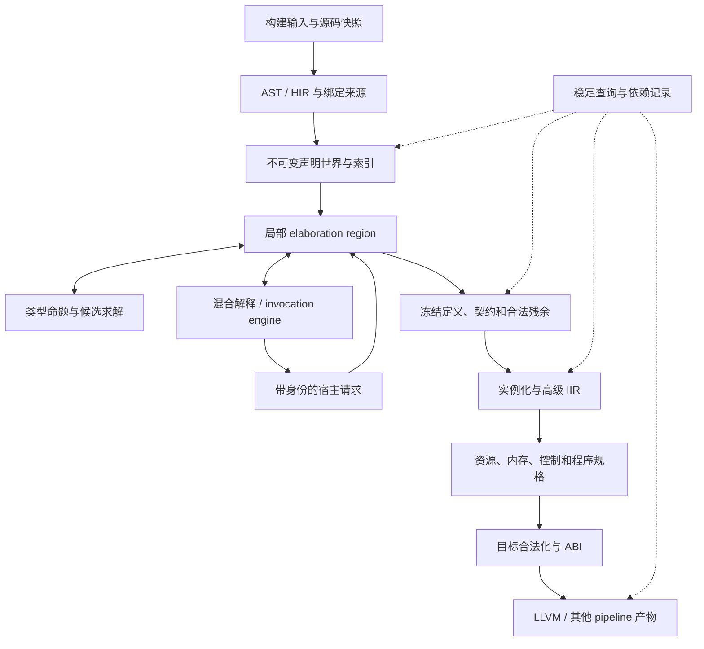

# 新一代全链路架构

状态：重构设计，尚未实现。依据 [语言契约](language-contracts.md)，当前偏差见
[审计](architecture-audit.md)。以下组件名为内部职责名，不要求按此数量创建 crate。
本阶段先设计，不修改编译器、库或测试源码。

## 1. 核心判断

这次重构的中心是**稳定世界、局部检查、受控执行和产物交付之间的边界**。
前端不能先失去依赖再让后端猜回；VM 不能拥有整个可变编译器；solver 不能承包程序验证；
查询不能缓存半完成检查器。保持这些边界后，再决定文件和 crate 如何拆分。



图中的执行回边不表示允许循环求值。请求必须具有已存在的输入或可解释的生产者；
已知签名支撑递归，与“求出自身尚未产生的值”是两种依赖。

## 2. 数据归属与生命周期

| 所有者 | 拥有什么 | 可以共享什么 | 不得携带什么 |
| --- | --- | --- | --- |
| BuildSession | 输入快照、目标、sysroot 身份、工具及产物目录 | 已验证输入、任务结果 | 未声明的全局当前包/target |
| WorldSnapshot | 声明目录、接口版本、实现索引、稳定属性、来源表 | 不可变节点、索引、已发布定义 | 活动 metavariable、VM 槽引用 |
| ElaborationRegion | 推断变量、局部事实、term holes、工作队列、候选及诊断缓冲 | 对 WorldSnapshot 的只读引用 | 可被另一个候选原地修改的状态 |
| CandidateTrial | 私有替换、前提、临时义务和失败理由 | 不可变世界；带 guard 的合法证明 | 未提交的全局赋值、不纯投机执行 |
| VmSession | 调用帧、寄存器/局部槽、值引用、运行进度、预算 | 稳定 CodeObject、不可变值节点 | 旧世界裸指针、跨会话活动存储 |
| DefinitionTransaction | 草稿、预留身份、候选世界、发布收据 | 原世界及已完成签名 | 在 commit 前可见的半批声明 |
| ArtifactStore | 本次编译已验证的 IR/对象/符号与依赖 | 内容及兼容接口 | 缺文件却声称成功的缓存条目 |

WorldSnapshot 不是永久单例。builder 成功发布形成后继世界；进行中的查询明确继续使用旧版本
还是在发布边界重新绑定。不能原地修改世界后继续使用此前的实现选择证明。

存储版本不决定全部可见性。SemanticView 还记录作用域、实例、线性可见前缀、候选集合版本、
phase 和 target；静态声明不按检查完成顺序变得可见。loose 环境生成实现的线性使用与
整个实例的 coherence 分别检查，具体协议见[状态与发布](elaboration-state-and-publication.md)。

### 源码、属性与接口的生产边界

SourceSnapshot 包含文件内容、模块发现结果、生成源码来源与构建输入身份。仅记录已经打开
的文件不够：新增一个模块可能改变名称发现和候选集合，目录发现本身也是依赖。

AST 保留括号、属性附着和 expression/pattern 外层范围；parser 不为方便 lowering 提前
吞掉 if/match 等外层分隔。pattern 优先级按正式规则处理，括号显式划定范围。
关键字/保留字属于词法契约，不能把 char、void、NoReturn 等具名 builtin 绑定变成关键字。
tuple type 通过普通 Tuple callable 形成，不引入 Rust 式括号 tuple type 特判。

HIR 中每个 take view 保留对应 node kind；属性 multi 前缀先保存其附着目标和顺序，
不在 parser 中按属性名字决定类型/ABI。带依赖的属性在合法阶段求值，已求值部分及实际
输入进入稳定查询；尚未成立的配置不是 WorldSnapshot 中的事实。

名称解析区分导入路径、重导出原身份、词法 shadow 和生成代码卫生。尚需生成结果提供
的名称关系可以形成有来源的观察请求；无生产者的未解析名字直接诊断。
签名和主体可以分别查询，但签名自身的默认值、属性及依赖域需要普通语义检查，不能
为了切割查询而假定签名全是静态 Type 常量。

## 3. 身份分域

逻辑上至少区分 `DeclarationId`、`BinderId`、`RuntimeDependencyId`、`MetaId`、
`CoreHoleId`、`StorageId`、`QueryKey`、`ArtifactId`。是否采用现有整数包装可稍后决定，
但任何 API 都必须表达所属 world/region/session，不能靠调用者记忆约定。

- 声明身份说明哪个定义；名称和重导出路径只是到它的解析路径。
- 存储身份和 runtime 依赖身份不是值内容 hash；复制描述不会制造另一个对象的证明。
- 跨编辑 query 定位不是语言名义身份；命中后仍需核验声明映射与语义依赖。
- arena index 的复用需要 owner/generation，取消后的旧 ticket 不可命中新槽。
- `Symbol::from_raw_parts` 一类进程内表示不得直接成为持久化格式。

## 4. 稳定产物和检查中的产物分开

拟采用以下逻辑产物，物理布局可共享不可变节点：

```text
ResolvedDefinition = syntax + declaration/binder links + provenance
CheckedInterface = telescope + formation contracts + phase + ABI intent
OpenDefinition = checked interface + stable residual body + dependencies
CheckedInstance = instance key + completed comptime types + runtime dependencies
VerifiedInstance = checked instance + resource/control/specification evidence
TargetArtifact = target-lowered code + symbols + data + dependency manifest
```

`Checked` 不是可以随手构造的标签。入口返回产物时必须验证对应条件；新的变换如果改变
相关部分，需重新构造证据，不能在旧证书上直接改字段。
错误恢复节点可以存在于编辑器结果里，但不属于可交付的上述实例。

NIR 继续承担定义端稳定关系和残余描述；IIR 应是独立的高级实例 IR，而不是把 NIR
Function 加一个 key 就视为已经完成。IIR 保留结构化控制、闭包、效应、pattern 和
BitVec 关系；不预设 SSA，不保留尚待求值的类型 comptime 部分。

## 5. 类型和值的最小公共内核

类型内核提供声明引用、受检构造、binder-aware substitution、结构观察接口、预算及
S-expression dump。普通 comptime 值使用同一冻结/恢复规则，不让 NF 再定义一套值语言。
类型值可以包含稳定类型引用，类型应用可以引用冻结值；这是一组共同的数据模型，
不要求在 Cargo 层制造 type → value → type 循环。

目标表示：

```text
TypeCore = immutable term + ordered hole telescope
TypeRef = core + checked substitution
DependencyEnvironment = typed runtime identities + EnvironmentPlan
EnvironmentPlan = ordered acquisition actions + required resource evidence
```

TypeRef 不内嵌某次使用点的取得路径，因为同一语义依赖可以有多个合法路径。
依赖域可以引用更早槽位；替换在 telescope 顺序下检查。抽象化需要保持重复身份和
外部身份区别，不按文本名或裸地址合并。完整类型相等要解释 substitution。

进入 IIR 时逐项完成 comptime 输入，runtime dependency 仍可为参数/捕获/外部绑定。
EnvironmentPlan 的动作绑定到求值计划，必须说明从何处取、何时取、借用还是转交、
哪段使用期间有效。仅有 available RuntimeId 集合无法构造该计划。

闭合函数身份容器继续要求无环境；需要环境的 callable 使用独立描述，不偷偷放宽旧类型。
`lift` 的源码生产、类型引用、捕获、调用和 lowering 要形成同一交付线。

## 6. 一次调用的共同计划

所有普通调用、NF 输入、方法、quote fn 和模板实例共享参数绑定基础：

```text
ArgumentPlan {
  supplied_slots, named_labels, collector,
  source_evaluation_order,
  default_dependencies,
  contextual_domain_observations,
  receiver_and_capability_adjustments,
  result_obligations
}
```

NF 最终形成不透明应用，普通 invocation 执行主体，quote fn 展开代码，行为各自保留；
共享的是输入准备规则，不是把三种动作折叠成一次 evaluate。

工作过程：建立候选局部输入 → 观察已知形参域和实参描述 → 安排可推进的兄弟工作 →
按需请求 comptime → 验证默认值与契约 → 确定 callee/实现 → 提交完整调用计划。
runtime 执行序列由该计划明确保存，检查顺序不能改变它。

collector 收集普通 comptime 值，不先把 Type 元素变成特殊槽。
显式整个参数包和展开分别保留其来源；错误、早退和默认表达式的执行次数都必须有定义。

## 7. 局部调度和稳定查询分别组织

### 局部 region

直接递归能够完成的工作继续直接做；只有需要独立保存进度的工作成为 task。
观察接口返回 `Known(evidence)`、`Blocked(producer, generation)`、
`Unresolved(reason)` 或 `Failed(diagnostic)`，不能用一个 None 覆盖全部情况。

观察后登记 watcher，再核对 generation；完成/失败/合并/回退都通知相关观察者。
重复唤醒去重，取消撤销登记；暂停 lambda 子任务不应阻止后续实参提供类型。
任务状态仅在本次 region 内存活，freeze 另行抽取合法 residual。

观察应细化到参数域、类型头、值或布局等 facet，避免以整份声明 ready 制造假环。
外层依赖分析分别记录检查和执行需求；精确捕获不能删除用户显式参数。
生产者前缀、递归依赖闭包及失效规则见[依赖观察](dependency-observations.md)。

### 稳定 query

首先采用 SourceSnapshot、ResolvedModule、DefinitionInterface、NormalizedDefinition、
InstantiatedDefinition、VerifiedInstance、TargetArtifact 等具有稳定输入输出的边界。
名字表示职责，未要求把所有表达式变成 query。

query 记录实际读取的接口、主体、属性、实现索引代次、目标与 build 输入；“未找到实现”
也依赖候选集合版本。接口不变但主体变化时，可以保留只依赖接口的检查，必须使实际
依赖主体的内联和代码产物失效。最终产物缺失应重新物化，不能返回成功但空路径。

Unknown 保存预算/缺失输入原因，不作为永久否定。正在求值也不是递归成功凭据。
持久化只保存稳定引用与依赖，恢复时重新验证 schema/compiler/target/sysroot 版本。

## 8. 全链路走读：依赖结果类型的调用

以 `fn keep(comptime flag: bool, value: defer SelectType(flag))` 为语义场景：

1. 解析和 HIR 保存 flag 的身份与 value 的延迟依据，不把 defer 展平成未知 Type。
2. 定义检查建立合法接口及 residual；普通调用点 supplies flag 后请求 SelectType。
3. VmSession 用固定世界运行，必要宿主请求只暂停该帧；不重放已完成计算。
4. 返回的 Type 经接收世界准入；如果是 NF，保留头；随后检查 value 的域。
5. 实例化消去 comptime 参数，生成含完整 TypeRef 的高级 IIR。
6. 资源检查检验 value 的实际转移，环境取得计划交给调用和后端；不能靠类型相同授予 Copy。
7. 目标检查决定 ABI，发布本次目标产物；query 记录 SelectType 实际依赖。

若 flag 来自 runtime 内容，阶段检查失败；不能生成动态类型工厂掩盖缺失 comptime 输入。
若 Type 带合法 runtime identity，则保留身份与环境，不读取对象内容来计算类型。

## 9. 模块与依赖方向

| 逻辑模块 | 只依赖的职责 | 当前迁移来源 |
| --- | --- | --- |
| semantic data | 基础身份、来源、受检数据容器 | nir、comptime_runtime 中稳定数据部分 |
| syntax/resolution | 源码快照、语法、身份 | lex/parse/resolve/hir/ast_lowering |
| world/query | 稳定数据及接口、输入提供者 | middle/query、luna caches |
| type solving | 类型项、证明接口、实现世界只读视图 | ptc/type_resolution |
| elaboration | 上述服务接口及本地 region | elaboration/program 与分散入口 |
| comptime engine | 稳定 code/value、宿主请求协议 | comptime_compiler/runtime/interpretor |
| instance construction | 冻结定义、替换、按需执行服务 | materialization、iir/staging |
| program checking | IIR、程序规格、资源/控制证据 | verification_core/program_verification |
| target lowering | 已交付 IIR、ABI、target manifest | luna/host，暂用现有 LLVM |
| product driver | 上述边界的装配与产物管理 | luna；不创建 anar |

宿主请求通过带类型的数据协议回调，不让 VM 反向依赖整个 elaborator；资源分析通过
稳定接口申请实例或摘要，不隐式重入全包前端。先整理边界再移动 crate，避免只有名字变化。

## 10. 并发、诊断和可观察性

本阶段单代理设计；运行编译器的未来并发基于稳定世界的只读共享和独立 region/session。
未完成生命周期审计前不添加 unsafe Send/Sync。相同 query 可共享生产者，消费者取消
不能撤销其他消费者仍需要的工作；不纯执行是否可共享必须遵循源程序执行身份。

所有产物 dump 显示 world、声明、binder、TypeRef、替换、证据和来源关系；本地编号稳定排序，
字符串与符号转义。不把 Rust Debug 或指针地址当公共 IR 格式。
诊断保留定义、调用、生成链和失败前提；被放弃候选的错误不抢占成功程序的最终诊断。

成本分账：输入/解析、世界准备、域替换、候选数、证明步、字节码构建、执行、值传输、
实例构造、资源检查和目标交付。计数不改变程序语义；warm cache 不免除接收方准入。

## 11. 当前设计选择与代价

| 决定 | 为什么这样选 | 必须承担的代价 |
| --- | --- | --- |
| 不可变世界 + 局部 overlay | 让候选、builder、查询共享稳定事实，隔离未提交变更 | 发布后显式对应版本；持久结构不能隐藏全包复制成本 |
| 局部任务和持久 query 分开 | 暂停粒度由信息依赖决定，缓存边界由稳定产物决定 | 两层身份与生命周期都要设计，不能共享一张万能状态表 |
| 共用值/参数语义，保留执行载体职责 | 解决 NF 及调用的语义漂移，同时保留混合阶段能力 | 每种载体仍需控制流实现和差分行为验证 |
| IIR 有独立交付类型 | 防止定义端 residual 被当成具体实例运行 | 变换和验证器要维护高级语义，不能简单复制 NIR |
| core/substitution/environment 三分 | 共享结构不丢对象身份和使用点存活 | 需组合替换、按需观察及证据缓存，不能靠展开全树省设计 |
| 先生产证据再改消费者 | 修复 text/依赖类型/cleanup 的信息缺口 | 一次纵向改动可能跨多个 crate，必须明确同批范围 |
| 复用现有 solver/容器算法 | 已有回跳、证明和共享结构的价值不因重构消失 | 必须审计接线，而不是把旧 API 原封不动套新壳 |

region/task、候选、VM 请求和发布的状态转换已在[状态协议](elaboration-state-and-publication.md)
中展开；[理论证据协议](type-models-and-theory-evidence.md)细化模型投影、原义务复核和重放。
这些仍是设计，尚未接入生产入口。后续需细化世界增量存储布局、具体 Rust 所有权接口、
跨编辑身份映射、各 theory 的准入与见证覆盖和开放布局的目标表示。这些是实现设计问题，不要求作者
为每个局部选择审阅；但不能在它们尚不明确时宣称全链路迁移已经具备开工条件。
