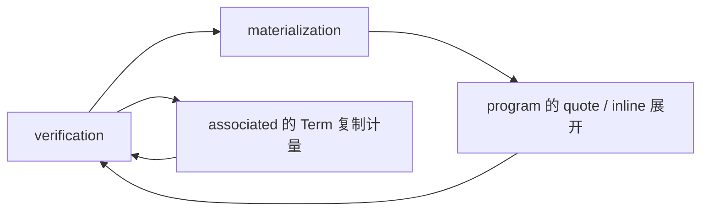

# Elaboration 的 crate 拆分

目标是缩小修改后的重编译范围，并让子系统测试能独立运行。拆文件只改善导航；
把相互调用的模块随意分到 crate，会把隐式耦合变成循环依赖或巨大的公开接口。
这里按稳定的输入、输出和证据所有权切边界，不改变语言语义。

## 当前规模与第一步

本次检查的拆分前 Rust 源码约 193,249 行。其中 program 约 86,591 行，
verification 约 69,131 行，materialization 约 7,636 行。
这包含各模块内部的单元测试，不包含 tests 目录；不是机器编译耗时的比例。

已将约 3,274 行 PTC 实现移到 `compiler/ptc`：

- Cargo 依赖只有 `nir`，不依赖 elaboration、HIR 或 comptime interpreter。
- `elaboration::ptc` 重导出同一个 crate；旧消费者继续使用同一套类型和实现，
  没有复制求解器，也没有让两个 crate 分别编译同一份源码。
- solver 和 error-row 测试直接归 PTC；检查非法声明能否进入 materialization
  的跨模块集成测试仍在 elaboration。
- 原本供兄弟模块调用的查询与理论准入方法成为 Rust crate 间接口。
  理论准入仍由编译器提供已检查的声明身份，不是源语言的新权限。
- PTC 只处理类型命题；程序算术、内存规格和资源验证没有迁入 PTC。

单独检查：

```sh
python3 -B development/check.py --timeout 900 -- test --release -p ptc
```

本次已有依赖缓存时，新 PTC crate 和测试构建用时约 8.53 秒，共 79 项通过。
这是一次局部构建观察，不是冷构建基准，也不意味着整个编译器会同比加速。
后续修改 PTC 仍会使它的消费者失效；修改上层 elaboration 则不会重编译 PTC。
现有 cache 清理入口保留小型依赖缓存，仍优先清理 luna/elaboration。

## 后续边界与顺序

| 顺序 | 建议边界 | 职责 | 拆出前必须完成的工作 |
| --- | --- | --- | --- |
| 1，已完成 | `ptc` | 类型公式、有限理论、证明与反例 | 保留 opaque normal-form 头、预算及 Unknown 语义 |
| 2 | 类型推断与 trait resolution | inference store、obligations、matching、implementation、capabilities、associated 查询 | 把通用 Term 结构计量从 memory 模块移到 NIR 或类型基础层；候选事务和证据保持同一所有者 |
| 3 | 实例语义与程序验证 | 将类型视图和方法选择与执行依赖闭包区分；随后迁出 flow、memory、moves、drop 等验证 | 消除验证对完整 materialization 调度器的反向依赖；先证明选中方法、预算及失败行为与原路径一致 |
| 4 | staging / materialization | quoted code、inline 展开和具体调用闭包 | 将已检查 NIR 上的展开与源码 Checker 分开，明确预算、fresh identity、来源映射和候选发布接口 |
| 5 | 剩余 elaboration | HIR 到 NIR 的检查、协议接线、阶段交织与顶层协调 | 依赖上述稳定服务，不把活动推断状态冻结或交给全局缓存 |

第二至第五步是后续设计方向，尚未创建这些 crate。不能把表格当作已经完成的拆分。
最值得继续移出的体量是 verification，而不是无限增加只有几个工具函数的小 crate。

## 已确认的依赖环



具体来源：

- `verification/memory.rs` 与 `moves.rs` 使用 materialization 的类型规范化和
  方法实例选择。`resolve_method_instance` 当前调用完整 `build` 闭包流程，
  不能直接当作一个纯索引查询搬走。
- materialization 使用 `program::expand_materialized_quotes`、
  `expand_bound_quote`、inline effect 展开和 copied-expression freshening。
  把整个 materialization 直接抽成下层 crate 会形成环。
- `associated::charge_projection_copy` 调用 `verification::memory::bound_type`。
  通用类型结构限额属于下层基础能力，不应使 associated 依赖内存验证。

优先把通用结构计量放到下层，把方法选择结果作为带身份、类型参数与证据的输入
交给验证。若必须使用回调，应是明确的语义服务接口，不能用全局回调注册表、
线程局部状态或 `Any` 来隐藏依赖环。初期重导出用于兼容旧 Rust 路径，不用于
让下层反向引用上层。

## 每一步的验收

每个 crate 能单独构建和运行自己的测试；Cargo 依赖保持无环。类型身份、
normal-form 头、错误 ABI 与 effect ABI 的区别、comptime/runtime 阶段、
预算失败与恢复、资源契约，以及 S-expression dump 都保持原行为。
同时运行受影响的跨层集成和真实 sysroot 用例，不能只用迁走的单元测试验收。

迁移要搬动测试所有权，避免为了运行一个底层测试仍需构建整个前端。
保留跨层用例在集成层；不要为了脱离旧 crate 而删除这些用例中的语义断言。
需要同步 workspace、Cargo.lock、检查入口和现行文档路径；历史记录中的旧路径
按历史上下文阅读。

当前仍使用共享构建缓存、`-j 1` 和禁用 incremental 的既定配置。crate 拆分先
提供重编译隔离与局部测试收益，不同时修改并行度、优化级别或缓存规则，避免
混淆性能证据与磁盘资源风险。
