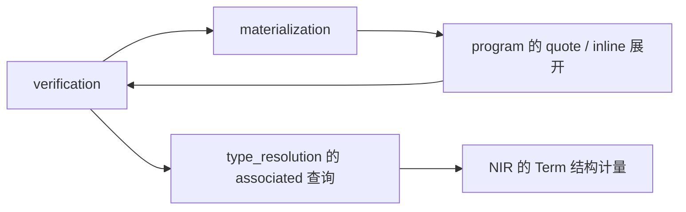

# Elaboration 的 crate 拆分

目标是缩小修改后的重编译范围，并让子系统测试能独立运行。拆文件只改善导航；
把相互调用的模块随意分到 crate，会把隐式耦合变成循环依赖或巨大的公开接口。
这里按稳定的输入、输出和证据所有权切边界，不改变语言语义。

## 当前规模与第一步

本次检查的拆分前 Rust 源码约 193,249 行。其中 program 约 86,591 行，
verification 约 69,131 行，materialization 约 7,636 行。
这包含各模块内部的单元测试，不包含 tests 目录；不是机器编译耗时的比例。

已将约 3,274 行 PTC 实现移到 `compiler/ptc`：

- Cargo 依赖只有 `nir`，不依赖 elaboration、HIR 或 comptime interpreter。
- `elaboration::ptc` 重导出同一个 crate；旧消费者继续使用同一套类型和实现，
  没有复制求解器，也没有让两个 crate 分别编译同一份源码。
- solver 和 error-row 测试直接归 PTC；检查非法声明能否进入 materialization
  的跨模块集成测试仍在 elaboration。
- 原本供兄弟模块调用的查询与理论准入方法成为 Rust crate 间接口。
  理论准入仍由编译器提供已检查的声明身份，不是源语言的新权限。
- PTC 只处理类型命题；程序算术、内存规格和资源验证没有迁入 PTC。

单独检查：

```sh
python3 -B development/check.py --timeout 900 -- test --release -p ptc
```

本次已有依赖缓存时，新 PTC crate 和测试构建用时约 8.53 秒，共 79 项通过。
这是一次局部构建观察，不是冷构建基准，也不意味着整个编译器会同比加速。
后续修改 PTC 仍会使它的消费者失效；修改上层 elaboration 则不会重编译 PTC。
现有 cache 清理入口保留小型依赖缓存，仍优先清理 luna/elaboration。

## 后续边界与顺序

| 顺序 | 建议边界 | 职责 | 拆出前必须完成的工作 |
| --- | --- | --- | --- |
| 1，已完成 | `ptc` | 类型公式、有限理论、证明与反例 | 保留 opaque normal-form 头、预算及 Unknown 语义 |
| 2，已完成 | `type_resolution` | inference store、obligations、matching、implementation、capabilities、associated 查询 | 把通用 Term 结构计量从 memory 模块移到 NIR 或类型基础层；候选事务和证据保持同一所有者 |
| 3，逻辑核心已完成 | 实例语义与程序验证 | 将类型视图和方法选择与执行依赖闭包区分；随后迁出 flow、memory、moves、drop 等验证 | 消除验证对完整 materialization 调度器的反向依赖；先证明选中方法、预算及失败行为与原路径一致 |
| 4 | staging / materialization | quoted code、inline 展开和具体调用闭包 | 将已检查 NIR 上的展开与源码 Checker 分开，明确预算、fresh identity、来源映射和候选发布接口 |
| 5 | 剩余 elaboration | HIR 到 NIR 的检查、协议接线、阶段交织与顶层协调 | 依赖上述稳定服务，不把活动推断状态冻结或交给全局缓存 |

第三步已创建 verification_core，完整程序验证的边界仍在拆解；第四、第五步
仍是后续方向。不能把表格当作已经完成全部拆分。
最值得继续移出的体量是 verification，而不是无限增加只有几个工具函数的小 crate。

## 已确认的依赖环



最初审计时的具体来源（后续解除情况见各阶段记录）：

- `verification/memory.rs` 与 `moves.rs` 使用 materialization 的类型规范化和
  方法实例选择。`resolve_method_instance` 当前调用完整 `build` 闭包流程，
  不能直接当作一个纯索引查询搬走。
- materialization 使用 `program::expand_materialized_quotes`、
  `expand_bound_quote`、inline effect 展开和 copied-expression freshening。
  把整个 materialization 直接抽成下层 crate 会形成环。
- 原来 `associated::charge_projection_copy` 调用 `verification::memory::bound_type`。
  第二阶段已将结构计量下移至 `nir::type_budget::charge_structure`，解除此环。
  verification 保留诊断适配器，算法、深度上限及消耗顺序不变。

优先把通用结构计量放到下层，把方法选择结果作为带身份、类型参数与证据的输入
交给验证。若必须使用回调，应是明确的语义服务接口，不能用全局回调注册表、
线程局部状态或 `Any` 来隐藏依赖环。初期重导出用于兼容旧 Rust 路径，不用于
让下层反向引用上层。

## 每一步的验收

每个 crate 能单独构建和运行自己的测试；Cargo 依赖保持无环。类型身份、
normal-form 头、错误 ABI 与 effect ABI 的区别、comptime/runtime 阶段、
预算失败与恢复、资源契约，以及 S-expression dump 都保持原行为。
同时运行受影响的跨层集成和真实 sysroot 用例，不能只用迁走的单元测试验收。

迁移要搬动测试所有权，避免为了运行一个底层测试仍需构建整个前端。
保留跨层用例在集成层；不要为了脱离旧 crate 而删除这些用例中的语义断言。
需要同步 workspace、Cargo.lock、检查入口和现行文档路径；历史记录中的旧路径
按历史上下文阅读。

当前仍使用共享构建缓存、`-j 1` 和禁用 incremental 的既定配置。crate 拆分先
提供重编译隔离与局部测试收益，不同时修改并行度、优化级别或缓存规则，避免
混淆性能证据与磁盘资源风险。

## 第二阶段：类型推断与 trait resolution

`compiler/type_resolution` 整体拥有 inference store、obligations、matching、
implementation、capabilities、associated 和 calls。候选事务、waiters、选中证据
与失效 revision 保持在同一 crate，没有转成共享全局缓存或稳定 NIR。
elaboration 重导出原 Rust 路径，调用方继续使用同一份上下文与类型。

新 crate 的生产依赖是 NIR、PTC 和 HIR；HIR 目前仅用于已存在的
`ImplementationPhase` 枚举。comptime_runtime 只作为测试依赖构造数字值。
编译期执行调度器、语言协议和源码检查仍属于 elaboration，不将 invocation
或源码层的依赖引入求解核心。下一步可将阶段枚举移至共享语义层，但此次不
通过重复定义枚举或隐式转换改变阶段选择接口。

跨边界只开放上层实际调用的操作。索引提供声明参数域和 nominal layouts 的
只读借用；推断上下文提供 identity、is_trial、is_assigned 查询，上层不能直接
写入内部变量。comptime 输出的已赋值检查仍在执行前完成；身份分配仍共享
同一个原子计数器，候选 commit 的父身份和 revision 校验没有改变。

九组纯求解集成测试已迁入新 crate，既检查独立模块也检查它们的组合：
associated、capabilities、calls、implementation、implementation_phases、
inference、inherent、matching、obligations。涉及 materialization、invocation
或程序验证的集成用例仍留在 elaboration。

```sh
python3 -B development/check.py --timeout 900 -- test --release -p type_resolution
```

旧开发记录中的 `-p elaboration --test calls` 等命令描述历史执行；新运行应按
上述归属使用 `-p type_resolution`。没有为了维持旧测试路径而复制编译测试。

本阶段验证（工作目录 `/home/fin/luna`，各入口退出 0）：

- 上述独立测试 262 项通过，`/tmp/luna-tools-h6_f5p2r/result.json`。
- 同一 check 入口的 `test --release -p elaboration --test associated_resources
  --test invocation_budget --test gradual --test ptc`：24 项通过，
  `/tmp/luna-tools-tr6wv1s1/result.json`。
- `test --release -p nir --lib type_budget`：两项通过，
  `/tmp/luna-tools-z92b51rm/result.json`。
- `test --release -p luna --test execution type_computations`：八项通过，
  `/tmp/luna-tools-ig8mdp1k/result.json`。包含候选/外部上下文拒绝和执行前的
  已赋值输出检查，验证新只读接口没有推迟失败至副作用发生之后。
- `python3 -B development/library_check.py --release --timeout 900
  --stage native-math --stage sysroot-meta --stage sysroot-builders`：全部通过，
  `/tmp/luna-library-79obq5tu/summary.json`。
- 通过 command 入口的 `cargo fmt --all -- --check` 和 `git diff --check`。
  本轮没有运行全 workspace 测试。

## 第三阶段前半：独立的程序逻辑核心

`compiler/verification_core` 拥有有界整数/至多三次多项式推理、关系与差分约束、
谓词证明和重放、版本化 Facts，以及 owned-position 的可用性状态机。
约 7,200 行实现整体迁移，依赖仅 NIR 和 comptime_runtime，不依赖 PTC、
type_resolution、materialization 或源码检查器。NIR 依赖用于已有的常量整数
表达式差值查询；这里不选择 trait 方法或生成代码。

elaboration 的 verification 模块重导出原有公共类型。NIR 控制流遍历、内存
视图、移动/清理和效应检查仍在上层；它们调用逻辑核心检查程序规格，而不是
把程序命题交给 PTC。此阶段完成时验证器仍有四处 materialization 调用，不能把本阶段
称为整个 verification 已独立。

迁移时收紧了跨层存储访问：区间使用只读端点或消耗自身的 into_bounds；
Facts 使用只读 relation/current 查询和 shares_lineage 检查。分支仍共享原子
版本时钟，区间移动不额外复制大整数。assume_relation 明确是调用者已经建立
关系后的假设入口，不是证明凭证；证明字段、关系存储和版本时钟不公开写入。
计量、degree/depth 限制、Unknown、失败与恢复、证明重放和 S-expression 输出
沿用原算法。只开放上层原本已调用的操作，不复制一个下层求解实现。

原 verification 测试集中的纯逻辑用例与 ownership 测试迁入新 crate；
两项 flow 集成用例保留在原 verification 测试入口，flow、moves 等
NIR 层回归留在 elaboration，跨层执行案例留在 luna。

```sh
python3 -B development/check.py --timeout 900 -- test --release -p verification_core
python3 -B development/check.py --timeout 900 -- test --release -p elaboration --lib verification::
```

再次检查方法选择后确认：普通 resolve_method_instance 不仅选中一个 body，
还排队遍历该方法的传递函数/接口依赖。quote 路径不排入可执行函数，但共享
接口展开和 specialization 的检查。下一阶段应先提取显式的 dispatch world
与选择结果，再界定验证与执行闭包各自需要的检查；不能直接删去闭包遍历来
消除依赖，也不能用全局 callback/TLS 把依赖藏起来。

本阶段验证均在 `/home/fin/luna` 执行并退出 0：

- 上述 `-p verification_core` 测试 129 项通过，
  `/tmp/luna-tools-7s9nfbap/result.json`。
- 上述 `-p elaboration --lib verification::` 测试 80 项通过，
  `/tmp/luna-tools-njrfwzb7/result.json`。
- 同一 check 入口的 `test --release -p elaboration --test verification`：
  两项通过，`/tmp/luna-tools-jc1caqq8/result.json`。
- `test --release -p luna --test execution relational`：四项通过，
  `/tmp/luna-tools-rb58vgil/result.json`。
- `python3 -B development/library_check.py --release --timeout 900
  --stage native-math --stage sysroot-resources`：全部通过，
  `/tmp/luna-library-rfqqre7x/summary.json`。
- 格式检查通过，`/tmp/luna-tools-hhmb2wzf/result.json`；
  `git diff --check` 通过。未运行全 workspace 测试。

## 声明世界与具体类型查询

`type_resolution::dispatch::DeclarationWorld` 统一建立目标相关的 implementation
索引、声明参数域/排序、PTC 上下文和 given assumptions。materialization 使用
同一服务建立自己的世界；不另建一套验证专用索引。缓存由 world 私有持有，
只暴露只读索引/上下文和查询操作，避免不同包快照串用关联类型规范化结果。

`normalize_concrete_type` 已直接使用这个服务，memory/moves 的两处调用不再
经过 materialization::build。原 TypeAnnotation 分支只规范化类型、没有加入
执行队列；现在保留同一建索引顺序、规范化算法与复制计量，失败仍把外部
剩余预算设为零。normal-form 头保持 opaque，定义侧的宽松 staging view 缓存
仍在 materialization，不会进入严格规范化缓存。

普通方法与 quote 方法的选择仍调用 materialization，保留其接口 specialization
和传递依赖检查。当前四处反向调用已消除两处，不能据此认为整个环已消失。
下一步可以在共享声明世界之上提取选择证据与实例契约，继续保留闭包验证。

新增的独立回归用例检查包快照缓存隔离、缓存命中消耗、查询失败预算归零和
重试恢复。现有 materialization/关联资源及真实 sysroot 检查覆盖上层接线。

本阶段验证在 `/home/fin/luna` 执行，全部退出 0：

- `python3 -B development/check.py --timeout 900 -- test --release
  -p type_resolution --test associated`：22 项通过，
  `/tmp/luna-tools-sfdl5t39/result.json`。
- 同一入口的 `test --release -p elaboration --lib
  --test associated_resources --test ptc`：241 项通过，
  `/tmp/luna-tools-d51l59g9/result.json`。
- `python3 -B development/library_check.py --release --timeout 900
  --stage native-math --stage sysroot-meta --stage sysroot-builders`：全部通过，
  `/tmp/luna-library-6ibvyint/summary.json`。
- 格式检查 `/tmp/luna-tools-g_bq7w8a/result.json` 与 `git diff --check` 通过。
  没有运行全 workspace 测试。
