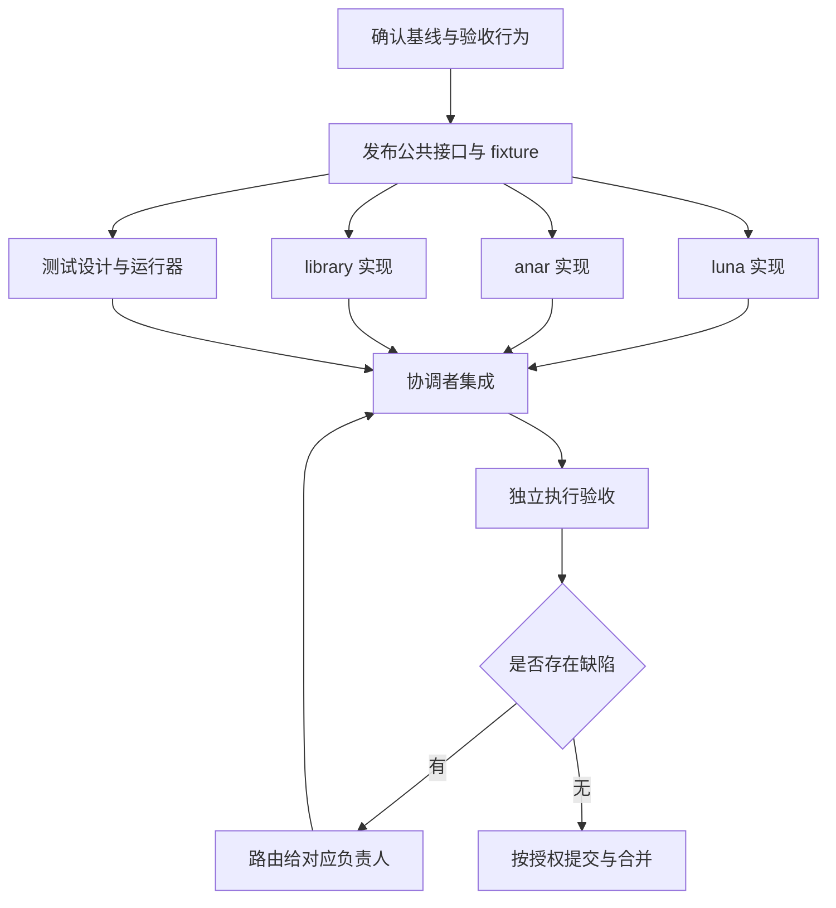

# 开发任务图与交付协议

> 已停用：用户于 2026-10-07 要求停止 graph engineering。本文仅保留历史记录，当前开发遵循根 AGENTS.md 的直接开发方式。

本协议把开发拆成能够独立完成和核验的任务，供 luna、anar、library、测试角色协作。小范围、顺序依赖明显的工作由一个负责人完成；并发用于扩大独立工作量。

## 1. 开工前的最小调查

协调者先检查当前分支、工作区修改、适用 AGENTS、语言契约、相关实现与测试入口。输出一张小表：已有实现、预期行为、缺口、依赖接口、可用检查和受保护文件。

源码说明目前能做什么，正式文档说明应当做什么。某段旧代码与作者已确认规则不同，按实现偏差处理；缺少明确规则的真实语义问题才交作者决定。等待一个问题不阻止其他独立节点继续。

当前工程地图见 [README](README.md)。anar 的实际仓库需要在第一次 anar 任务中定位并读取其本地协议；不把仓库名直接猜成路径或 Rust package 名。

## 2. 先交付接口，再分派实现

跨角色接口至少写明：

- 输入、输出、身份与版本，哪些信息必须完整、哪些允许残余。
- host/target、阶段与安全等级要求。
- 错误、取消、失败后的可重试状态及诊断归属。
- 依赖和失效条件，包括负查询、配置与生成物。
- 最小正例、拒绝例及消费方如何验证结果。

接口描述可以先以文档、类型声明或 fixture 交付；它不需要假装已经有完整实现。双方通过同一份已确认描述独立开发，后续接口变化由唯一负责人升级版本并通知消费者。

## 3. 节点契约

以下为任务记录模板，不是新增 Flurry 语法。复杂任务保存在 `development/runs/<task>/`；该目录按实际任务创建，不为每次对话新建日志。

```yaml
task:
  id: task-name
  objective: observable-result
  acceptance_criteria:
    - user-visible-behavior-and-evidence
  baseline:
    repository: verified-repository-path
    commit: exact-commit
    required_patches: []
  protected_changes: []
  authorized_actions: []
limits:
  max_workers: 8
  max_concurrency: 4
  max_waves: 3
  max_retries: 1
  max_depth: 1
  max_review_rounds: 2
  time_limit_minutes: 120
  budget:
    kind: worker_turns
    value: 12
nodes:
  - id: bounded-unit
    role: luna
    owner: assigned-agent
    worktree: isolated-path
    branch: task-branch
    reads: []
    writes: []
    depends_on: []
    input_artifacts: []
    output_artifacts: []
    checks: []
    acceptance_criteria: []
    stop_condition: output-and-evidence-delivered
    selected_skills: []
    status: pending
edges: []
rejected_edges: []
observed:
  workers: 0
  peak_concurrency: 0
  waves: 0
  retries: 0
  depth: 0
  review_rounds: 0
  budget_used: 0
events: []
```

数值是起始模板，协调者按实际宿主能力和范围设定，并记录观测值。并发包含协调者；宿主只有四个槽位时，不能同时启动协调者加四个子代理。worker_turns 计算已分派的工作回合；无法观测某类预算时明确说明，不能捏造 token 或费用。

准备分派前，把 reads/writes、输入输出、检查和验收填成具体内容，不能把模板占位词当作已定义契约。每个工作者只收到本节点所需上下文和适用技能。

## 4. 依赖与调度

对每条边回答：“下游需要上游哪份具体产物？”没有具体答案就删边，并记录原因。例如测试设计依赖语义契约，不依赖实现主体；测试执行才需要可运行实现。



该图表达可以并行的关系，不要求每次任务都有全部四种实现节点。若 library 必须消费 luna 新增的类型接口，则添加那一份接口的真实依赖；不要一概把整个 library 任务拖到编译器全部完成之后。

状态可取 pending、ready、running、blocked、delivered、verified、failed、cancelled。delivered 只表示产物到达；verifier 检查后才变为 verified。没有产物、格式不完整或超出边界的返回记为失败，并在预算内重派、缩小范围或报告未完成。

## 5. 文件与工作区所有权

1. 协调者为并行写入者创建隔离 worktree／分支，并记录共同基线。
2. 开始前检查所有 writes 集合；同文件交集必须拆分为接口任务、指定单一写入者或串行交接。
3. 根 manifest、lockfile、全局配置、公共 IR 与跨组件接口各有明确负责人。需要改动时提交具体需求，不在另一个任务中顺手修改。
4. 测试文件独立时可交测试角色；内联测试与实现同文件时，由文件负责人整合测试补丁。
5. 原工作区的未提交修改保留原状。若任务依赖它们，协调者先制作经授权、可复现的共同基线，不假定新 worktree 自动具备。
6. 角色只提交其 owns 范围，协调者检查 diff 后集成。不能用整仓 git add 掩盖来源不清的产物。

隔离保护文件，接口版本保护协作。两个 worktree 同时修改同一公共结构，依然存在语义冲突，不能等合并工具碰巧无冲突就算完成。

## 6. 四类角色的交付接口

| 生产方 → 消费方 | 交付物 |
|---|---|
| anar → luna | 包身份、根文件、源码集合、合法依赖、配置及构建目标，宏准备和生成物的依赖证据 |
| luna → anar | 已检查接口、编译产物或明确失败，输入依赖、可缓存结果与诊断，产物对应的目标信息 |
| library → luna | 已声明库接口、intrinsic／协议需求、源用例及所需语义，不直接改编译器注册表 |
| luna → library | 当前实际支持的构造、稳定的内置接口与拒绝诊断，不以未来功能冒充可用能力 |
| 各实现 → 测试 | 契约、变更范围、运行入口、基线及所需环境 |
| 测试 → 各实现 | 可复现输入、预期与实际差异、失败层次、输出锚点；不改 oracle 以迎合错误实现 |

anar 与 luna 跨进程还是进程内调用由具体任务决定；此表不预先规定序列化格式、CLI 参数或 RPC 协议。

## 7. 验证与审阅

先运行与变更直接相关的行为测试和构建检查。编译通过不等于语义通过；模板加法测试、空断言和纯快照更新不能独自验收一项语言能力。

工作者交付格式：

```text
任务 / 仓库 / 基线 / 分支
修改路径与补丁或提交
已实现行为及其契约来源
执行命令、工作目录、退出码、输出文件
测试输入、预期、实际结果
未运行项及原因
已知缺陷、接口变化、下游需要重验的范围
```

独立审阅者读取最终 diff、固定验收条件、必要来源和检查输出，不继承实现者的解释作为唯一依据。能够重跑的确定性检查应重跑；仅阅读代码的判断明确记为未执行的审阅。

复杂任务使用固定验收表：过程项检查图、边界、隔离、来源、预算与授权；结果项逐一对应用户要求，不因实现困难删除。过程记录只能证明调度记录了什么，不能代替产物检查。

每条缺陷记录严重性、复现锚点、文件、负责人和重验范围。修复只回到该负责人，依赖受到影响才重验下游。达到检查轮数上限时报告剩余问题，不把 capped 写成完成。

## 8. 集成与提交

协调者按真实依赖顺序检查并集成产物，再运行接口和端到端验收。worker 的局部成功不能替代集成结果；合并后的版本变化可能使原检查失效。

提交前核对暂存文件、差异检查、未提交基线及授权。日常集成进入 dev；用户要求发布或合回 main 时，再按该次授权执行。已有明确授权无需重复确认；push 与本地 commit／merge 分别判断。

分支切换受到脏文件阻碍时，先保护文件和索引状态，再采用可追踪的 stash 或其他可逆方案，并验证恢复结果。只恢复本次保存的对象，不使用来源不明的 stash pop，也不以强制 checkout 消除阻碍。

最终报告给出完成行为、真实检查、未完成项、提交／分支状态和保留的原有修改。除重大接口或设计决定外，不要求逐轮聊天落盘。
