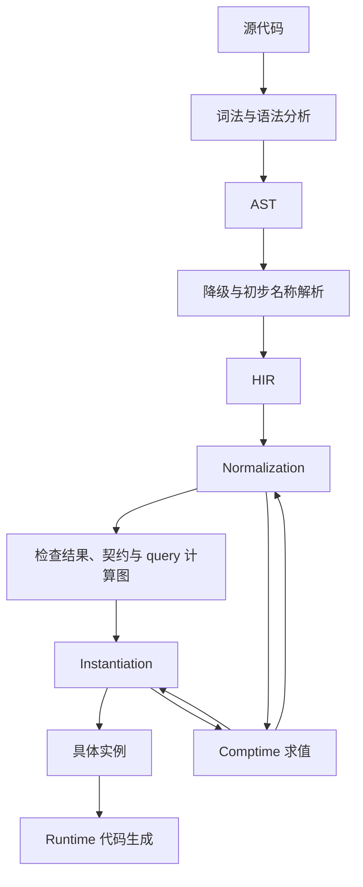

# 编译流水线

Flurry 将源程序转换为可检查的定义，再根据具体输入形成实例。编译时求值参与 normalization 和 instantiation；它不是只在某个单独步骤出现的常量折叠。

图中的回边表示阶段之间可以通过 query 产生依赖和结果，不表示所有表达式都反复求值。

| 边界 | 输出契约 |
|---|---|
| AST → HIR | 保存定义与表达式结构，完成相应初步名称解析，能按构造判断 ordinary/loose |
| Normalization | 完成规定的定义端检查，保留已知契约及依赖未知输入的计算 |
| Instantiation | 输入具备后继续求值与检查，输出对应的具体结果或实例 |
| Runtime 代码生成 | 使用已确定的类型、调用与布局，保留 runtime 操作 |

静态作用域为名称解析提供起点。它来自满足无子句限制的 `mod`、`struct`、`enum`、`union` 定义；`mod` 是用于模块组织的类型。

实现应遵守三个不变量：

1. 检查强度按构造确定，不能因为一个计算暂时没有值就将 ordinary 降为 loose。
2. query 的检查结果、具体求值结果与副作用不能混为一个“已完成”标记。
3. 需要具体结果的代码生成不能接收尚未兑现的占位结果。

独立 comptime 函数可以编译为 engine 字节码，由调用触发 execution；混合上下文中的相关 IR 使用 interpretation。两种载体遵守相同的用户语义，见 [normalization 与 instantiation](../comptime/normalization-and-instantiation.md#两种执行载体)。

具体 pass 的数量、查询缓存结构和执行器组织方式属于实现选择。机械执行的算法骨架、复杂度与失败路径见[两阶段检查的编译器引导](../comptime/normalization-and-instantiation.md#编译器实现引导)。
