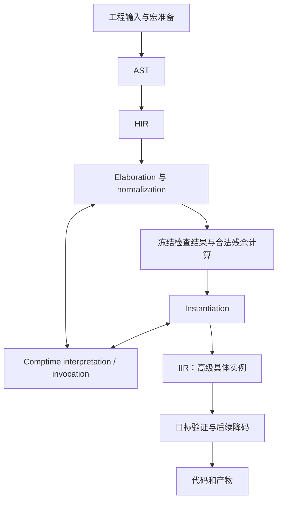

# 编译流水线

## Intro

编译器逐步把源程序变成可以执行的具体实例。它有时只需要知道一个值的类型或契约，有时必须先完成一次编译时计算，才能继续检查后面的代码。

Elaboration 与 comptime 因而交织进行。阶段的划分说明每份产物必须满足什么条件，并不要求先检查完整个程序，再集中执行所有编译时计算。

## 语法

```text
comptime_function -> pure? comptime fn id(parameter*) (-> result)? clauses? (block | (= expr))
comptime_param -> comptime parameter
defer_expr -> defer expr
normal_form_head_application -> expr<argument*>
attribute -> ^expr
```

这些是影响编译阶段的源语言形式。AST、HIR、normalization 结果和 IIR 是编译器表示，不增加用户语法。

## 正式定义

### 检查、计算和实例

Normalization 按构造的 ordinary/loose 规则检查定义，保存已建立的契约和合法延迟的工作。Instantiation 绑定本次输入，继续所需计算与检查。一次定义检查中的具体调用也可以就地实例化，不必等整份源码处理完毕。

检查义务完成不等于表达式已经算出具体值。反过来，某个计算产生了值，也不能使它跳过对应的类型、阶段或资源要求。

同一次调用中，callee 签名、外围期望及各实参提供的合法信息可以共同约束推断变量，包括后面的实参帮助前面的 lambda。这个信息流不改变普通实参的 runtime 求值次序。

定义端参数、运行时依赖和本次推断新建的未知项分别处理。类型引用一个 runtime 对象，不授权编译器读取该对象未来的内容。

### 交付边界

| 产物 | 必须提供的内容 | 可以保留的内容 |
|---|---|---|
| AST | 源码结构、分组范围、属性附着与来源 | 尚未完成的语义判断 |
| HIR | 明确的构造种类、绑定与待解析依据、检查上下文 | 尚待 elaboration 的类型、协议与计算 |
| Normalization 结果 | 必检义务的结果、可用契约、稳定绑定 | 语言允许的残余计算和依赖 |
| 具体实例 IIR | 已完成的类型 comptime 部分、实例关系、可供目标继续处理的高级操作 | runtime 依赖、控制流、闭包、效应和其他高级特征 |
| 后端产物 | 已兑现目标接口的代码与相关数据 | 按 runtime 接口规定继续执行的工作 |

IIR 尚未要求采用 SSA。类型中的 comptime 部分已完成，并不要求类型的所有 runtime 依赖变成常量，也不要求所有高级操作已经降成机器指令。

范式头的保留是完成类型计算后的合法结果之一。它不会因为输入具体、结果进入 IIR 或函数标为 pure，就展开为函数体的返回表达式。

### 失败

必需计算失败、ordinary 必检义务未完成、缺少实现证据或依赖无法交付时，不能把占位结果作为成功实例交给后端。允许 IDE 继续分析的错误占位也不能据此生成代码。

合法延迟的工作可以跨定义检查边界保存，但冻结产物不能直接引用本次推断的活动状态。具体区分见[两阶段计算与冻结](staging-and-freezing.md)。

### 阅读路线

| 文档 | 内容 |
|---|---|
| [源码准备、解析与 HIR](syntax-and-hir.md) | 输入依赖、属性前缀、上下文敏感解析、take view |
| [Elaboration 与上下文检查](elaboration.md) | 双向信息、刚性参数、实参角色与调用计划 |
| [局部依赖与暂停](local-dependencies.md) | Goal 边界、观察、等待、唤醒、失败与取消 |
| [候选求解与提交](candidate-solving.md) | 结构索引、PTC、事务与不可重放的执行 |
| [两阶段计算与冻结](staging-and-freezing.md) | Interpretation、invocation、残余计算与实例化 |
| [运行时依赖类型的表示](runtime-dependent-types.md) | 可 intern 的带洞结构、substitution 与环境 |
| [增量查询与诊断](incremental-queries.md) | 稳定结果、依赖指纹、失效、循环与恢复 |
| [IIR 与代码交付](iir-and-codegen.md) | 高级实例 IR、类型完成条件及目标降码 |

## 常见示例

### 在检查一次调用时求出参数类型

```flurry
use std.prelude.*;

pure comptime fn SelectType(wide: bool) -> Type {
    if wide {
        i64
    } else {
        i32
    }
}

fn keep_selected(
    comptime wide: bool,
    value: defer SelectType(wide),
) -> defer SelectType(wide) {
    value
}

test {
    let result = keep_selected(true, 7i64);
    println("{}", result);
}
```

输出 7。检查 keep_selected 的定义时，主体只把同类型的输入交付为结果，不需要对尚未具体化的类型执行加法。调用提供 true 后，类型计算得到 i64，再检查 7i64 与结果要求。

| 工作 | 取得的信息 |
|---|---|
| 检查定义 | wide 是 comptime 输入；参数和结果使用同一延迟类型 |
| 准备调用 | wide 对应 true，普通实参是 i64 |
| 计算类型 | SelectType(true) 得到 i64 |
| 完成调用 | 实参匹配，结果类型确定 |
| 交付 IIR | 保留普通值的传递；类型里不再等待 SelectType |

若本例传入一个未来才知道的 runtime bool 作为 wide，阶段检查失败。编译器不能为它生成运行时类型工厂来补齐该 comptime 参数。

### 相互递归可以依赖已经给出的签名

```flurry
fn is_even(value: u32) -> bool {
    if value == 0 {
        true
    } else {
        is_odd(value - 1)
    }
}

fn is_odd(value: u32) -> bool {
    if value == 0 {
        false
    } else {
        is_even(value - 1)
    }
}
```

两个函数体都可以按对方的签名检查。普通递归调用不要求先在编译时算出对方每次调用的结果。函数体引用环与具体值计算环承担不同的责任。

## 与 Rust / Zig / C / C++ 的关键差异

Rust 的 HIR、MIR 也是阶段表示，分别保留不同层次的语言结构。Flurry 的阶段要求还明确区分定义端契约、合法残余计算和类型 comptime 部分已完成的 IIR；不能按名字把 IIR 等同于某种 SSA 表示。[Rust HIR](https://rustc-dev-guide.rust-lang.org/hir.html)、[Rust MIR](https://rustc-dev-guide.rust-lang.org/mir/index.html)

Zig 的 comptime 参数参与实例化，C++ 模板也有推导和替换。Flurry 在 ordinary 定义端仍要求依据契约完成指定检查。C 无对等的这种开放定义检查机制，可用宏或外部生成后检查具体代码。详细对照见[两阶段检查](../comptime/normalization-and-instantiation.md#与-rust--zig--c--c-的关键差异)。

## 运行时实现设计引导

生成程序接收普通参数、资源与环境，不在每次调用时重启 elaboration 或 PTC。编译阶段确定的类型计算被消费；语言本来规定的 runtime 检查、Splice 方法工作、效应处理与环境取得仍保留。

编译器可以改变表示和执行载体，但必须保持源程序的求值次数、次序、控制效果、依赖 identity 和清理责任。类型相同不单独构成任意重排的依据。

## 编译器实现引导

### 分层与相互请求



回边表示真实的数据需求，不表示反复执行同一份程序。请求分为读取已经存在的结构、只需结果契约、需要具体计算结果三类。只有最后一类必须等待值本身。

静态作用域来自满足无子句限制的 mod、struct、enum、union 定义。模块树、源码发现和宏准备见[代码组织](../code-organization/index.md)。声明身份、包构建实例、类型身份、局部绑定与临时推断变量分别保存，不用同一个数字或字符串承担全部关系。

### 交付检查

1. HIR 保留每个构造的语义种类与来源；take view 已按操作种类形成专用节点。
2. 定义检查完成相应 ordinary 义务，记录可用证据及其前提。
3. 只冻结合法残余工作，结束本次局部任务，清除活动推断引用。
4. 实例化完成类型中的 comptime 计算及相应检查，保留正确的 runtime 依赖替换。
5. IIR 验证高级操作的接口和阶段；目标后端再验证自身支持的操作与表示。
6. 产物发布前确认目标要求及必检义务完成；失败保留来源链。

同一依赖可以只触发一份可复用计算，但不能把不同输入、实例环境或目标配置的工作误合并。编译成本分别统计解析、求解、编译时调用、实例扩展和目标生成，不用 AST 节点数估计全部工作。
