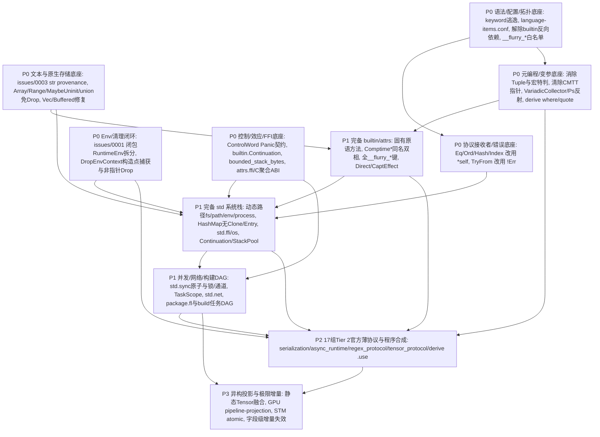

# Wave 3 全局差距审计总评分卡与路线图（`00-executive-gap-scorecard`）

> **角色与文档定位**：`backend-auditor`（Wave 3 全局综合交付，联合审签方：`@evidence-verifier`、`@arch-verifier`）  
> **审计基线**：仓库分支 `dev`，`HEAD` commit `b9a52238edaf31207f3061e7a4afdc8c18692695`（简称 `b9a52238`）；静态源码核验 + 跨卷综合（未运行 `cargo build` / `cargo test`）  
> **综合输入**：9 份已审签领域报告（[`01`](file:///home/fin/luna/tmp/gap-audit/01-frontend-syntax-macros-resolve.md)–[`09`](file:///home/fin/luna/tmp/gap-audit/09-library-std-and-ecosystem-readiness.md)）、[`Cargo.toml`](file:///home/fin/luna/Cargo.toml) 全部 **31** 个工作区 crate、`library/` 全部 **6** 个内置包（`102` 个 `.fl` / `23,874` LOC）、以及 [`tmp/wishlist/00-index-and-roadmap.md`](file:///home/fin/luna/tmp/wishlist/00-index-and-roadmap.md)（10 份规格、`20,753` LOC、`240` 项 `WL-XX-NN`、`54` 项 `OQ-01`..`OQ-54`）

---

## 1. 审计范围、检查基线与统计口径

### 1.1 代码盘点与资产边界

1. **编译器工作区（31 个 Crate）**：实时核对 [`Cargo.toml`](file:///home/fin/luna/Cargo.toml#L1-L41) 全部 31 个 `compiler/*` 成员（`symbol`、`ast`、`diagnostic`、`lex`、`parse`、`macro_expander`、`vfs`、`resolve`、`hir`、`ast_lowering`、`query`、`middle`、`interface`、`intrinsic`、`elaboration`、`ptc`、`type_resolution`、`verification_core`、`materialization`、`program_verification`、`bitvec_opt`、`pattern_automata`、`luna`、`nir`、`comptime_executor`、`comptime_interpretor`、`comptime_runtime`、`comptime_compiler`、`iir`、`fmt`、`anar`）。剔除 `/tests/` 子目录、`tests.rs` / `*_tests.rs` / `*_test.rs`、外部 `#[cfg(test)] mod ...;`（如 `comptime_interpretor` 14 个独立单测文件）及源码内 `#[cfg(test)]` / `#[test]` 项后，实盘共 **`931` 个非测试 `.rs` 源文件 / `470,900` 行代码**（详见 §6.3 全表）。
2. **六个内置包（Tier 1 Sysroot）**：实盘核对 `library/{builtin,meta,attrs,build,std,verification}` 共 **`102` 个 `.fl` 源文件 / `23,874` 行代码**，连同 [`library/language-items.conf`](file:///home/fin/luna/library/language-items.conf)（136 行）与 [`development/library_check.py`](file:///home/fin/luna/development/library_check.py)。Tier 2 官方薄协议包（`tmp/wishlist/10`，17 组）目前处于 **`0` 文件 / `0` 行** 空白前置阶段。

### 1.2 权威分层与统计口径

1. **Core 核心规范目标（Core Norm Target）**：仅以作者确认、[`AGENTS.md`](file:///home/fin/luna/AGENTS.md)（§1 单二进制 `luna` 取消独立 `anar`；§3 六内置包与 `math` 归属；§5 不可破坏语义边界）与现行正式 [`docs/`](file:///home/fin/luna/docs/README.md) 为权威标尺，辅以 [`issues/0001`–`0004`](file:///home/fin/luna/issues/0001-runtime-dependent-origin-and-default-param.md) 已追踪阻塞；**严格排除** `2026-05` 前早期历史归档草案与 AI 生成教学材料。
2. **Extended Wishlist 扩展目标（Wishlist Extension Target）**：以 [`tmp/wishlist/00`](file:///home/fin/luna/tmp/wishlist/00-index-and-roadmap.md)–`10`（`240` 项 `WL-XX-NN`）与 [`tmp/silver-design/04-compiler-wishlist.md`](file:///home/fin/luna/tmp/silver-design/04-compiler-wishlist.md)（`P0-1`..`P2-3`）为长期生态完整度标尺。
3. **Core vs Extended 汇总口径**：报告 `02`、`04`、`06`、`07`、`08` 在其 §2 显式拆分 Core 与 Extended（合计 `142 Core + 28 Extended = 170`）；报告 `01`、`03`、`05`、`09` 在其 §2 按子域汇总并在 §3 逐行标注规范出处（其中包含 `54` 项同时承载 Core 基础规范与 Wishlist 演进目标的 `[Core + Wishlist]` 混合条目），其**纯 Wishlist 条目计 `12` 项**（`01`: 1、`03`: 2、`05`: 1、`09`: 8；注：`09` 中面向 Tier 2 的编译器前置项 `GAP-09-28` 在原表按 `Core + Wishlist WL-10-01..05` 标尺记入 Core/Hybrid）、Core/Core+WL 条目计 `140` 项。全库合计 **`282 Core/Hybrid + 40 Pure-Extended = 322` 项**，且全部 **44** 项 `⚠️ Divergent` 均位于 Core 侧（Pure-Extended 为 `0`）。

### 1.3 跨报告切片去重原则（Critical Deduplication Rules）

- **特性与偏离条目去重**：`01`–`09` 共计 **`322` 项 `GAP-XX-NN`** 与 **`44` 项 `⚠️ Divergent`** 属于各领域独立盘点视角之和。跨编译管线耦合问题（如 `Tuple`/`meta.List` 特判在 `02`/`03`/`06` 三处出现、`Eq`/`Ord`/`Index` 按值 `*self` 在 `08`/`09` 同时阻断、`anar` 残留定位在 `01`/`07` 出现、裸属性键在 `01`/`04`/`08` 出现、`|>`/`==>` 优先级在 `01`/`07` 出现）均在 §3 与 §5 中显式对齐去重，避免重复立项或高估根因数量。
- **源码定量普查绝对互斥**：报告 `03`（`130` 文件 / `78,601` LOC）、`04`（`240` 文件 / `84,385` LOC）与 `05`（`105` 文件 / `94,755` LOC）按专题横向抽取了跨 crate 切片，与 `01`/`02`/`06`/`07` 存在大量文件重叠（如 `03` 有 123 个文件分别落在 `01` 的 `parse/hir/ast_lowering` 和 `02` 的 `elaboration` 内）。因此 **§6.3 全仓盘点严格采用 31 个 crate 互斥按文件汇总的实盘扫描值（`931` 非测文件 / `470,900` LOC）**，并在 §6.3 末单独列明与 `01`–`07` 域切片的对账关系，杜绝任何双计。

---

## 2. 全局成熟度评分卡与风险汇总表

### 2.1 领域 `01`–`09` 执行成熟度评分卡（与各分卷 §2/§3 严格 1:1 对齐）

| 报告 | 审计域 | 总计 | `🟢 Full` | `🟡 Partial` | `🟠 Frontend-Only` | `🔴 Missing` | `⚠️ Divergent` | `⚪ Deferred` | Core vs Extended 口径拆解 |
|---|---|---:|---:|---:|---:|---:|---:|---:|---|
| [`01`](file:///home/fin/luna/tmp/gap-audit/01-frontend-syntax-macros-resolve.md) | 词法、语法、AST/HIR、宏、解析 | **39** | 7 | 15 | 2 | 3 | 11 | 1 | 38 Core(+8 Hybrid) + 1 Pure-WL (`GAP-01-36`) |
| [`02`](file:///home/fin/luna/tmp/gap-audit/02-type-system-ptc-traits-elaboration.md) | 类型系统、PTC、Traits、派生、Elaboration | **32** | 4 | 14 | 1 | 9 | 3 | 1 | 27 Core (`4/13/1/6/3/0`) + 5 Extended (`0/1/0/3/0/1`) |
| [`03`](file:///home/fin/luna/tmp/gap-audit/03-functions-params-patterns-views.md) | 函数、参数、`pattern_automata`、Take View | **39** | 7 | 21 | 3 | 6 | 2 | 0 | 37 Core(+17 Hybrid) + 2 Pure-WL (`GAP-03-16, 37`) |
| [`04`](file:///home/fin/luna/tmp/gap-audit/04-comptime-cmtt-reflection-attrs.md) | Comptime 双引擎、CMTT、反射、官方属性 | **46** | 12 | 13 | 2 | 16 | 3 | 0 | 39 Core (`12/12/1/11/3/0`) + 7 Extended (`0/1/1/5/0/0`) |
| [`05`](file:///home/fin/luna/tmp/gap-audit/05-resource-verification-purity-effects.md) | 资源管理、程序验证、P0–P5 纯度、效应/错误 | **35** | 9 | 10 | 3 | 8 | 4 | 1 | 34 Core(+4 Hybrid) + 1 Pure-WL (`GAP-05-35`) |
| [`06`](file:///home/fin/luna/tmp/gap-audit/06-nir-iir-synthesis-llvm-backend.md) | NIR、IIR、程序合成、LLVM 23 & Effect ABI | **28** | 5 | 8 | 0 | 12 | 3 | 0 | 23 Core (`5/8/0/7/3/0`) + 5 Extended (`0/0/0/5/0/0`) |
| [`07`](file:///home/fin/luna/tmp/gap-audit/07-cli-build-query-incremental-tooling.md) | `luna` CLI、构建流、Query、缓存、`fmt`、LSP | **24** | 3 | 9 | 0 | 6 | 6 | 0 | 21 Core (`3/9/0/3/6/0`) + 3 Extended (`0/0/0/3/0/0`) |
| [`08`](file:///home/fin/luna/tmp/gap-audit/08-library-builtin-meta-attrs-build-verif.md) | `builtin`/`meta`/`attrs`/`build`/`verification` 与 Sysroot | **40** | 2 | 19 | 0 | 9 | 9 | 1 | 32 Core (`1/16/0/5/9/1`) + 8 Extended (`1/3/0/4/0/0`) |
| [`09`](file:///home/fin/luna/tmp/gap-audit/09-library-std-and-ecosystem-readiness.md) | `std`、17 组 Tier 2 薄协议与 Tier 3 生态 | **39** | 1 | 16 | 1 | 17 | 3 | 1 | 31 Core(+25 Hybrid, 含 `GAP-09-28`) + 8 Pure-WL |
| **合计** | **全语言栈 + 库与生态（去重前全条目和）** | **322** | **50** | **125** | **12** | **86** | **44** | **5** | **282 Core/Hybrid (`49/120/11/54/44/4`) + 40 Pure-WL (`1/5/1/32/0/1`)** |
| **占比** | **占全量 `322` 项比例** | **100%** | **15.5%** | **38.8%** | **3.7%** | **26.7%** | **13.7%** | **1.6%** | Core 完全合规仅 `17.4%` (`49/282`)；`44` 项偏离全部在 Core |

> **全局格局研判**：编译器前端基础词法/宏框架、PTC 理论求解内核、Comptime 双引擎主路径、P3/P4 纯度至 LLVM 23 行为属性以及 `std` 基础容器（`Vec`/`HashMap`/`String` runtime-dep `.allocator` 范式）均已具备扎实工程骨架（`🟢+🟡` 占 **`54.3%`**）；但中下游正交性、运行时依赖闭包/清理闭合、原生控制与效应 ABI、跨目标构建 DAG、以及 `builtin`/`std`/Tier 2 生态接口之间存在显著结构断层（`🔴+🟠+⚠️` 达 **`44.1%`**，其中直接违背 `AGENTS.md`/`docs/` 的 `⚠️ Divergent` 达 **44 项**）。

### 2.2 全局 `SND` / `CMP` / `ROB` 严重度仪表盘（与各分卷 §2/§6 严格 1:1 对齐）

| 报告 | 维度分布（`SND / CMP / ROB`） | `Critical (P0/blocker)` | `High (P1)` | `Medium (P2)` | `Low (P3)` | 合计 | 核心风险焦点 |
|---|---|---:|---:|---:|---:|---:|---|
| [`01`](file:///home/fin/luna/tmp/gap-audit/01-frontend-syntax-macros-resolve.md) | `6 / 6 / 5` | **4** (`3, 0, 1`) | **8** (`3, 3, 2`) | **5** (`0, 3, 2`) | **0** | **17** | `\|>`/`==>` 误解析、`SuperPath` 越包根、可见性/异步块静默丢弃、AST panic |
| [`02`](file:///home/fin/luna/tmp/gap-audit/02-type-system-ptc-traits-elaboration.md) | `5 / 6 / 5` | **0** | **7** (`2, 3, 2`) | **6** (`2, 2, 2`) | **3** (`1, 1, 1`) | **16** | `issues/0001` 闭包 env 混同、PTC 仅 4/19 原子、`derive fn` 七大阻断、`729` 处 panic 表面 |
| [`03`](file:///home/fin/luna/tmp/gap-audit/03-functions-params-patterns-views.md) | `5 / 5 / 4` | **0** | **5** (`2, 2, 1`) | **6** (`2, 2, 2`) | **3** (`1, 1, 1`) | **14** | `list_pattern_view_rest` 死循环、不可达分支静默、`567` 处 `_ =>` 兜底 |
| [`04`](file:///home/fin/luna/tmp/gap-audit/04-comptime-cmtt-reflection-attrs.md) | `5 / 5 / 4` | **0** | **6** (`2, 4, 0`) | **6** (`2, 1, 3`) | **2** (`1, 0, 1`) | **14** | `domain.is_some()` 越过白名单、CMTT 指针残留、staged 闭包/CMTT/反射缺失 |
| [`05`](file:///home/fin/luna/tmp/gap-audit/05-resource-verification-purity-effects.md) | `5 / 9 / 5` | **2** (`1, 1, 0`) | **7** (`2, 4, 1`) | **8** (`2, 3, 3`) | **2** (`0, 1, 1`) | **19** | `DropEnvContext` 清理点反查、`env_arguments` 与多形态 `Drop` 拒收、`spec/verified` 失效 |
| [`06`](file:///home/fin/luna/tmp/gap-audit/06-nir-iir-synthesis-llvm-backend.md) | `3 / 5 / 4` | **0** | **6** (`2, 3, 1`) | **5** (`1, 2, 2`) | **1** (`0, 0, 1`) | **12** | LLVM 文本消毒盲区、`statics` 缺验证、`MatchPlan` 回退、C ABI 缺聚合体、`10` `panic!()` |
| [`07`](file:///home/fin/luna/tmp/gap-audit/07-cli-build-query-incremental-tooling.md) | `7 / 6 / 6` | **1** (`0, 1, 0`) | **10** (`5, 2, 3`) | **6** (`2, 2, 2`) | **2** (`0, 1, 1`) | **19** | `package.fl` & `build.*` DAG 全缺、缓存碰撞与指纹退化、`diagnostic` 下溢/`query` panic |
| [`08`](file:///home/fin/luna/tmp/gap-audit/08-library-builtin-meta-attrs-build-verif.md) | `5 / 5 / 4` | **2** (`1, 1, 0`) | **6** (`2, 2, 2`) | **5** (`2, 2, 1`) | **1** (`0, 0, 1`) | **14** | `Index` 值 `self` 返指针、缺 `Array/Range/mem/effects` 底座、`builtin`->$K_6$ 环依赖 |
| [`09`](file:///home/fin/luna/tmp/gap-audit/09-library-std-and-ecosystem-readiness.md) | `7 / 6 / 5` | **8** (`2, 5, 1`) | **9** (`5, 1, 3`) | **1** (`0, 0, 1`) | **0** | **18** | `Vec.remove` double-drop、`BufReader/BufWriter` 溢出吞错、`std.fs`/`ffi`/`sync` 与 Tier 2 空缺、`std.fmt` 11 处 `assumes false` |
| **总计** | **`48 SND / 53 CMP / 42 ROB`** | **17** (`7, 8, 2`) | **64** (`25, 24, 15`) | **48** (`13, 17, 18`) | **14** (`3, 4, 7`) | **143** | **17 Critical（11.9%）+ 64 High（44.8%）集中于库安全、控制/ABI 与基础设施底座** |

---

## 3. 跨层特性差距高优索引（`GAP-00` ↔ `WL-XX-NN`）

### 3.1 跨层高优阻塞映射索引（去重归纳全语言关键能力链）

| 索引 ID | 跨层核心能力主题 | 标尺与 Wishlist 映射（`WL-XX-NN`） | 关联各域 `GAP` 编号 | 综合状态 | 关键卡点与生态影响 |
|---|---|---|---|---|---|
| **`GAP-00-01`** | **文法精度、关键字逃逸与包根隔离** | Core + `WL-01-29/30`, `WL-06-06` | `GAP-01-04/05/06/16/30`, `GAP-07-18`, `GAP-08-36` | `⚠️ Divergent` | `\|>`=80、`==>` 左结合、`SuperPath` 越界、仅有 `default` 局部逃逸阻塞 `^attrs.derivation.default` 与标准路径段 |
| **`GAP-00-02`** | **消除硬编码特判（`Tuple`/`meta.List`/`@define_macro1/2`/裸属性）** | Core (`AGENTS.md` §1/§5) + `WL-05-27`, `WL-06-07` | `GAP-01-17/25/26`, `GAP-02-08`, `GAP-03-18`, `GAP-04-43`, `GAP-06-04`, `GAP-08-30/34/36` | `⚠️ Divergent` | `Tuple`/`meta.List` 专有槽位阻断通用变参 NF 头；裸 `packed`/`intrinsic_enum` 与宏属性白名单 bypass 破坏正交性 |
| **`GAP-00-03`** | **协议接收者、错误返回值与集中绑定底座** | Core + `WL-01-01/03..07/12/24/26`, `WL-04-01..03/10/11/26` | `GAP-03-39`, `GAP-08-03/04/12/13/14`, `GAP-09-04/07/36` | `🔴 Missing` / `⚠️ Divergent` | `Eq`/`Ord`/`Hash`/`Index` 消费 `self`、`TryFrom`/`TryInto` 用 `?T`、缺 `Array`/`Range`/`MaybeUninit`/`ManuallyDrop`/`AddAssign` |
| **`GAP-00-04`** | **Runtime-Dep 闭包 ABI 与构造期环境捕获 `Drop`** | Core (`issues/0001`, `AGENTS.md` §1) + `WL-03-18`, `WL-07-03..06`, `WL-10-04` | `GAP-02-22/23`, `GAP-03-07`, `GAP-05-04`, `GAP-09-03/05/06/28` | `🟡 Partial` / `⚠️ Divergent` | `materialization` 拒收泛型闭合体隐式 `RuntimeId`；`DropEnvContext` 清理点反查且拒收非指针/契约化 `Drop`；卡死 Tier 2 派生 |
| **`GAP-00-05`** | **通用变参收集、匿名记录 `Ps` 反射与 `where` 局部推断** | Core + `WL-03-01..07/19/20`, `WL-05-07`, Silver `P0-1/P0-2` | `GAP-02-03/24`, `GAP-03-14/16/17`, `GAP-04-28/29` | `🔴 Missing` / `🟡 Partial` | 缺 `VariadicCollector` / `ExtendedVariadicCollector` / `Term::Record` 字段反射；方法与 `comptime fn` 缺 `where` 局部推断 |
| **`GAP-00-06`** | **`derive fn` 泛化与宏/双阶段协议对称** | Core (`AGENTS.md` §3/§5) + `WL-03-11..14`, `WL-04-21/22`, `WL-05-20..28`, `WL-10-01..05` | `GAP-02-16/18`, `GAP-03-25`, `GAP-04-03/17/25`, `GAP-08-18/24/26/30`, `GAP-09-13/28` | `🟡 Partial` / `⚠️ Divergent` | `derive fn` 七大阻断；固有 `comptime impl` 未通、`Display.comptime_fmt` 违背同名规则、CMTT 残留 `*self` 与 `assumes false` |
| **`GAP-00-07`** | **PTC A01–A19、`Type.predicates.*`、布局与 `type_id`** | Core + `WL-05-01..11` | `GAP-02-01..07/28..31`, `GAP-04-26/27/30..38`, `GAP-08-23/27` | `🟡 Partial` / `🔴 Missing` | 仅接 4/19 原子（`IntLe` 缺 NIR 接线）、`Type.predicates` 缺 `is_not_sized` 与短名统一、缺 `stride_of`、缺 128-bit `Type.type_id` |
| **`GAP-00-08`** | **`str` 来源证明、`&r T` 可达性与文本 UTF-8 全集** | Core (`issues/0003`) + `WL-04-05/14`, `WL-07-10/11`, `WL-09-03` | `GAP-05-08/09`, `GAP-08-15/16`, `GAP-09-10/11/12`, `GAP-06-05` | `🔴 Missing` / `⚠️ Divergent` | `TextProvenance` 入口割裂卡死 `str` 方法与 `String.as_str`；`&r T`、`MemoryView`、`SelfRef` 止步前端或空白；缺 `FromUtf8Err` |
| **`GAP-00-09`** | **模式匹配完备性、多错模式 `![...]` 与 Take View** | Core + `WL-02-01..26` | `GAP-01-09/37`, `GAP-03-05/21..37`, `GAP-05-28`, `GAP-06-14` | `🟡 Partial` / `🔴 Missing` | `MatchPlan` 遇 guard/thunk/slice 退回链式、`ListPatternView.rest` 死循环、`fn foo(case ...)` 与 `Struct/Map/Range/Concat` 视图缺失 |
| **`GAP-00-10`** | **代数效应控制字、捕获式 `Continuation`、`async` 与 `panic` ABI** | Core (`effect-abi.md`) + `WL-05-31`, `WL-08-01..10`, Silver `P0-3/P1-1` | `GAP-03-10`, `GAP-05-30..33`, `GAP-06-18..22`, `GAP-08-09`, `GAP-09-23/24` | `🔴 Missing` / `🟡 Partial` | `DirectPassing` 有单核、`ControlWord` 刚去 TLS；但捕获式 `builtin.Continuation`、`StackPool`/`BoundedStackPool`、`bounded_stack_bytes`、`HandleError`/`HandleEffect`、`std.process.panic` 与 `async` 调度全缺 |
| **`GAP-00-11`** | **C ABI 聚合体、`^attrs.ffi`、`std.os` / `fs` / `path` / `simd`** | Core + `WL-06-02/08/19`, `WL-07-13..20` | `GAP-04-44`, `GAP-06-07..11/23/24/28`, `GAP-09-14..21/25/27/38` | `🔴 Missing` / `🟡 Partial` | 仅闭合 `.c` 标量导出；无外部符号 `declare`、无 SysV/AAPCS64 聚合分类、无 `__flurry_align`/`std.simd`/`std.sync.atomic`/`std.net`/动态路径 `File` |
| **`GAP-00-12`** | **纯度 P0–P5、程序验证 `verification` 与合成代数** | Core (`AGENTS.md` §3) + `WL-09-01..16` | `GAP-01-39`, `GAP-02-32`, `GAP-05-05/12..24/35`, `GAP-06-12..17`, `GAP-08-38`, `GAP-09-26/39` | `🟡 Partial` / `⚪ Deferred` | `purity.rs` P3/P4→LLVM 23 有效但拒 `static` 且无 P0/1/2/5；`spec/verified/decreases` 静默失效；`bitvec_opt` 已运行；`Tensor`/`Combinator`/`STM` 缺失 |
| **`GAP-00-13`** | **包工程、`luna` 单二进制 DAG、`pipeline-projection`、IR `Display` 与增量** | Core (`AGENTS.md` §1/§5) + `WL-06-10..21` | `GAP-01-12/34/35`, `GAP-02-27`, `GAP-06-02/25/26`, `GAP-07-01..24`, `GAP-08-01/37`, `GAP-09-34/35` | `🔴 Missing` / `⚠️ Divergent` | `package.fl` 与 `build.{package,targets,tasks}` DAG 为零、`middle` 仅 1 query、`anar` 残留命名且缺后端、缺 `pipeline-projection`/`meta.runtime.invoke`、6 包依赖违反单向拓扑（`builtin`->$K_6$） |
| **`GAP-00-14`** | **Tier 2 官方 17 组薄协议包与 Tier 3 生态就绪** | Wishlist `WL-10-01..22` + 反膨胀黑名单 | `GAP-08-39/40`, `GAP-09-28..31` | `🔴 Missing` | 17 组协议包均为 0 文件；前置缺 `Symbol` 参数化 `trait`、`.use(...)` 派生、非 `__flurry_*` 元数据融合、跨 trait `quote .allocator` |

### 3.2 Wishlist 10 卷（`240` 项 `WL-XX-NN`）与 Tier 2 生态就绪度总览

| 分册 (`tmp/wishlist/`) | 规模（行 / `WL` 数） | 在 `01`–`09` 中的覆盖与实盘就绪评估 | 阻断至可用阶段 |
|---|---:|---|---|
| [`01-syntax-protocols-and-operators.md`](file:///home/fin/luna/tmp/wishlist/01-syntax-protocols-and-operators.md) | 1,850 / **33** | 核心算符与基础比较已运行；`Eq`/`Ord`/`Index` 值传递、`*Assign`/`Concat`/`Range`/`SpaceApply`/`Deref`/`Try*` 及 `\|>`/`==>` 待修 | **P0–P1** |
| [`02-pattern-matching-and-views.md`](file:///home/fin/luna/tmp/wishlist/02-pattern-matching-and-views.md) | 2,039 / **26** | `match`/`automata`/`BitVec`/`ListPatternView` 主干运行；`TuplePatternView`/`TypePatternView`/5 类视图/`fn foo(case ...)`/quoted arms 待补 | **P0–P2** |
| [`03-parameter-elaboration-and-derivation.md`](file:///home/fin/luna/tmp/wishlist/03-parameter-elaboration-and-derivation.md) | 913 / **24** | 位置/具名/默认/局部推断初成；`VariadicCollector`/`Extended*`/`Ps` 反射/`derive fn` 子句与无 `unsafe` 投影/`ImplicitPassing` 缺失 | **P0–P1** |
| [`04-builtin-types-math-iterators-fmt.md`](file:///home/fin/luna/tmp/wishlist/04-builtin-types-math-iterators-fmt.md) | 2,752 / **28** | `math` 标量与属性 `Display`/`Debug` 基线完成；全部原语固有方法、双相 `Comptime*`、推/拉 `Iterator`、`Array`/`mem` 底座与 `str` provenance 缺失 | **P0–P1** |
| [`05-meta-cmtt-macros-reflection.md`](file:///home/fin/luna/tmp/wishlist/05-meta-cmtt-macros-reflection.md) | 2,894 / **32** | 双引擎与部分反射/`meta.data` 就绪；PTC A01–A19 仅 4 项、CMTT `Any`/多分支洞/指针清理、`type_id`、`meta.{code,compilation,diagnostics,runtime}` 缺失 | **P0–P2** |
| [`06-attrs-build-pipeline-projection.md`](file:///home/fin/luna/tmp/wishlist/06-attrs-build-pipeline-projection.md) | 1,122 / **21** | 5 组核心 `__flurry_*` 键工作、`build.info` 只读快照；缺 16+ `__flurry_*` 键、`build` DAG/沙盒、`IIR.access`/`pipeline-projection`/`InvalidationDep` | **P0–P3** |
| [`07-std-mem-collections-io-os.md`](file:///home/fin/luna/tmp/wishlist/07-std-mem-collections-io-os.md) | 2,464 / **20** | 堆容器 runtime-dep `.allocator` 样板（`Vec`/`HashMap`/`String`）已立；`fs` 仅编译期路径、`path`/`ffi`/`os`/`simd`/`panic`/`Entry`/防漏洞修复待办 | **P0–P2** |
| [`08-effects-async-concurrency-net-runtime.md`](file:///home/fin/luna/tmp/wishlist/08-effects-async-concurrency-net-runtime.md) | 2,375 / **18** | 仅同步 `DirectPassing` + `ControlWord` 与 `Atomic` 未接后端；`builtin.Continuation`/`StackPool`/`TaskScope`/`std.sync`/`stm`/`std.net` 均 **0%** | **P0–P2** |
| [`09-verification-synthesis-and-tensors.md`](file:///home/fin/luna/tmp/wishlist/09-verification-synthesis-and-tensors.md) | 1,323 / **16** | `bitvec_opt`/`pattern_automata`/P3–P4 可用（`verification` 包按 `AGENTS.md` §3 暂缓）；幽灵类型、全 P0–P5、`Tensor`/`Combinator` 核融合缺失 | **P0–P3** |
| [`10-official-protocol-packages-and-boundary.md`](file:///home/fin/luna/tmp/wishlist/10-official-protocol-packages-and-boundary.md) | 3,021 / **22** | 反膨胀黑名单合规（Tier 1 零污染）；但 5 项前置（`WL-10-01..05`）未闭环，**17 组 Tier 2 官方薄协议包实现为 0/17** | **P0–P2** |
| **合计（不含 `00` 总纲）** | **20,753 / 240** | **Core 底层阻塞不除，Tier 2/3 无法以零妥协 Flurry 编写；反膨胀红线已守住** | — |

---

## 4. 系统性阻塞深度剖析与依赖拓扑

### 4.1 跨层根阻塞依赖拓扑图

### 4.2 五大系统性根阻塞深度剖析（聚焦零妥协库交付）

1. **根阻塞 I：Runtime-Dependent `allocator` 透传与清理生命周期未闭合（`issues/0001` + `SND-05-01` + `CMP-05-01`）**
   - [`library/std`](file:///home/fin/luna/library/std/mem_impl/boxed.fl) 已按 `AGENTS.md` §5 建成零存储开销 `.A = DefaultAllocator, quote .allocator` 范式，但编译器中后端存在三处断裂：① [`materialization/src/lib.rs:2848-3220`](file:///home/fin/luna/compiler/materialization/src/lib.rs#L2848-L3220) 拒绝闭包/回调体内因单态化显现的隐式 `RuntimeEnvParameter`（且 [`elaboration/src/program.rs:4921-4942`](file:///home/fin/luna/compiler/elaboration/src/program.rs#L4921-L4942) 将 `quote` 参数混入用户显式闭合捕获列表）；② [`drop/access.rs:278-308`](file:///home/fin/luna/compiler/program_verification/src/drop/access.rs#L278-L308) 在**清理点帧内**按 `req.identity` 临时反查 env 表达式且仅支持指针类型，[`drop/plan.rs:456-484`](file:///home/fin/luna/compiler/program_verification/src/drop/plan.rs#L456-L484) 拒绝 assumed/contracted `Drop`、[`moves/operations.rs:696-766`](file:///home/fin/luna/compiler/program_verification/src/moves/operations.rs#L696-L766) 拒绝临时/间接/闭包调用带 `env_arguments`；③ [`derivation.rs:39-215`](file:///home/fin/luna/compiler/elaboration/src/program/derivation.rs#L39-L215) 禁止 `derive fn` 携带 `where` 子句或 `quote` 形参。结果：`Box.with_ref`、`Vec.retain`、`Slice.sort_by` 及 Tier 2 容器 `Serialize` 无法在标准语言规则下通用编译。
2. **根阻塞 II：核心协议签名违背资源模型与六包拓扑伪闭合（`SND-08-01` + `DIV-08-01..06`）**
   - `builtin` 中的 `Eq.eq` / `Ord.cmp` / `Hash.hash` / `Index.index` 仍按值接收 `self`（`Index.index(self) -> *Output` 构成按值消耗后返内部指针的 **Critical 悬垂漏洞**）；`TryFrom`/`TryInto` 仍用 `?Self` 而非 `!Err Self`；`Display` 混写 `comptime_fmt` 违反同名双相规则。更深层的是 [`frontend.rs:664-675`](file:///home/fin/luna/compiler/luna/src/frontend.rs#L664-L675) 以全连通图 $K_6$ 依赖关系掩护了 `builtin` 到 `meta`/`attrs` 的 4 处反向引用（`DIV-08-01`），与 [`parse/src/basic.rs:192-203`](file:///home/fin/luna/compiler/parse/src/basic.rs#L192-L203) 仅放行 `default` 成员位（仍拒定义位 `default`）共同卡死了 `attrs.derivation.default` 与独立分包增量构建。
3. **根阻塞 III：文本/底层存储原语缺失叠加 `std` 内存与溢出脆弱性（`issues/0003` + `CMP-08-01` + `SND-09-01/05`）**
   - `TextProvenance` 在 `program_verification/src/purity.rs`/`luna/src/cleanup.rs` 与 `luna/src/protocols.rs:310,551`/`program_verification/src/moves.rs:15052` 间判定撕裂（`DIV-05-02`），使安全零拷贝 `str` 方法、`String.as_str` 及外部 FFI 文本构造持续阻塞（`native-text-method-provenance.fl`）。同时 `builtin` 缺失四大底座 `Array<T, N>`、`Range*` 六族、`builtin.mem`（`Layout`/`MaybeUninit`/`ManuallyDrop`）与控制特征（`CMP-08-01`），编译器未验证 `union` 免 `Drop`（`01` 中 `UnionDef` 甚至未过 `ast_lowering`），导致 `std` 被迫错误承载 `Layout` 且 `BufWriter` 无法安全拆解 `into_inner`；而现有 `std` 已存在 `Vec.remove` 早退留值 double-drop（`SND-09-01`）、`BufReader`/`BufWriter` 地址溢出静默成功（`SND-09-05`）与 `std.fmt` 11 处 `assumes false;`（`ROB-09-01`）等 P0 风险。
4. **根阻塞 IV：控制流栈帧、外部 FFI 与管线投影尚未建立通用后端载体（`06` + `07` + `08`）**
   - `host/llvm` 虽已完成 TLS 移除与 `ControlWord` `{ T, ptr }` + 同步零参 `DirectPassing`，但全部需要栈捕获或跨界控制的机制均处于 0%：无捕获式 `builtin.Continuation`（无栈切换/C 帧屏障/`Once` 校验）、无 `StackPool`/`BoundedStackPool`、无 `meta.runtime.bounded_stack_bytes`、无 `HandleError`/`HandleEffect`、无 `std.process.panic` 终止与逆序 `Drop` 合同。FFI/目标层面 `control.rs:166-275` 仅支持闭合 `.c` 标量导出，缺外部无体 `declare`、SysV/AAPCS64 聚合分类、`^attrs.layout.align`、`std.sync.atomic`、`std.simd` 以及 `IIR.access`/`^attrs.compilation.project` 通用投影入口——直接把 `std.runtime`/`std.sync`/`std.net`/`std.ffi`/`std.os`/GPU 后端全部锁在门外。
5. **根阻塞 V：编译器特判与工程构建工具链割裂（`DIV-02-01` + `CMP-07-01` + `GAP-01-26/34`）**
   - 编译器内部仍保留 `Tuple`/`meta.List<Type>` 专用槽位与构造判异（违背 `AGENTS.md` §5）、`@define_macro1/2` 专用展开白名单、裸属性名 `packed`/`intrinsic_enum` 与 `attributes.rs:126-141` 的 `domain.is_some()` 白名单绕过；工程与工具面则完全缺失 `package.fl`、`build.{package,targets,tasks}` DAG、持久化指纹与多目标交叉配置（`host/llvm/platform.rs:11` 硬编码宿主机宏条件），`anar` 尚未完全并入 `luna` 品牌空间且仅停留在 HIR 前段。

---

## 5. 全仓架构偏离与技术债总账（`⚠️ Divergent` 汇总）

### 5.1 全仓 44 项 `⚠️ Divergent` 1:1 核对与跨层去重总账

> 下表精确收敛 `01`–`09` §3 全部 **44 项 `⚠️ Divergent`**（`01:11 + 02:3 + 03:2 + 04:3 + 05:4 + 06:3 + 07:6 + 08:9 + 09:3 = 44`，无一遗漏），并与各分卷 §5 `DIV-XX-NN` 编号建立严格 1:1 映射。注：`08` §5 的 `DIV-08-02` 与 `DIV-08-03` 均归属于 `GAP-08-12`，`DIV-08-05` 同时涵盖 `GAP-08-14` 与 `GAP-08-24`，`DIV-08-08` 为 `attrs` 裸 `^intrinsic_enum` 子债（对应前端 `GAP-01-17`）；`04` §5 的 `DIV-04-04` 为旧日志勘误记录，非偏离实体。

| 聚类 | `GAP-XX-NN` | 对应 `DIV-XX-NN` | 偏离事实与主要源码定位 | 违反规范依据 | 修复归口 & 优先级 |
|---|---|---|---|---|---|
| **词法与语法 (`01`, `07`)** | `GAP-01-02` | — (`01` §5) | `lex/src/lexer.rs:7-15` 放行 3 段 Emoji 起始标识符 | `docs/basics/lexical.md:9` | 收紧为 ASCII 起始 (**P1**) |
| | `GAP-01-03` | — (`01` §5) | `lex` 仍词法化已废弃 `'{ ... }` (`MacroContent`) | `construction-macro.md`, `AGENTS.md` §5 | 改迁移报错后删 (**P2**) |
| | `GAP-01-04`, **`GAP-07-18`** *(镜像)* | — (`01` §5, `07` §5) | `parse/src/operators.rs:50` 与 `fmt/src/exprs.rs:2617` 将 `\|>` 优先级错设为 `80` | `docs/grammar/syntax`, `WL-01-29` | 同步降至低优先级 (**P0**) |
| | `GAP-01-05` | — (`01` §5) | `parse/src/expressions.rs:194-198` 将 `==>` 按左结合解析（与 `fmt` 右结合分裂） | `docs/grammar/syntax`, `WL-01-30` | 改为右结合 (**P0**) |
| | `GAP-01-06` | — (`01` §5) | `parse/src/basic.rs:192-203` 等成员/路径/定义位仅豁免 `default` 成员段且拒定义位 | `lexical.md:36-42`, `WL-06-06` | 开放合法关键字逃逸 (**P0**) |
| **前端降级、可见性与属性键 (`01`, `04`, `08`, `09`)** | `GAP-01-16` | — (`01` §5) | `ast_lowering/src/item.rs:366-367` 丢弃顶层 `Pub`/`Private` 且拒字段可见性 | `docs/code-organization/visibility.md` | HIR 结构化保留 (**P1**) |
| | `GAP-01-17`, `GAP-04-43`, `GAP-08-34` *(跨层镜像)* | `DIV-04-03`, `DIV-08-07` *(+`DIV-08-08`子债)* | `ast_lowering/item.rs:201` 硬编码裸 `^intrinsic_enum`；`attributes.rs:145` / `constructors.fl:10` / `structure.fl:133` 保留裸 `packed` 键及回退；`attributes.rs:126-141` `domain.is_some()` 绕过消费者白名单 | `official-attribute-keys.md`, `AGENTS.md` §5 | 全迁 `__flurry_*` + `^attrs.*` 删白名单漏洞 (**P0–P1**) |
| **路径作用域与 `IR Display` (`01`, `06`)** | `GAP-01-30` | — (`01` §5) | `resolve/src/module_builder.rs:657-670` 允许 `SuperPath` 越过 `ScopeKind::Package` 读 `Root` | `scope-and-paths.md:60` | 禁止步出包根 (**P0**) |
| | `GAP-01-12`, **`GAP-06-02`** *(跨层镜像)* | `DIV-06-01` | `ast` 缺 `Display` 且 S-expr 字面量不转义；`nir::Static` 无 `Display`、`nir/iir::Package::fmt` 非完整 S-expr 转储 | `AGENTS.md` §5（全 IR 转义 S-expr `Display`） | 补齐全量 S-expr 适配器 (**P1–P2**) |
| **特判债务（`Tuple` 与宏 `01`, `02`, `03`, `06`）** | `GAP-02-08`, **`GAP-03-18`**, **`GAP-06-04`** *(三层镜像)* | `DIV-02-01`, `DIV-03-01`, `DIV-06-02` | `nir::BuiltinCallable::{List,Tuple}`、`Role::{Tuple,TypeList}`、变参收集分支与专用判异横跨 5 crate | `AGENTS.md` §5（严禁 `Tuple`/`meta.List` 特判） | 统一为通用 comptime 列表值与 NF 头协议 (**P0–P1**) |
| | `GAP-01-26`, **`GAP-08-30`** | `DIV-08-10` | `macro_expander` 硬编码 `@define_macro1/2` 专用通道；`meta.macros` 漏重导出 `attrs.macros.{ast,peg}` | `AGENTS.md` §1, `issues/0004` | 退化为通用属性驱动宏并补齐重导出 (**P1–P2**) |
| **双相协议与 Comptime 指针 (`02`, `03`, `04`, `08`, `09`)** | `GAP-02-16` | `DIV-02-02` | 固有 `comptime impl` 被 `interfaces.rs:447` 与 VM 拒绝；`^attrs.comptime_phase` 不赋予同级 trait 优先级 | `AGENTS.md` §3/§5, `the-comptime-phases-of-traits.md` | 打通固有 `comptime impl` 与阶段调度 (**P1**) |
| | `GAP-03-25` | `DIV-03-02` | `list_patterns.rs:66-100` 保留 `_comptime` / `ElementComptime` 后缀单 trait 检测 | `AGENTS.md` §3（同名双相 `pure comptime trait`） | 删除后缀特判，接入 `ComptimeListPatternView` (**P1**) |
| | `GAP-04-03` | `DIV-04-01` | `cmtt/generators` 与 `list_patterns` 残留 `*self`/`H::Ref`/`Term::Pointer` 构建，4 份文档残存指针旧章 | `AGENTS.md` §5（comptime 严禁指针，值引用） | 清除 CMTT 指针构建并同步更新文档 (**P0**) |
| | `GAP-04-17` | `DIV-04-02` | `cmtt/functions.rs:81-92` `quote_holes` 全局计数，拒绝互斥分支各含 1 洞 | `docs/cmtt/quotation-and-stages.md` | 改按互斥分支路径独立计数 (**P1**) |
| | `GAP-08-18`, **`GAP-09-13`** | `DIV-08-06`, `DIV-09-01` | `Display` 内混写 `^attrs.comptime_phase comptime_fmt`；`std.fmt.comptime_format` 对 `.debug` 写 `assumes false` | `AGENTS.md` §1/§3, `the-comptime-phases-of-traits.md` | 拆分 `meta.ComptimeDisplay.fmt` 与 `ComptimeDebug` (**P0**) |
| | `GAP-08-24` | `DIV-08-05` | `meta.numeric.conversions` 与 `ComptimeTextBytes` 使用 `u64` 索引、`?Self` 返回及 `assumes false` | `AGENTS.md` §1/§5 | 迁回 `Integer` 索引、`!Err` 与完整实现 (**P1**) |
| **闭包、`Drop`、纯度与来源 (`02`, `05`)** | `GAP-02-22` | `DIV-02-03` | `program.rs:4921` 显式闭包把 `RuntimeEnv` 字段混入用户语义捕获列表 | `issues/0001` | 分离操作环境与语义捕获 (**P0**) |
| | `GAP-05-04` | `DIV-05-01` | `DropEnvContext` 在清理点 frames 反查且不支持非指针 env；`drop/plan.rs:430` 保留误导注释 | `drop-elaboration.md:46` | 改为创建/移动期捕获并支持泛化 env (**P0**) |
| | `GAP-05-08` | `DIV-05-02` | `TextProvenance` 在 `cleanup`/`purity` (`VerifiedByRegionAnalysis`) 与 `protocols`/`moves` (`Unchecked`) 间割裂 | `issues/0003`, `AGENTS.md` §1 | 全管线统一区域验证通路 (**P0**) |
| | `GAP-05-20` | `DIV-05-03` | `program_verification/src/purity.rs:2058` 对所有 `K::StaticAddress` 返回 `false`，未区分不可变常量读与可变状态 | `docs/resource-management/runtime-purity.md` | 区分 `static` 只读 (P2–P4) 与可变 (P0/1) (**P1**) |
| | `GAP-05-23` | `DIV-05-04` | `program_verification/src/purity.rs:939` 在 P3 下未豁免阶段形参 `Type`/`Integer`/`Float` 的运行时 `Copy` 检查 | `docs/resource-management/runtime-purity.md` | P3 同步豁免 comptime 类型形参 (**P1**) |
| **内置包规范、协议签名与命名 (`06`, `07`, `08`, `09`)** | `GAP-06-05`, **`GAP-07-07`**, **`GAP-08-01`** *(三层镜像)* | `DIV-06-03`, `DIV-08-01` | `sysroot.rs:10-46` 固定 `BUILTIN=0,STD=1` 与过期注释；`packages.rs` 单 prelude；`frontend.rs:664` $K_6$ 全连通掩护 `builtin`->`meta`/`attrs` 反向边 | `AGENTS.md` §5, `builtin-packages.md` | 按身份标识固定 6 包 + 5 默认 prelude 去重 + 解除 `builtin` 反向边 (**P0**) |
| | `GAP-08-12`, `GAP-08-13`, `GAP-08-14`, **`GAP-09-36`** | `DIV-08-02..05`, `DIV-09-03` | `Index`/`Eq`/`Ord`/`Hash` 消费 `self`；`ops.fl` 导出无运算符的 `BitAnd..Shr`；`TryFrom`/`TryInto` 返回 `?T` 而非 `!Err` | `once-clone-copy.md`, `error-handling.md`, `AGENTS.md` §5 | 全部迁移 `*self`、`!Err` 与移除废弃位运算 trait（或迁 `numeric.bits`）(**P0**) |
| | `GAP-08-32`, **`GAP-09-22`** | `DIV-08-09`, `DIV-09-02` | `meta.ast` 导出 `Optional<T> = ?T`、`option.fl`/`result.fl` 遗留命名、`meta/README` 与 `std` 文档过期、`ffi.md`/`stm.md` 0 字节 | `AGENTS.md` §5 | 删除 `Optional<T>` 兼容别名、清理文档偏离并补齐 0 字节核心规范 (**P1**) |
| **CLI、目标抽象、Formatter 与 LSP (`01`, `07`)** | `GAP-01-34`, **`GAP-07-02`**, **`GAP-07-23`** | — (`01`/`07` §5) | `anar` 保留独立包/命名空间/配置键且 LSP 仅达 `ast_lowering` 并吞错注空 AST | `AGENTS.md` §1（单二进制 `luna`） | 归并品牌至 `luna lsp` 并接入真实类型/宏增量查询 (**P2–P3**) |
| | `GAP-07-11` | — (`07` §5) | `host/llvm/platform.rs:11` 与 `host/tools.rs` 硬编码宿主 x86_64/Linux，缺外部管线产物交付 | `pipeline-projection/backends-and-artifacts.md` | 驱动级 target triple 参数化与外部管线投影对接 (**P1–P2**) |
| | `GAP-07-19` | — (`07` §5) | `fmt/src/verify.rs` 跳宏区/属性/导入顺序校验，`fmt/src/cli.rs` 非 UTF-8 路径损失 | `AGENTS.md` §1/§6, `07` §5 | 补严结构校验与 `OsString` 无损路径 (**P1**) |

> **44 项 `⚠️ Divergent` 精确计数核销**：`GAP-01` (11 项：`02,03,04,05,06,12,16,17,26,30,34`) + `GAP-02` (3 项：`08,16,22`) + `GAP-03` (2 项：`18,25`) + `GAP-04` (3 项：`03,17,43`) + `GAP-05` (4 项：`04,08,20,23`) + `GAP-06` (3 项：`02,04,05`) + `GAP-07` (6 项：`02,07,11,18,19,23`) + `GAP-08` (9 项：`01,12,13,14,18,24,30,32,34`) + `GAP-09` (3 项：`13,22,36`) = **44**（去重后对应约 **22 项独立根架构违例**）。  
> **已清零红线确认**：`library/std` 的 22 个 `.fl` 源码中 `Option`/`Result` 枚举 = **0**、`::` 双冒号路径 = **0**、使用处 `.symbol'builtin` = **0**、`SystemAllocator` 容器硬编码 = **0**；五非 `std` 内置包 `.fl` 中 comptime 指针 (`*self`/`.ref`/`.*`) = **0**；全仓 `todo!()` / `unimplemented!()` = **0**。

---

## 6. 全仓健全性 · 完备性 · 鲁棒性专项总览（`SND` / `CMP` / `ROB`）

### 6.1 Top `SND` 健全性与未定义行为风险（含全 7 项 Critical `SND`）

1. **`SND-01-01` / `02` / `03` [Critical, 前端语义篡改与权限泄露]**：`parse` 将 `\|>` 设为高优先级 `80` 且将 `==>` 解为左结合，静默改写求值与逻辑树；`ast_lowering/src/item.rs:366-367` 丢弃 `Pub`/`Private` 包装且 `expr.rs:822` 将 `AsyncBlock`/`ComptimeBlock` 压平为普通块；`resolve/src/module_builder.rs:657-670` 允许 `SuperPath` 步出包根 `ScopeKind::Package` 偷读合成 `Root` 绑定。
2. **`SND-05-01` [Critical, 运行时依赖清理身份错位]**：[`drop/access.rs:278-308`](file:///home/fin/luna/compiler/program_verification/src/drop/access.rs#L278-L308) 在清理帧动态查找 env，容器返回或跨作用域存储时极易找不到绑定或重用错乱环境。
3. **`SND-08-01` [Critical, 悬垂指针契约]**：[`library/builtin/protocols/ops.fl:82-90`](file:///home/fin/luna/library/builtin/protocols/ops.fl#L82-L90) 中 `Index.index(self, idx) -> *Output` 以值接收 `self` 并返还内部指针，破坏仿射/借用安全。
4. **`SND-09-01` [Critical, `Vec.remove` Double-Drop]**：[`library/std/collections_impl/vec.fl:352-377`](file:///home/fin/luna/library/std/collections_impl/vec.fl#L352-L377) 读取待移除元素后若 `checked_mul_usize` 早退返回 error，原槽位元素仍保留并会在 `Vec.drop` 时二次析构。
5. **`SND-09-05` [Critical, I/O 溢出静默返还成功]**：[`library/std/io_impl/buffered.fl:239-272, 375-383`](file:///home/fin/luna/library/std/io_impl/buffered.fl#L239-L383) 在 `checked_add_usize` 溢出时返回成功/`0`（同源 [`writer.fl:22-46`](file:///home/fin/luna/library/builtin/protocols/formatting/writer.fl#L22-L46) `SND-08-04` 遇 `null => break` 静默截断）。
6. **核心 High `SND` 聚类**：① 属性校验漏洞 `SND-04-01`（`attributes.rs:126-141` `domain.is_some()` 越过白名单）；② 静默契约失灵 `SND-05-02`（`spec`/`verified`/`decreases` 未拦截未证函数）；③ 模式死循环与阴影 `SND-03-01`（`list_pattern_view_rest` 默认 `while true {}`）+ `SND-03-02`（`unreachable_arms` 静默）；④ LLVM 文本消毒与 `statics` 遗漏 `SND-06-01/02` + `SND-05-05`；⑤ 增量缓存碰撞/跳过校验 `SND-07-01/02/03/04/06`；⑥ `std` 栈搬出与泄漏隐患 `SND-09-02/03/04/06/07`。

### 6.2 Top `CMP` 完备性盲区、`_ =>` 静默吞并与 Sysroot/测试断层

1. **全部 8 项 Critical `CMP` 阻塞**：
   - `CMP-05-01`：运行时 `env_arguments` 与假设/契约 `Drop` 被 `moves`/`drop` 多入口硬拒绝；
   - `CMP-07-01`：`package.fl` 与 `build.{package,targets,tasks,generated,util}` 构建流全缺；
   - `CMP-08-01`：`builtin` 缺失四大核心底座（`Array<T,N>`、`Range*` 六族、`builtin.mem`、`HandleError`/`HandleEffect`/`Continuation`/`panic`）；
   - `CMP-09-01` / `02` / `03` / `04` / `06`：`std.fs` 仅支持 `comptime path: str`、集合缺少 `Index`/`*self` `Eq`/`Ord`、`HashMap` 强制 `K :- Clone` 且无种子/无 `Entry`、`String.as_str`/`FromUtf8Err`/`MaybeUninit`/`BTree*` 缺失、并发/异步/网络与 17 组 Tier 2 包全部归零。
2. **`_ =>` 静默吞并、枚举变体遗漏与正交盲区**：
   - `parse`/`ast_lowering`/`elaboration`/`host/llvm` 存在大面积遗漏：`ast/src/lib.rs` 244 个有效节点中 `ast_lowering` 有 **28 个节点未真降级**（`CMP-01-02`），`elaboration` 核心模式/表达式调度切片含 **567 处兜底 Arm**（`CMP-03-01`，如 `expression_values/mod.rs:75-80`），`compiler/elaboration/src` 非测试源码另有 **`104` 处** `"is not implemented"`（34 处）/ `"not yet implemented"`（70 处）显式门控，`host/llvm.rs:2995` 保留 `inner_unimplemented`（`CMP-06-01`），`pattern_dag.rs:80-131` 遇 guard/thunk 静默回退链表比较（`CMP-06-02`）。
   - `ptc::Atom` 仅接 **4/19** 原子、`IntLe` 未接 `nir::TypePredicate`；`Type.predicates.*` 仅识别 12 长名且缺 `is_not_sized`/`Union`/`Record`/`Char`；字节码禁用 fallback 并拒绝 `TemplateEqual`/`Effect*`；CMTT 缺失 `Any` 与 quoted arm；除 `char` 外其余 20+ 原语类型在 `library/builtin` 几乎**零固有 `impl`**（`CMP-08-02`）。
3. **Sysroot 与集成测试断层（`ROB-08-03` + `ROB-09-05`）**：
   - [`development/library_check.py`](file:///home/fin/luna/development/library_check.py) 含 38 阶段但缺完整 `std` 验证段且依赖手工切分参数（如 `meta-values` 传入 `builtin/primitives.fl`）绕开模块依赖；[`library/README.md:393-397`](file:///home/fin/luna/library/README.md#L393-L397) 记录 `full-sysroot` 冒烟仍受 `panic`/I/O/formatting 缺口阻塞；`development/repros/native-text-method-provenance.fl` 至今未能闭环；`compiler/interface` 注释仍沿用 `(0=builtin, 1=std)` 旧模型。

### 6.3 全仓 31-Crate 非测试 Rust 源码与 6-Builtin `.fl` 互斥普查（无重复计数）

> **实盘统计口径**：直接扫描 `Cargo.toml` 全部 **31** 个 workspace crate 的 `src/**/*.rs`，词法剥离注释/字符串与单行 `use` 语句，并严格剔除 `/tests/` 子目录、`tests.rs` / `*_tests.rs` / `*_test.rs`、外部 `#[cfg(test)] mod ...;`（如 `comptime_interpretor` 14 个独立单测模块）及源码内 `#[cfg(test)]` / 独立 `#[test]` 项；跨仓库共计 **`931` 个非测试 `.rs` 文件 / `470,900` 行代码**（另注：所有 31 个 crate 非测试 `todo!()`/`unimplemented!()` 均为 **`0`**）。

#### A. 31 个编译器 Crate 互斥全盘表

| Crate（`compiler/*`） | 归属领域 | 非测文件 | 非测 LOC | `.unwrap()` | `.expect()` | `panic!()` | `unreachable!()` | `HashMap` | `HashSet` | `DUMMY_SP` / `Span::default` / `0..0` |
|---|---|---:|---:|---:|---:|---:|---:|---:|---:|---|
| `symbol` | `01` | 1 | 255 | 0 | 1 | 0 | 0 | 0 | 0 | 0 / 0 / 0 |
| `ast` | `01` | 3 | 3,261 | 40 | 2 | 2 | 0 | 0 | 0 | 1 / 1 / 0 |
| `diagnostic` | `01`, `07` | 1 | 444 | 0 | 0 | 0 | 0 | 0 | 0 | 2 / 0 / 0 |
| `lex` | `01` | 5 | 2,328 | 2 | 0 | 0 | 0 | 6 | 0 | 0 / 0 / 0 |
| `parse` | `01` | 12 | 11,119 | 6 | 2 | 0 | 1 | 3 | 4 | 12 / 0 / 0 |
| `macro_expander` | `01` | 11 | 7,622 | 9 | 0 | 0 | 1 | 33 | 6 | 13 / 0 / 0 |
| `vfs` | `01`, `07` | 1 | 234 | 0 | 0 | 0 | 0 | 0 | 0 | 0 / 0 / 0 |
| `resolve` | `01` | 16 | 4,438 | 20 | 1 | 0 | 0 | 26 | 12 | 8 / 0 / 0 |
| `hir` | `01` | 32 | 5,975 | 2 | 3 | 0 | 0 | 2 | 0 | 0 / 0 / 0 |
| `ast_lowering` | `01` | 9 | 8,173 | 20 | 18 | 0 | 35 | 10 | 9 | 2 / 2 / 0 |
| `query` | `07` | 7 | 822 | 0 | 3 | 2 | 0 | 4 | 0 | 0 / 0 / 0 |
| `middle` | `02` | 4 | 360 | 0 | 1 | 1 | 0 | 0 | 0 | 0 / 0 / 0 |
| `interface` | `02`, `07` | 2 | 237 | 0 | 0 | 0 | 0 | 0 | 0 | 0 / 0 / 0 |
| `intrinsic` | `06` | 3 | 584 | 0 | 1 | 0 | 0 | 0 | 0 | 0 / 0 / 0 |
| `elaboration` | `02` | 293 | 134,153 | 357 | 100 | 0 | 272 | 57 | 38 | 28 / 15 / 9 |
| `ptc` | `02` | 38 | 8,314 | 17 | 4 | 0 | 6 | 13 | 4 | 0 / 0 / 0 |
| `type_resolution` | `02` | 39 | 17,644 | 11 | 9 | 0 | 6 | 33 | 16 | 0 / 0 / 0 |
| `verification_core` | `05` | 13 | 6,643 | 15 | 2 | 0 | 2 | 0 | 0 | 0 / 0 / 0 |
| `materialization` | `06` | 16 | 9,141 | 5 | 5 | 0 | 11 | 22 | 17 | 0 / 0 / 1 |
| `program_verification` | `05` | 54 | 74,774 | 78 | 26 | 0 | 99 | 105 | 34 | 0 / 0 / 6 |
| `bitvec_opt` | `06` | 8 | 9,508 | 0 | 17 | 0 | 4 | 0 | 0 | 0 / 0 / 0 |
| `pattern_automata` | `03`, `06` | 7 | 7,341 | 0 | 30 | 10 | 19 | 0 | 0 | 0 / 0 / 0 |
| `luna` | `06`, `07` | 64 | 41,487 | 39 | 27 | 0 | 32 | 53 | 27 | 2 / 0 / 1 |
| `nir` | `06` | 86 | 37,732 | 14 | 3 | 0 | 19 | 8 | 8 | 0 / 0 / 14 |
| `comptime_executor` | `04` | 1 | 274 | 0 | 0 | 0 | 0 | 2 | 0 | 0 / 0 / 0 |
| `comptime_interpretor` | `04` | 131 | 41,037 | 57 | 60 | 0 | 121 | 73 | 18 | 0 / 0 / 15 |
| `comptime_runtime` | `04` | 12 | 2,178 | 4 | 1 | 0 | 0 | 0 | 0 | 0 / 0 / 0 |
| `comptime_compiler` | `04` | 22 | 5,653 | 10 | 5 | 0 | 14 | 2 | 0 | 0 / 0 / 0 |
| `iir` | `06` | 19 | 8,782 | 13 | 0 | 0 | 31 | 19 | 17 | 0 / 0 / 0 |
| `fmt` | `01`, `07` | 13 | 12,633 | 6 | 1 | 0 | 0 | 7 | 5 | 1 / 0 / 0 |
| `anar` | `01`, `07` | 8 | 7,754 | 1 | 0 | 0 | 1 | 31 | 20 | 5 / 0 / 0 |
| **31 Crate 互斥合计** | `01`–`07` | **931** | **470,900** | **726** | **322** | **15** | **674** | **509** | **235** | **74 / 18 / 46**（共 **138**） |

#### B. 6 个内置包 `.fl` 源码实盘普查（`102` 文件 / `23,874` LOC）

| 内置包 | `.fl` 文件 | `.fl` LOC | `unsafe` | `'builtin` | `'intrinsic` | 规范合规模板与鲁棒热点摘要 |
|---|---:|---:|---:|---:|---:|---|
| `library/builtin` | 28 | 8,970 | 52 | 167 | 50 | 仅 2 处固有 `impl`；含 1 处 `assumes false`、`1` 处 `while true {}`；`ProbeWriter` 泄漏至公开 `options`；仅 `options.fl:10` 注释含字面量 `Option`（无 `Option`/`Result` 枚举） |
| `library/meta` | 36 | 6,757 | 44 | 180 | 44 | 含 3 处 `assumes false`；`Map`/`Set` $O(N)$ 线性扫；`TokenBuffer`/`PegNode` $O(N^2)$ `concat`（需 `--fuel 2000000`）；`0` 处 `*self` 漏出 |
| `library/attrs` | 10 | 99 | 0 | 0 | 0 | `layout_impl` 仍保留 `attrs.layout.packed` 旧构；缺失 `compilation.*`/`derivation.default`/`quote_fn_template.*` |
| `library/build` | 5 | 121 | 0 | 3 | 0 | 仅 `info/{mode,package,target}.fl`；`prelude` 为空；5 个目录纯 `.md` 占位 |
| `library/std` | 22 | 7,925 | 231 | 0 | 12 | 零 `::`/零 `Option` 枚举/零使用处 `'builtin`；`std.fmt` 含 11 处 `assumes false`；`Vec.remove`/`buffered.fl` 含 Critical 漏洞 |
| `library/verification` | 1 | 2 | 0 | 0 | 0 | 依 `AGENTS.md` §3 暂缓（仅空 `pub mod prelude {}`） |
| **6 包合计** | **102** | **23,874** | **327** | **350** | **106** | **Tier 2 17 组薄协议包 = `0` `.fl` 文件 / `0` LOC** |

#### C. Panic 表面、无序容器、缺失 `Display` 与 `01`–`07` 切片对账

1. **全仓 Top 非测试文件级热点（按单文件 Panic 边界总和排行）**：
   - **Top Panic 热点**：[`elaboration/src/program/open_functions.rs`](file:///home/fin/luna/compiler/elaboration/src/program/open_functions.rs)（**70** 处：33 `unwrap` + 4 `expect` + 33 `unreachable!`）、[`program_verification/src/memory/text_regions/transfers.rs`](file:///home/fin/luna/compiler/program_verification/src/memory/text_regions/transfers.rs)（**47** 处：16/0/0/31）、[`comptime_interpretor/src/lib.rs`](file:///home/fin/luna/compiler/comptime_interpretor/src/lib.rs)（**43** 处：5/3/0/35）、[`elaboration/src/program/interfaces.rs`](file:///home/fin/luna/compiler/elaboration/src/program/interfaces.rs)（**41** 处：30/0/0/11）、[`iir/src/staging.rs`](file:///home/fin/luna/compiler/iir/src/staging.rs)（**34** 处：12/0/0/22）与 [`elaboration/src/program.rs`](file:///home/fin/luna/compiler/elaboration/src/program.rs)（**33** 处：12/9/0/12）。
   - **Crate 级聚集分布**：`elaboration` 集中了 **`357` `.unwrap()` + `100` `.expect()` + `272` `unreachable!()` = `729` 处**；`comptime_interpretor` 在剔除 14 个外部 `#[cfg(test)]` 文件与 `memory.rs` 独立 `#[test]` 块后含 `57` `.unwrap()` + `60` `.expect()` + `0` `panic!()` + `121` `unreachable!()`（与 [`04`](file:///home/fin/luna/tmp/gap-audit/04-comptime-cmtt-reflection-attrs.md#L288) 完全一致）；全仓 **15 处非测试 `panic!()`** 中 `pattern_automata/src/eval.rs` 占 **`66.7%` (`10/15`)**（`ROB-06-01`），其余为 `ast` 2 处（`ROB-01-01`）、`query` 2 处（`ROB-07-02`）、`middle` 1 处。
   - **非确定性容器（`744` 处：`509 HashMap + 235 HashSet`）与零定位退化（`138` 处）**：非测试代码（剥离 `use`/注释/字符串）中 `HashMap`/`HashSet` 最密集文件为 `program_verification/src/memory.rs`（59 处：48+11）、`materialization/src/lib.rs`（36 处：20+16）、`anar/src/index.rs`（26 处：19+7）、`text_regions.rs`（25 处：17+8）及 `luna/src/macro_host.rs` / `cleanup.rs`（各 23 处）；`DUMMY_SP` / `Span::default` / `0..0` Span 回退集中于 `elaboration/src/program.rs`（13 处）、`parse/src/error.rs`（8 处）、`macro_expander/src/lib.rs`（7 处）及 `nir/src/phases{.rs,/*.rs}`（13 处，全 crate 共 14 处）。
   - **S-expression `Display` 缺口汇总**：`ast`（缺带 `SourceMap` `Display` 与转义）、`nir::Static`（缺 `Display`）、`nir/iir::Package::fmt`（未完整采用转义 S-expression）、`comptime_runtime::Object` 等内部数据展示不一致，且 `diagnostic` 在 `DUMMY_SP` 下存在 `u32` 下溢 panic（`ROB-07-01`）。
2. **与 `01`–`07` 分卷切片显式对账**：
   - `01`（`114` 文件 / `67,258` LOC ≈ 12 个前端 crate 全量加 `luna/{frontend,macro_host}.rs`）；`02`（`376` 文件 / `161,168` LOC = `ptc` + `type_resolution` + `middle` + `interface` + `elaboration`）；`06`（`178` 文件 / `99,605` LOC = `nir` + `iir` + `materialization` + `bitvec_opt` + `pattern_automata` + `intrinsic` + `luna/src/{host,cleanup,protocols,resources}`）；`07`（`96` 文件 / `63,605` LOC = `luna` + `anar` + `query` + `vfs` + `fmt` + `diagnostic` + `interface`）。其中 `luna`（64 文件 = `host/cleanup/protocols/resources` 39 + CLI/前端/缓存 25）、`interface`、`diagnostic`、`vfs`、`fmt`、`anar`、`pattern_automata` 处于相邻域边界；`03`（130 文件 / 78,601 LOC）、`04`（240 文件 / 84,385 LOC）与 `05`（105 文件 / 94,755 LOC）均为按专题抽取的横切切片（共享 `parse`/`hir`/`ast_lowering`/`elaboration`/`nir`/`iir`），**不能与 `01/02/06/07` 直接相加**；上表 **31 crate 并集（`931` 非测文件 / `470,900` LOC）** 为唯一无重复全仓基准。

---

## 7. P0–P3 分期修复路线、Wishlist 排期对齐与 Open Questions

### 7.1 四阶段 P0–P3 修复路线图与被动验收门禁（不跑构建，仅定验签标准）

| 阶段 | 核心交付包（对位全仓 `GAP` / `SND` / `DIV` 与 `tmp/wishlist/00` §4.3） | 被动验收门禁（Acceptance Gates — 静态/用例验收合约） |
|---|---|---|
| **Phase 0（P0 — 止血、核心语义纠偏与硬阻塞清零）** | 1. **安全与语义止血**：修复 `Vec.remove` double-drop（`SND-09-01`）、`BufReader`/`BufWriter` 与 `ByteWriter` 溢出静默（`SND-09-05`, `SND-08-04`）、`std.fmt` 11 处 `assumes false`（`ROB-09-01`）、`\|>` 优先级/`==>` 右结合/`SuperPath` 越包界（`SND-01-01/03`）、`attributes.rs` `domain.is_some()` 越权（`SND-04-01`）、`DropEnvContext` 创建期捕获（`SND-05-01`）。 2. **库协议与底层底座纠偏**：将 `Eq`/`Ord`/`Hash`/`Index` 迁移至 `*self`（`SND-08-01`）、`TryFrom`/`TryInto` 迁至 `!Err`；解除 `builtin`->$K_6$ 反向依赖（`DIV-08-01`）与放开关键字成员/定义位逃逸（`default`/`inline`）；补全 `language-items.conf` & `official-attribute-keys.md` 核心/P0 键（`^attrs.macros.*`, `^attrs.derivation.default`, `^attrs.layout.align`, `^attrs.ffi.link*`, `^attrs.effects.stack_strategy`）；落地 `Array`/`Range*`/`MaybeUninit`（收敛 `union` 免 `Drop`）/溢界原语。 3. **编译器 5 大硬阻塞解除**：打通 `issues/0001` 闭包操作环境分槽（`DIV-02-03`）、`issues/0003` `str` provenance 全通路（`DIV-05-02`）、`CMTT` 清除 `*self` 指针残留（`DIV-04-01`）、`ControlWord` + `std.process.panic` 展开契约 + 捕获式 `builtin.Continuation` + `meta.runtime.bounded_stack_bytes`（Silver `P0-3`）、`VariadicCollector`/`Extended*`/`Ps` 反射（Silver `P0-1/P0-2`）+ `derive fn` `where`/`quote` 支持。 | **P0 门禁**（对应测试固件清单）： 1. `--sysroot library` 全包冒烟（`library-smoke.fl`）与 `development/repros/native-text-method-provenance.fl` 通过； 2. `library/builtin` **不依赖 `meta`/`attrs`/`std`** 独立编过； 3. `parse/tests/precedence.rs` 覆盖 `\|>` / `==>` 优先级与结合性；`luna/tests/{runtime_dependent_types,closure_environment_parameters,std_allocators_collections_io,library_std}` 覆盖 `Box.with_ref`/`Vec.remove` 防二次析构/`BufReader` 溢出报错； 4. `resolve/tests/single_imports.rs` 验证 `SuperPath` 越包根静态拒收；`luna/tests/{attrs_and_meta_reflection,library_attributes,macros_integration}` 通过。 |
| **Phase 1（P1 — 完备 `builtin`/`std`/OS/并发与通用机制统一）** | 1. **彻底清特判与双相统一**：清除 `Tuple`/`meta.List` 专用槽与 `@define_macro1/2` 特判；打通固有 `comptime impl`、`^attrs.comptime_phase` 同级优先级、`list_patterns.rs` 去 `_comptime` 后缀、CMTT 互斥分支单洞计数；拆分 `meta.ComptimeDisplay`/`ComptimeDebug` 与同步 20+ 原语固有 `impl`。 2. **中后端能力完备**：接通 `ptc::Atom` 剩余原子与 `IntLe -> NIR`、补齐 `Type.predicates` 短名与 `is_not_sized`、`Type.type_id` 128-bit Merkle、`where` 方法/comptime 局部推断、`MatchPlan` 去链表退回、C 聚合 ABI（SysV/AAPCS64）+ 无 `extern` FFI 声明、纯度 `P0`–`P5` + `static` 只读。 3. **系统库、并发、构建与诊断加固**：落地动态路径 `std.fs`/`path`/`env`/`process`、`HashMap` `.H: BuildHasher` + 无 `Clone` + `Entry`、`String.as_str`/`FromUtf8Err`、`StackPool`/`BoundedStackPool`/`TaskScope`/`CancelToken`、`std.sync` 原子/锁/通道/`std.net` 同步 socket；落地 `package.fl` + `build.{package,targets,tasks}` DAG；收敛 `comptime_interpretor`/`elaboration`/`diagnostic`/`query` 高频 panic 点与全 IR S-expression `Display`。 | **P1 门禁**： 1. `luna test` 跨包验证 `std.fs` 运行时路径、`std.ffi` C 聚合往返、`std.sync` 多线程/`Mutex`、`std.net` loopback socket 与 `BoundedStackPool` 栈界守卫； 2. `library_check.py` 接入全量 `std` 阶段与双相 `Comptime*` 一致性测试； 3. 验证自定义泛型 NF 变参收集（无需 `Tuple` 特判）及 `QueryEngine` 循环诊断（零进程崩溃）； 4. `luna --emit` 全层级 IR S-expression 往返可解析。 |
| **Phase 2（P2 — Tier 2 17 组官方薄协议、高级验证与 `anar` 退场）** | 1. **Tier 2 生态发力**：打通 `WL-10-01..05`（`Symbol` 参数化 `trait`、`.use(...)` 派生、非 `__flurry_*` 键与跨 trait `quote .allocator`），率先交付 `serialization`、`async_runtime`、`random`、`testing`、`regex_protocol`/`parser_protocol`、`http`/`database`/`crypto`/`telemetry` 等 **17 组 Tier 2 薄协议包**（守卫 Tier 1 反膨胀黑名单）。 2. **高级特性收口**：`TotalOrd`、`EndlessList`/其余 5 类模式视图、`fn foo(case ...)`、Pin-free 边界、非阻塞 `std.net`、`std.simd`、`Arena`/`SlotMap`/`SoA` 分流、与暂缓解除后启用 `verification` 幽灵类型与 `safe`/`verified` 静态准入；完成 `anar` 向 `luna lsp`（含宏/elaboration 驱动）并表迁移。 | **P2 门禁**： 1. 跨 Tier 1/2/3 端到端集成案例（如 `Serialize<.json>.use(json_lib.without_allocation)`、`regex_protocol` CMTT DFA 编译、`async_runtime` + `TaskScope`）； 2. 六包静态依赖扫描门禁：`builtin`/`std` 零 Tier 2 黑名单符号渗入且单向 DAG 无环； 3. `anar/tests/lsp_integration.rs` 覆盖真类型悬停与诊断一致性。 |
| **Phase 3（P3 — 异构 `pipeline-projection`、核融合与字段级精准增量）** | 1. 静态形状 `Tensor` 代数核融合 + `#emit_item` 推流融合 + `meta.compilation.IIR` / `meta.runtime.invoke` 向 Tier 2 `tensor_protocol` 与 Tier 3 GPU（CUDA/SPIR-V/WGSL）投影。 2. `std.sync.stm` BTO 事务块（`atomic` + `TVar`/`OrderedLock`）与 `build.{generated,util}` 沙盒完整化。 3. 基于 `InvalidationDep` 的字段级增量缓存指纹与 `middle` 全阶段 Query 化，推进高密度 `HashMap` 迭代确定性收尾。 | **P3 门禁**： 1. 静态 `Tensor` 核融合 IR diff 与异构投影产物确定性重放验证； 2. `InvalidationDep` 单字段改动仅触发最小依赖单元重编基准对比； 3. `MemoryView` 分离证明在并发切片场景全线闭环。 |

### 7.2 与 54 项跨卷 Open Questions（`OQ-01`–`OQ-54`）排期对齐

> 全部 78 项分册待决问题已于 [`00-index-and-roadmap.md` §6.2](file:///home/fin/luna/tmp/wishlist/00-index-and-roadmap.md#L362-L482) 无损收敛为 `OQ-01`–`OQ-54`；以下按排期紧迫度给出决策优先级分组（需作者拍板方能零歧义落地）：

| 决策批次 | `OQ` 范围与核心待决主题 | 关联关键风险 / `⚠️ Divergent` |
|---|---|---|
| **P0 急需裁决（22 项，阻塞 Phase 0 实施）** | **语法与协议**：`OQ-02`（`*Assign` vs writeback）、`OQ-03`（`Index *self` 与 `&r`/`MutSlice`）、`OQ-06`（`Default` 名/`default` 关键字/`ComptimeHash` 无指针状态）； **原语与文本**：`OQ-11`（`&r` 空白文档与 `str` provenance）、`OQ-12`（`Slice`/`MaybeUninit`/`Layout` 归属收敛 `04` vs `07`）、`OQ-14`（`Display.comptime_fmt` 迁移与 `Debug` 更名为 `fmt`）； **参数与环境**：`OQ-21`（`VariadicCollector.assoc Tmp<S>` 参数化）、`OQ-22`（`ExtendedVariadicCollector` 契约）、`OQ-26`（`field_ptr` 无 `unsafe` 投影）、`OQ-27`（`issues/0001` env 闭包与 `TryClone`/OOM 分裂）； **元编程与属性**：`OQ-30`（`meta.ast` 结构化与去 `@define_macro1/2`）、`OQ-31`（`bounded_stack_bytes` 目标与无界返 `null`）、`OQ-33`（`HostInvokeErr.Diagnostic` 大写）、`OQ-34`（16+ `__flurry_*` 登记与清裸键）、`OQ-35`（`metadata` 浅覆盖 vs Tier 2 非 `__flurry_*` 键）； **运行时与 Tier 2**：`OQ-39`（`std.process.panic` 展开/abort/`Mutex` 投毒/`caller_location`）、`OQ-40`（无 `extern` `std.ffi` 替代 `platform.ll`）、`OQ-43`（`HandleEffect` 与 `effect enum` 展开）、`OQ-44`（首版 `BoundedStackPool` 有栈锁死）；`OQ-52`/`OQ-53`/`OQ-54`（`where format: Symbol`、Tier 2 包域标识、禁止开放默认派生）。 | 直接解除 `SND-08-01`, `DIV-08-01..08`, `DIV-09-01`, `DIV-02-03`, `DIV-05-01/02`, `DIV-04-03`, `GAP-01-06/26`, `CMP-09-01..06` |
| **P1 重点裁决（24 项，对齐 Phase 1 完备性）** | **语法与类型**：`OQ-01`（删/迁 `BitAnd..Shr`）、`OQ-04`（`Eq/Ord+TotalOrd` vs `Partial*`）、`OQ-05`（`\|>` 优先级 `35`/`15` 与 `==>` 运行期边界）、`OQ-07`（`-128i8`/`-32px` 与 `ArbitrarySizedInteger` >128b ABI）、`OQ-08`（`++` 与 `'multi_deref`）、`OQ-09`（`Tuple` `.0` vs `.get` & `Es.all(...)`）、`OQ-10`（`NoReturn` vs `never`）、`OQ-13`（推拉 `StepIterator`）、`OQ-15`（`BorrowView` 值描述符与 `Cow`）； **模式匹配**：`OQ-16`（`Tuple/TypePatternView` 归属与双相）、`OQ-17`（未覆写 `rest` 报错代替 `while true`）、`OQ-18`（`MapPatternView` 省略 `..`）、`OQ-19`（无载荷 `case -> bool`）、`OQ-23`、`OQ-24`、`OQ-25`（`TryVariadicCollector`、`Extension` 拒绝、`ImplicitPassing` 边界）； **反射与运行库**：`OQ-28`（`Type.predicates` 短名/`Reachability` vs `ReachSet`）、`OQ-29`（`ComptimeTextBytes` 迁回 `Integer`）、`OQ-32`（`include_*`/`invoke` 沙盒）、`OQ-41`（`std.simd` 越界宽度）、`OQ-42`（`SoA`/`SlotMap`/`SmallVec` Tier 1/2 划界）、`OQ-46`（`effects_ext` 与 `*T` 非 `Send`/`Sync`）、`OQ-47`、`OQ-48`（`predicate` 职责分层与 `skip_unsafe_propagation`）。 | 解锁 `GAP-01-04/05`, `GAP-02-03`, `SND-03-01`, `DIV-08-03/05`, `TD-02-02`, `TD-09-01` |
| **P2 演进裁决（8 项，收敛 Phase 2–3）** | `OQ-20`（函数级 `case` 多臂互斥 vs 偏序特化）、`OQ-36`（`InvalidationDep` 字段级失效）、`OQ-37`（内存读写契约从 `where` 迁往 `verification`）、`OQ-38`（Pin-free vs 内部不可移动契约）、`OQ-45`（`atomic(vars)` 与禁混用 `OrderedLock`）、`OQ-49`（`safe` <=3 次多项式边界）、`OQ-50`（零阶 `StaticTensor` 不展开与 `MaybeUninit` 初始化）、`OQ-51`（条件 `outcomes` 与 `branch_hint`）。 | 收敛 `GAP-05-35`, `GAP-06-15/16`, `GAP-07-16`, `GAP-09-26/39` |

---

### 7.3 Wave 1/2 领域审计全量索引（`01`–`09`）

- [01 · 词法、语法、AST/HIR、宏系统与解析审计](file:///home/fin/luna/tmp/gap-audit/01-frontend-syntax-macros-resolve.md)（39 GAPs / 17 Findings / 11 Divergent）
- [02 · 类型系统、PTC、Traits、Derivation 与 Elaboration 审计](file:///home/fin/luna/tmp/gap-audit/02-type-system-ptc-traits-elaboration.md)（32 GAPs / 16 Findings / 3 Divergent）
- [03 · 函数体系、参数 Elaboration、模式匹配、决策自动机与 Take View 审计](file:///home/fin/luna/tmp/gap-audit/03-functions-params-patterns-views.md)（39 GAPs / 14 Findings / 2 Divergent）
- [04 · Comptime、CMTT、反射与官方属性审计](file:///home/fin/luna/tmp/gap-audit/04-comptime-cmtt-reflection-attrs.md)（46 GAPs / 14 Findings / 3 Divergent）
- [05 · 资源管理、程序验证、纯度分级与效应/错误系统审计](file:///home/fin/luna/tmp/gap-audit/05-resource-verification-purity-effects.md)（35 GAPs / 19 Findings / 4 Divergent）
- [06 · NIR、IIR、程序合成与 LLVM 23 后端审计](file:///home/fin/luna/tmp/gap-audit/06-nir-iir-synthesis-llvm-backend.md)（28 GAPs / 12 Findings / 3 Divergent）
- [07 · CLI、工程构建、查询引擎与增量工具链审计](file:///home/fin/luna/tmp/gap-audit/07-cli-build-query-incremental-tooling.md)（24 GAPs / 19 Findings / 6 Divergent）
- [08 · 五基础内置包（`builtin`/`meta`/`attrs`/`build`/`verification`）与 Sysroot 审计](file:///home/fin/luna/tmp/gap-audit/08-library-builtin-meta-attrs-build-verif.md)（40 GAPs / 14 Findings / 9 Divergent）
- [09 · 标准库（`std`）、官方协议包边界与生态就绪度审计](file:///home/fin/luna/tmp/gap-audit/09-library-std-and-ecosystem-readiness.md)（39 GAPs / 18 Findings / 3 Divergent）
