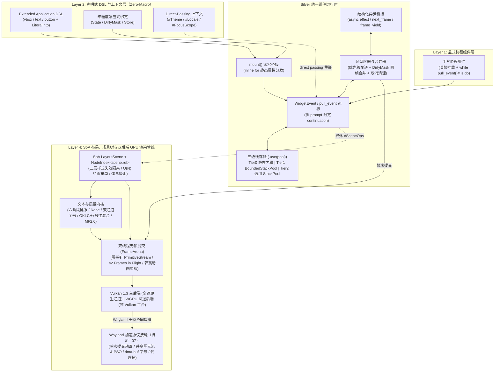

# Silver GUI 框架架构总览

> **状态**：`Draft v0.1（讨论稿）`  
> **源起**：[scratch](file:///home/fin/luna/tmp/silver-design/scratch)  
> **定位**：利用 Flurry 原生多 prompt 限定 continuation、界外 effect handler、可组合 `async effect`、`ExtendedVariadicCollector` 扩展应用与 `*T` 顺序别名等特性设计的原生 GUI 框架，尽量不依赖 CMTT、宏与 projection pipeline。

---

## 1. 核心命题与五大设计不变量

Silver 的一切设计围绕一个中心命题展开：**组件实例就是一枚被限定 continuation 冻结在特定栈界内的 Flurry 执行栈**。在此之上确立五条架构不变量：

1. **栈实例 = 组件实例（Stack Instance IS Component Instance）**  
   组件挂载即进入其函数栈帧执行首帧构造，挂起在 `pull_event()#` 即成为活跃实例；组件卸载即放弃对应 `builtin.Continuation`，沿隐藏中止通道按词法作用域逆序触发所有局部变量、状态句柄、子组件和异步任务的 `Drop`。没有独立于调用栈的“Hook 数组”或“State Bag”映射层。

2. **界外处理保小栈（Out-of-Boundary Handlers Keep Widget Stacks Bounded）**  
   依据 Flurry 效应 ABI，effect handler 分支在**限定边界之外**的外层栈（框架主栈）上执行。布局排版、文本塑形、GPU 场景更新、子组件创建和 I/O 等重操作通过 effect 穿过边界执行，**不计入组件自身栈上界**。绝大部分组件只需承载局部状态与少量事件循环帧，能在编译期确定较小的栈上界并直接按上界分池分配，无需每组件分配完整的虚拟大栈。

3. **双层统一，零宏桥接（Dual-Layer Unified, Zero-Macro Bridge）**  
   - **上层（Layer 2）**：声明式 `extended application` DSL（基于 `VariadicCollector`、`ExtendedVariadicCollector`、`inline for`/`inline if`、`LiteralInto` 单位后缀与细粒度响应式绑定）。  
   - **下层（Layer 1）**：手写 `while pull_event()# is do { ... }` 协程组件（适用于拖拽状态机、多步向导、定制动画或性能热点）。  
   两者之间**不使用 CMTT、构造/模板宏或 projection pipeline**，通过纯库级泛型与编译期元组/记录展开直接编译到同一套 `pull_event` 循环，且允许任意层次互相嵌套。

4. **异步原生可组合（Natively Composable Structured Concurrency）**  
   Flurry 的 `async effect` 天生归属于 handler 安装范围，调度建立在统一的多 prompt 限定 continuation 上。组件内部可把网络请求、定时器、vsync 动画帧、协同时间片切分直接写成顺序流；组件卸载或状态覆盖时自动取消未决子任务并等待清理，不需要在框架层重造 React Fiber。

5. **上下文即效应，别名即顺序指针（Context as Direct-Passing Effect, Aliasing via `*T`）**  
   主题、本地化、焦点作用域等自顶向下配置通过 `^attrs.effects.direct_passing` 提供，静态检查行消除、支持按项部分覆盖，并在恢复时自动取得外层最新供应值。UI 线程内的状态指针使用 Flurry 原生 `*T`（配合 `&r T` 可达性检查）实现零开销顺序别名，绕开 Rust GUI 常见的 `Rc<RefCell<T>>` / slotmap 繁文缛节。

---

## 2. 整体架构图

> **边界说明**：Layer 4 的核心 SoA 布局、双线程提交、Vulkan 主 / WGPU 回退管线与文本质量架构已在 `05` / `06` 展开；虚线接缝 `Wayland 加速协议（07）` 保留零重写扩展口，待后续专项讨论时详写。

---

## 3. 与主流 GUI 架构的横向对比

| 维度 | Silver (Flurry) | React (Fiber) | Flutter | SwiftUI | GPUI / Xilem (Rust) |
|---|---|---|---|---|---|
| **组件实例载体** | 挂起在 `pull_event()#` 的有界限定栈帧 | 堆上 Fiber 链表 + Hooks 数组 | Widget 描述 + 长寿 Element 对象树 | 堆上 AttributeGraph 节点树 | View 树重建 + `Entity` / 显式 State 树 |
| **卸载与清理机制** | 放弃 `Continuation`，隐藏中止通道按词法逆序自动 `Drop` | 记录 `useEffect` cleanup 回调并在提交后调用 | 手动重写 `State.dispose()`，易漏取消 | 依赖 `.onDisappear` 与外部引用计数 | `Drop` 在保留模型或 Entity 释放时触发 |
| **栈内存开销** | 编译期确定上界按级分池（典型 128B–1KB/组件），重操作界外执行 | JS 对象与闭包分配，依赖 GC | Dart 对象堆分配 + GC | 堆节点与值见证表 | 状态结构体 + 视图重建/Arena |
| **上下文传播** | `^attrs.effects.direct_passing`（行检查 + 局部单项覆盖） | `Context.Provider`（动态树查表） | `InheritedWidget`（运行期树检索与依赖登记） | `@Environment`（隐式键查找） | 显式传 `cx` 上下文对象 |
| **异步与取消** | 原生 `async effect` + 结构化作用域取消 | `useEffect` + `AbortController` + 手动竞态防护 | `Future`/`Stream` + 手动判断 `mounted` | Swift Concurrency `.task`（与 View 生命周期半耦合） | 异步 executor spawn + 手动句柄管理 |
| **DSL 机制** | `ExtendedVariadicCollector` + `VariadicCollector`（零宏、纯语言特性） | JSX（编译转译） | Dart 构造器嵌套（无额外语义折叠） | `@ViewBuilder` 结果构建器（特设编译器变换） | Builder 方法链或过程宏 |
| **共享状态与别名** | 单线程 `*T` 顺序别名 + `&r T` 可达性静态证明 | JS 引用 + 不可变快照约束 | Dart 引用（依赖手动 `notifyListeners`） | Property Wrapper + 引用包装 | `Rc<RefCell>` / `Entity<T>` + 上下文令牌句柄 |

---

## 4. 设计文档导航

| 文档 | 主题 | 状态 |
|---|---|---|
| [01-stack-instance-and-event-loop.md](file:///home/fin/luna/tmp/silver-design/01-stack-instance-and-event-loop.md) | 栈实例生命周期、有界栈分析与三级栈池、`pull_event` 事件模型、Layer 1 协程手写范式 | `Draft v0.1` |
| [02-dsl-and-reactivity-bridge.md](file:///home/fin/luna/tmp/silver-design/02-dsl-and-reactivity-bridge.md) | `VariadicCollector`/`ExtendedVariadicCollector` 零宏 DSL、零宏桥接响应式更新、动态控制流与 Direct-Passing 上下文 | `Draft v0.1` |
| [03-async-and-scheduling.md](file:///home/fin/luna/tmp/silver-design/03-async-and-scheduling.md) | 结构化异步任务与自动取消、多 prompt 组合动画/分帧、调度车道与同帧脏标记合并 | `Draft v0.1` |
| [04-compiler-wishlist.md](file:///home/fin/luna/tmp/silver-design/04-compiler-wishlist.md) | 为支撑 Silver 反推 `luna` 编译器与 `builtin`/`std` 的通用能力需求清单（P0–P2） | `Draft v0.1` |
| [05-layout-scene-and-rendering.md](file:///home/fin/luna/tmp/silver-design/05-layout-scene-and-rendering.md) | SoA 场景布局、`NodeIndex<scene.ref>`、双线程提交、Vulkan 主 / WGPU 回退管线与 Wayland 接缝 | `Draft v0.1` |
| [06-text-i18n-and-quality.md](file:///home/fin/luna/tmp/silver-design/06-text-i18n-and-quality.md) | 六阶段文字排版、Rope 增量视口、双通道字形与 GPU 曲线、OKLCH/线性光学混合与零分配国际化 | `Draft v0.1` |
| `07-wayland-accel-protocol.md` | Wayland 专属垂直协同协议（合成器动画/图元流/Shared PSO/dma-buf 共享字形图集/代理树） | **后续专题（TBD）** |
