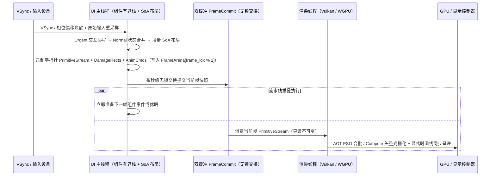

# Layer 4：SoA 场景布局、双线程提交与 Vulkan 主 / WGPU 回退渲染管线

> **状态**：`Draft v0.1（讨论稿）`  
> **前置阅读**：[00-overview.md](file:///home/fin/luna/tmp/silver-design/00-overview.md)、[01-stack-instance-and-event-loop.md](file:///home/fin/luna/tmp/silver-design/01-stack-instance-and-event-loop.md)、[03-async-and-scheduling.md](file:///home/fin/luna/tmp/silver-design/03-async-and-scheduling.md)  
> **专项衔接**：文本排版/色彩/国际化见 [06-text-i18n-and-quality.md](file:///home/fin/luna/tmp/silver-design/06-text-i18n-and-quality.md)；Wayland 合成器加速协议将单独展开于 `07-wayland-accel-protocol.md`。

---

## 1. 激进却严谨的架构立场

### 1.1 明确拒绝的历史包袱

Silver 的 Layer 4 从第一天起就彻底切割历史渲染包袱，拒绝在架构上为过时假设让步：
- **无 OpenGL / 无隐式状态机 / 无驱动猜测同步**：不兼容 OpenGL 或隐式 `dma-buf` 同步，全面采用显式命令队列、显式内存屏障与时间线信号量（Timeline Semaphores）。
- **无运行时着色器编译卡顿**：所有 2D/UI/矢量/计算着色器必须在构建期完成 AOT 编译与不可变管线状态（PSO）预置，运行期严禁冷启动现场编译 GLSL/SPIR-V。
- **无 X11 子窗口体系、无 OOP 虚方法渲染树**：拒绝用“一个对象一个堆指针 + 虚表多态 `paint()`”组织场景；所有布局与渲染图元以连续平铺的结构体数组（SoA）与零指针值流驱动。
- **无多帧深队列输入滞后**：严禁驱动向交换链堆积 3 帧以上待显示画面，在途帧（Frames in Flight）严格锁定在 **1 至 2 帧**。

### 1.2 同等严苛的工程严谨性

激进不等于裸奔。Silver 用 Flurry 的静态契约确保每一层高速通道都有完备的不变量守卫：
- **确定性阶段隔离**：布局写入几何、预绘制裁剪命中、录制图元流、双线程无锁交换四阶段严格分离，杜绝“布局读到未更新几何、绘制反写触发二次重排”的抖动死循环。
- **句柄身份静态绑定**：借助 Flurry 运行时依赖类型（[runtime-dependent-type.md](file:///home/fin/luna/docs/type/runtime-dependent-type.md)），轻量 `NodeIndex<scene.ref>` 本体只有 `4B`，却在类型系统层面永久绑定到特定 `LayoutScene`，不可能误将窗口 A 的节点索引传入窗口 B。
- **不向最小公约数妥协的双后端**：**Vulkan 1.3+ 为第一公民主后端**，仅当运行平台不支持 Vulkan（如 macOS/iOS Metal、纯 DX12 Windows、WebGPU/WASM 或缺乏 Vulkan 1.3 驱动环境）时才自动切换至 **WGPU 回退后端**。Vulkan 独享的显式同步、`dma-buf` 零拷贝、持久化 UMA 映射与多核录制通过能力位优雅降级，绝不把 Vulkan 阉割成 WGPU 的交集子集。

---

## 2. 面向数据（DOD）的 SoA 场景布局树与运行时依赖句柄

### 2.1 热冷分离 + 前序扁平化 + 三层样式失效隔离

组件栈（Layer 1 / Layer 2）不直接持有胖对象树，而是通过界外 `#SceneOps` 效应在框架主栈的 `LayoutScene` 中分配轻量句柄。`LayoutScene` 采用**前序遍历平铺数组 + SoA（Structure-of-Arrays）+ 热冷数据分离**，保证单次布局/渲染扫描对 CPU L1/L2 缓存行 100% 友好：

| 数据分区 | 存储列（平铺索引对齐） | 缓存行与失效语义 |
|---|---|---|
| **Hot 拓扑列** | `parent: u32`、`first_child: u32`、`next_sibling: u32`、`subtree_len: u32`、`depth: u16` | 单趟布局与裁剪遍历仅顺序扫描此区 |
| **Hot 脏与边界位域** | `^attrs.packed.bit struct NodeFlags`（`dirty_layout`、`dirty_paint`、`dirty_compositor`、`is_relayout_boundary`、`is_repaint_boundary`、`is_compositing_layer`、`is_occluded`） | 语义级具名 bool 字段，编译器直接降码为 `BitVec<7>` 并复用 `bitvec_opt` 优化，无分支且零魔数 |
| **样式层 1：布局样式** | `LayoutStyle`（Flexbox / Grid 约束、逻辑边距 `inline_start/end`、`block_start/end`、`min/max/aspect`） | 修改此层置 `dirty_layout \| dirty_paint` |
| **样式层 2：绘制样式** | `PaintStyle`（`LinearRgba` / `OKLCH` 填充、边框、超椭圆 Squircle 圆角、解析阴影、自定义着色器 Uniform） | **绝不触发布局重算**，仅置 `dirty_paint` |
| **样式层 3：合成样式** | `CompositorStyle`（32 位浮点仿射变换矩阵、透明度 `opacity`、裁剪矩形、背景模糊半径、色彩空间元数据） | **绝不触发布局与重绘**，仅置 `dirty_compositor`，可直接 1:1 卸载给合成线程/Wayland 合成器 |
| **计算几何输出列** | `LayoutRect`（物理像素吸附后的 `x, y, w, h`）、`HitBox`、`DamageRect` | 由布局器单向写入，渲染录制与命中测试只读 |
| **Cold 旁路表** | 调试标签、`AccessKit` 无障碍文本、字体/图像引用句柄、罕见材质扩展 | 彻底剥离出布局热路径，按冷索引稀疏查询 |

> **共享环境不增开销**：依据 Flurry [runtime-dependent-type.md](file:///home/fin/luna/docs/type/runtime-dependent-type.md)，数组或容器保存成百上千个 `NodeIndex<scene.ref>` 时，所有元素共享同一个外层 `scene.ref` 环境，**每个句柄本体仅占 4 字节（`u32`）**，不逐元素复制指针。

### 2.2 `NodeIndex` 与帧级线性分配器（`FrameArena`）

```flurry
use std.collections.Vec;
use std.mem.Allocator;
use std.mem.DefaultAllocator;

-- 按位紧密打包（等价 BitVec<7>），直接共享 bitvec_opt 与无分支位写回，告别手写魔数掩码
^attrs.packed.bit
pub struct NodeFlags {
    dirty_layout: bool = false,
    dirty_paint: bool = false,
    dirty_compositor: bool = false,
    is_relayout_boundary: bool = false,
    is_repaint_boundary: bool = false,
    is_compositing_layer: bool = false,
    is_occluded: bool = false,
}

pub struct LayoutScene
where
    .A: Type = DefaultAllocator,
    requires A :- Allocator,
    quote .allocator: lift *A = DefaultAllocator.GLOBAL.ref,
{
    count: u32,
    -- SoA 热列（各列共享 LayoutScene 的运行期依赖 allocator）
    parents: Vec<u32, .A = A, .allocator = allocator>,
    first_children: Vec<u32, .A = A, .allocator = allocator>,
    next_siblings: Vec<u32, .A = A, .allocator = allocator>,
    subtree_lens: Vec<u32, .A = A, .allocator = allocator>,
    flags: Vec<NodeFlags, .A = A, .allocator = allocator>,
    layout_styles: Vec<LayoutStyle, .A = A, .allocator = allocator>,
    paint_styles: Vec<PaintStyle, .A = A, .allocator = allocator>,
    compositor_styles: Vec<CompositorStyle, .A = A, .allocator = allocator>,
    rects: Vec<LayoutRect, .A = A, .allocator = allocator>,
}

-- 运行时依赖类型句柄：本体只有 4 字节 index，编译期防止跨场景混用
pub struct NodeIndex
where quote scene: lift *LayoutScene
{
    index: u32,

    pub fn set_compositor_opacity(*self, alpha: f32) {
        -- 目标引导读取与接收者适配：无需冗余写 .*
        let idx: u32 = self.index;
        if idx < scene.count {
            let slot = idx.as(usize);
            scene.compositor_styles[slot].opacity = alpha;
            scene.flags[slot].dirty_compositor = true;
        }
    }

    pub fn read_rect(*self) -> ?LayoutRect {
        let idx: u32 = self.index;
        if idx < scene.count {
            scene.rects[idx.as(usize)]
        } else {
            null
        }
    }
}

-- 帧级线性内存池（Bump Allocator）：单帧 O(1) 指针推进分配，提交消费完后 O(1) 整块重置
pub struct FrameArena
where
    .A: Type = DefaultAllocator,
    requires A :- Allocator,
    quote .allocator: lift *A = DefaultAllocator.GLOBAL.ref,
{
    base: *u8,
    cursor: usize,
    capacity: usize,

    pub fn reset(*self) {
        self.cursor.* = 0usize;
    }
}
```

---

## 3. 单趟约束布局引擎与物理像素对齐

Silver 布局层拒绝需要多轮线性方程求解（Cassowary）的昂贵约束，全面采用确定性 **$O(N)$ 单向约束协商**：

1. **Constraints-Down, Sizes-Up（两阶段单趟 Flexbox + Grid）**  
   父节点自顶向下下发最小/最大约束，子节点上报确定尺寸并缓存 **Height-for-Width** 测量结果（由文本排版层提供 O(1) 查表，彻底避免嵌套弹性容器里的 $O(N^2)$ 重复折行）。
2. **`RelayoutBoundary` 局部剪枝**  
   当容器自身尺寸由父级固定或与内容无关时，自动标为重排边界。子文本变化时只从该边界局部向下测量，不会波及全树。
3. **遮挡剔除前置剪枝（Occlusion Culling Hook）**  
   在执行测量与图元录制前，读取当前窗口可见区域掩码（`VisibleRegion`，普通窗口为视口矩形，接通 Wayland 加速协议后为合成器直供的遮挡裁剪矩形）。完全被遮挡的子树直接置 `is_occluded` 并跳过测量、字形查询与 GPU 录制。
4. **逻辑坐标先行与 RTL 自动镜像**  
   布局样式全部使用书写方向无关的逻辑方向（`inline_start` / `inline_end`、`block_start` / `block_end`）。仅当 `#Locale` 为 RTL 时，在最终坐标分配阶段沿容器水平中轴统一执行物理翻转；带有 `.physical` 白名单标记的图标/媒体进度条/时钟自动豁免。
5. **小数缩放下的物理像素边界对齐（Device-Pixel Snapping）**  
   面对 125% / 150% / 175% 缩放倍率，缩放因子 `scale_factor` 直接下沉至最终几何分配步，将所有边框、1px 头发丝分割线及基线坐标吸附至物理设备像素网格（`round(coord * scale) / scale`），消除跨像素双线性缩放带来的边缘发虚。

---

## 4. 双线程无锁提交与极低输入延迟管线

### 4.1 UI 线程与渲染线程流水线重叠



### 4.2 输入到光子延迟（Input-to-Photon Latency）纪律

- **1–2 帧在途上限（Strict Frames-in-Flight ≤ 2）**：交换链与并发帧上下文硬性限制为 1–2 帧，绝不允许 CPU 向 GPU 队列提前囤积多帧形成输入粘滞。
- **输入重采样与轨迹预测**：高回报率鼠标（1000Hz）与触控采样在消费前按 VSync 呈现目标时间窗口重采样，并将位置 + 瞬时速度矢量传给拖拽协程与合成动画器。
- **VSync 相位偏移与 VRR 自适应步调**：支持根据渲染耗时动态调整相位，并在 VRR（ProMotion / FreeSync）屏幕上对齐实际完成时间，平滑吸收偶发超帧；若连续数帧处于静止状态，VRR 可动态降频至低刷新率省电。

---

## 5. Vulkan 1.3 主后端 + WGPU 回退双后端架构

### 5.1 后端选择原则：原生优先，不向交集退化

Silver 坚持“**Vulkan 能跑满绝不用中间层**”：
1. **主后端（Vulkan 1.3+）**：在 Linux (Wayland)、Windows、Android 上首选原生 Vulkan（动态渲染 `VK_KHR_dynamic_rendering`、时间线信号量 `VK_KHR_timeline_semaphore`、同步 2 `synchronization2`、Buffer Device Address）。
2. **回退后端（WGPU）**：仅当 Vulkan 1.3 不可用时切换（macOS / iOS 原生走 Metal、缺少合适 Vulkan 驱动的旧 Windows 环境走 DX12、浏览器环境走 WebGPU/WASM）。
3. **能力驱动隔离（不阉割 Vulkan）**：通过运行时探测一次并固化的 `BackendCapabilities`（内含 `^attrs.packed.bit struct BackendFeatures`）配合界外 `RenderOps` trait 协议区分能力路径。上层只输出同一份零指针、硬件亲和的 `PrimitiveStream`；高级特权（如 `dma-buf` 零拷贝、增量损坏区提交、UMA 持久化映射）在 Vulkan 后端直接打通，在 WGPU 后端走等价兼容路径。

### 5.2 核心类型与抽象边界（Canonical Flurry）

```flurry
pub enum BackendKind {
    vulkan_native,
    wgpu_fallback,
}

^attrs.packed.bit
pub struct BackendFeatures {
    timeline_semaphore: bool = false,
    dma_buf_import_export: bool = false,
    uma_persistent_mapped: bool = false,
    incremental_present_damage: bool = false,
    compute_vector_rasterizer: bool = false,
    hardware_hdr_edr: bool = false,
    compositor_shared_atlas: bool = false,
}

-- 启动时探测并固化，后续渲染路径零虚表分发猜疑
pub struct BackendCapabilities {
    kind: BackendKind,
    features: BackendFeatures,
}

^attrs.packed.bit
pub struct LayerFlags {
    use_squircle: bool = false,
    has_border: bool = false,
    has_backdrop_blur: bool = false,
    is_physical_dir: bool = false,
    color_space: u4 = 0,
    reserved: BitVec<24> = 0,
}

-- 写入 FrameArena 的紧凑 POD 渲染图元，全无堆指针，可直接拷贝进 GPU 实例化 SSBO（恰好 32 位标志字）
pub struct QuadPrimitive {
    bounds: Array<f32, 4>,          -- x, y, w, h（已吸附物理像素）
    radii: Array<f32, 4>,           -- 四个角圆角（支持 Squircle 连续曲率标志）
    fill_linear: Array<f32, 4>,     -- 线性光学空间 RGBA（premultiplied）
    border_linear: Array<f32, 4>,
    border_width: f32,
    squircle_n: f32,
    clip_id: u32,
    layer_flags: LayerFlags,
}

pub enum RenderErr {
    DeviceLost,
    SurfaceOutOfDate,
    OutOfDeviceMemory,
    ShaderArtifactMismatch,
}

-- 渲染后端能力接口：运行在框架渲染线程，不暴露给组件栈内部
pub trait RenderBackend {
    fn capabilities(*self) -> BackendCapabilities;
    fn submit_frame(*self, commit: *FrameCommit) -> !RenderErr void;
    fn resize_surface(*self, width: u32, height: u32, scale: f32) -> !RenderErr void;
    fn import_external_dmabuf(*self, fd: i32, meta: DmaBufMeta) -> !RenderErr ExternalTexId;
}

^attrs.packed.bit
pub struct NodeDirtyFlags {
    layout: bool = false,
    paint: bool = false,
    compositor: bool = false,
}

-- 组件栈与主线程之间的界外渲染/场景效应
pub effect enum SceneOps {
    alloc_node(parent: u32, kind: Symbol) -> u32,
    release_node(node_id: u32),
    mark_dirty(node_id: u32, flags: NodeDirtyFlags),
    commit_animation(node_id: u32, spec: SpringSpec),
}
```

### 5.3 混合 GPU 光栅化管线（统一语义，双出 AOT 产物）

1. **Fast Path（~95% 常规 UI 图元）**：  
   - **解析抗锯齿与有向距离场（Analytic AA / SDF）实例化合批**：单次实例化 Draw Call 绘制所有圆角矩形（包括 Apple 风格 Squircle 超椭圆）、边框、多色标线性/径向渐变与解析高斯投影，**零 MSAA 显存开销**，小数缩放边缘依然锐利。
   - **Kawase / 双通道降采样模糊**：为弹窗、毛玻璃卡片提供可控带宽的背景模糊；在接入 Wayland 扩展后可进一步卸载给合成器跨窗口直接模糊。
2. **Complex Vector Path（任意复杂路径 / SVG / 大字号曲线）**：  
   - 采用基于 **GPU 计算着色器（Compute Shader）的 2D 矢量光栅化管线**（借鉴 Vello / Graphite 思路），将路径控制点直接上传至 GPU Storage Buffer，由计算着色器并行完成分片裁剪（Tile Binning）、覆盖率积分与混合，彻底消除 CPU 三角化（Tessellation）瓶颈。
3. **AOT 着色器离线编译**：  
   同一套着色器源码在构建期离线编译为双份产物并随二进制打包：**SPIR-V**（供 Vulkan 1.3 直接配合持久化 `VkPipelineCache` 载入）与 **WGSL**（供 WGPU 创建不可变 Render/Compute Pipeline）。*(远期规划：将着色器直接纳入 Flurry [pipeline-projection](file:///home/fin/luna/docs/pipeline-projection/index.md) 统一生成 SPIR-V / WGSL。)*

### 5.4 Vulkan 1.3 原生特权 vs WGPU 回退对照矩阵

| 子系统 | Vulkan 1.3+ 主后端（全速通道） | WGPU 回退后端（仅 Vulkan 不可用时启用） |
|---|---|---|
| **跨队列/合成同步** | `VkTimelineSemaphore` + `linux-drm-syncobj` 显式同步围栏，零驱动猜疑阻塞 | WGPU `Queue.submit` 托管同步 + 内部屏障转换 |
| **图元缓冲区上传** | 探测 UMA（Apple/AMD/Intel 集显/移动端 SoC）时启用**持久化映射内存（Persistent Mapped SSBO）**，UI 提交即 GPU 可见，零 staging 拷贝 | 使用 `StagingBelt` / `queue.write_buffer` 标准分段缓冲写入 |
| **外部显存与零拷贝** | `VK_KHR_external_memory_fd` 直入 `dma-buf`（零拷贝视频帧、相机流、全局共享字形图集） | 通过平台纹理互操作或 CPU Staging 上传回退 |
| **局部损坏区呈递** | `VK_KHR_incremental_present` 结合布局输出 `DamageRects` 仅提交屏幕脏矩形 | 整帧 Swapchain 呈递配合 GPU Scissor 局部清绘 |
| **色彩与 HDR/EDR** | 直接暴露 `VK_EXT_hdr_metadata` 与广色域 Surface，原生直通显示控制器 | 若 WGPU surface 支持则请求 HDR 格式，否则在着色器内执行色调映射（Tone Mapping）降级到 sRGB |
| **命令录制并行度** | 多线程并行录制 `VkCommandBuffer`（Secondary Buffers）汇总至图形/计算队列 | 单渲染线程组装 `CommandEncoder` / `RenderBundle` |

---

## 6. 双轨动画卸载模型

结合 `scratch` 中对动画系统的反思，Silver 将动画严格划分为两条互补轨道：

1. **Track 1：合成线程卸载的阻尼弹簧引擎（首选快路径）**  
   - **适用属性**：`CompositorStyle`（位移、缩放、旋转、透明度、裁剪、Shader Uniform、可变字体连续轴）。
   - **单次提交 + 无锁展示态回读**：组件只提交一次物理弹簧参数（刚度 `stiffness`、阻尼比 `damping`、初始速度 `velocity`）。渲染/合成线程独立按帧时间增量 $\Delta t$ 积分，UI 主线程在动画期间完全休眠；同时暴露无锁只读的 `PresentationState`（类比 `CALayer.presentationLayer`），若用户在半途突然点击或甩手打断，组件立即读出当前真实坐标与瞬时速度，无缝衔接下一次手势。
2. **Track 2：组件栈协程动画（`next_frame()#`）**  
   - **适用场景**：动画期间必须改写文本布局、动态增删子组件或耦合复杂状态机的编排动效。
   - **可见性休眠**：当对应节点被布局或合成器判定脱离视口/完全遮挡时，调度器自动挂起该组件的 `next_frame` 唤醒，节点重回视口再恢复。

---

## 7. Wayland 专属加速扩展协议预留接缝

> 详细的私有 Wayland XML 协议设计与合成器侧协同机制将在后续 `07-wayland-accel-protocol.md` 专项讨论。本节只确认 Layer 4 在当下必须留好的四道**零重写接缝（Seams）**：

| 预留接缝 | Layer 4 已确立的抽象接口 | 未来接入 Wayland 专属协议时的替换方式 |
|---|---|---|
| **1. 动画卸载接缝** | `CompositorAnimatable` 提交弹簧参数；交互打断读取 `PresentationState` | 进程内从渲染线程读取；接入 `ext_silver_animation_v1` 后，参数一次下发给合成器，`PresentationState` 直接映射 `wl_shm` 共享页（甚至直通 DRM/KMS 硬件 Overlay） |
| **2. 图元流 / 微件宿主接缝** | UI 产出平铺零指针 `PrimitiveStream`（与具体 Swapchain 解耦） | 常规窗口交由进程内 Vulkan/WGPU 渲染；系统状态栏/OSD/启动器可直接切换为**共享环形缓冲区直写模式**，由合成器复用全局预编译 PSO 跨客户端合批绘制 |
| **3. 共享字形与资产池接缝** | `AtlasProvider` 与 `ExternalTexId` 隔离物理纹理来源 | 常规应用自建字形图集；在特权/协同模式下直接通过 `import_external_dmabuf` 绑定系统守护进程导出的只读 `dma-buf` 全局字形与图标图集，冷启动零拷贝 |
| **4. 零唤醒共享代理接缝** | 每帧提交顺带导出扁平 `HitTestTree`、`CaretAnchor`、`FrameQoSIntent`，并消费外部 `VisibleRegion` | 普通桌面回退为应用自算命中测试与重绘；接入协同共享内存后，合成器直接接管手势滚动仲裁、光标锚定 IME 翻折、精确遮挡剔除及内核 `SCHED_DEADLINE`/`uclamp` 算力前瞻调度 |

---

## 8. 待讨论问题（Open Questions）

- **Q5.1（混合光栅化分工线）**：常规圆角矩形/文字图集走“Instanced Analytic-AA/SDF”快路径、复杂路径走“Compute Shader 矢量光栅化”的双轨方案，是否需要在未来全量合并成 Vello 风格统一纯 Compute 管线，还是保留双轨以换取移动/低端 GPU 上的更高带宽效率？
- **Q5.2（着色器工程与 `pipeline-projection`）**：初期为了最快跑通 Vulkan + WGPU 双后端，着色器采用 Slang/WGSL 离线编译出 SPIR-V + WGSL；中长期是否将其作为 Flurry [pipeline-projection](file:///home/fin/luna/docs/pipeline-projection/index.md) 的重磅落地场景，用纯 Flurry 编写着色器并双出 SPIR-V / WGSL？
- **Q5.3（布局引擎自研 vs 参考借鉴）**：`LayoutScene` 上的 SoA Flexbox + Grid 求解器是直接按 Flurry SoA + SIMD 全新重写，还是初期先严格对齐 Taffy 的测试套件行为再逐步 SIMD 化？
