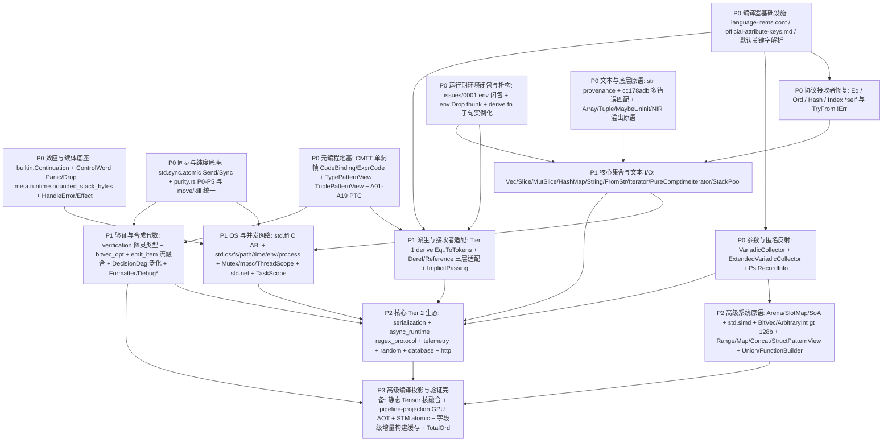

# Flurry / Luna 全量愿望单总纲、依赖拓扑与交付路线图（Master Index & Roadmap）

> **文档角色**：Wave 3 全局总纲与跨卷综合索引（owner: `@builtin-author`）  
> **综合来源**：全部 10 份经双审验签收敛的域规格愿望单（[`01`](./01-syntax-protocols-and-operators.md) – [`10`](./10-official-protocol-packages-and-boundary.md)，总计 **20,753 行 / 240 项 `WL-XX-NN`**），并与 [`AGENTS.md`](../../AGENTS.md)、[`docs/`](../../docs/README.md)、[`library/language-items.conf`](../../library/language-items.conf)、[`library/README.md`](../../library/README.md)、[`docs/comptime/official-attribute-keys.md`](../../docs/comptime/official-attribute-keys.md)、[`issues/0003`](../../issues/0003-builtin-packages-compiler-blockers.md)、[`issues/0004`](../../issues/0004-macro-system-carbon.md) 及 [`tmp/silver-design/04-compiler-wishlist.md`](../silver-design/04-compiler-wishlist.md) 对齐综合。

---

## 1. 全局规范边界与三层架构总览

### 1.1 十份规格书共同守卫的 Flurry 核心不变量

全库（`01`–`10`）所有设计与编译器开发契约均服从以下不可破坏的语言基线（依据 `AGENTS.md` §1、§3、§5 及现行 `docs/`，**严格排除 `2026-5` 之前历史 `proposal_trace/`、`prompt.fl`、`docs/OLD-2024/` 与非权威教程材料**）：

1. **原生可选与错误模型（严禁 `Option` / `Result` 枚举）**：
   - 可选值仅用语言原生 `?T`（`null`、`pat?`）；可恢复错误仅用原生 `!E T` 与异构错误行 `![E1, E2, ...Rest] T`（`error e`、`pat!`、`error pat`、`expr! { catch pat => ... }`）。
   - 错误类型一律使用 `PascalCaseErr`（如 `AllocErr`、`FormatErr`、`IoErr`），错误枚举变体使用 `PascalCase`（如 `OutOfMemory`、`UnexpectedEof`），普通枚举变体使用 `snake_case`（如 `Order.less`、`SeekFrom.start`）。
2. **统一表面语法与点路径规则**：
   - 全语言统一采用点分隔路径 `a.b.c`（**严禁双冒号路径**）；逻辑运算统一为 `and`/`or`/`not`（**零 `&&`/`||`/`!` 逻辑符号**）；注释统一为 `--` 与 `{- ... -}`；后缀运算统一为 `.ref`、`.*`、`.as(T)`、`.dyn(Trait)`；无 `extern` 关键字（改用 `^attrs.abi(...)`）；无 `While/Loop` 分裂（统一 `while true {`）；`trait`/`struct`/`enum`/`union`/`fn` 类型与约束参数一律写入 `where` 子句（仅 `normal_form_head_def`/`newtype`/`typealias`、`impl Target<...>` 及 `assoc id<parameter*>` 声明允许名称后 `<...>`），trait 约束用 `:-`，关联项含 `impl` 体均显式写 `: Type`；多行 `where`/`requires` 左 `{` 另起对齐一行；词法层面 `+ - * / % < >` 两侧必须留白（以消歧泛型 `<...>`，参见 `docs/basics/lexical.md:50`），`<= >= == !=` 按规范排版两侧留白；`}` 结尾块不加 `;`；返回 `Type` 的函数用 `PascalCase`。
3. **运行时依赖类型 `allocator` 范式**：
   - 所有堆分配数据结构（`Box`、`Rc`、`Arc`、`Vec`、`VecDeque`、`String`、`HashMap`、`HashSet`、`BTree*`、`Arena`、`TaskScope`、异步通道、`ToSocketAddrs` 等）及依赖容器的反序列化/派生逻辑，一律采用 `where ..., .A: Type = DefaultAllocator, requires A :- Allocator, quote .allocator: lift *A = DefaultAllocator.GLOBAL.ref` 模式：使用默认全局分配器时不增加容器本体任何额外存储开销，使用局部/自定义分配器时通过运行时环境交付计划传递并在 `Drop` 上同步释放，**严禁硬编码全局 `SystemAllocator`**。
4. **双阶段协议对称性与无指针 Comptime**：
   - 同一类型在 Runtime 与 Comptime 需要同名方法时，分置普通 `trait` 与 `pure comptime trait Comptime*`（**使用完全相同的方法名，禁止 `comptime_` 前缀或 `_comptime` 后缀**）；Comptime 方法统一采用 **`self` 值引用语义（严禁 `*self`、`.ref`、`.*`、`*List<T>`）**。
   - **Normal-Form 不展开与无特判原则**：`Tuple<...Es>`、`meta.List<Type>`、`StaticTensor` 等均走通用 `pure comptime fn` 与 NF 身份规则，不为具体库定义设置特判规则；已有完整参数列表时优先写 `Tuple<.Es = Es>`。
5. **CMTT 单洞规则与集中原语隔离**：
   - 一阶两阶段上下文引用 `< Ψ |- T >` / `< T -| Ψ >` 严格遵守**单洞（single-hole）**规则，复杂模式/语句组装统一经 `meta.code`/`meta.patterns` 的 `CodeBinding`、`ExprCode`、`code_match`/`code_sequence`/`apply_*_dependent` 完成。
   - `.symbol'builtin` 与 `.symbol'intrinsic` 仅允许出现在六个内置包的集中绑定层（如 `builtin/primitives.fl`、`builtin/bindings.fl`、`meta/bindings.fl`、`builtin/numeric/math_intrinsics.fl`）；六个内置包为编译器内置类型编写固有/trait `impl` 时享有孤儿规则豁免，外部用户与 Tier 2/3 包严格受包本地归属约束。
6. **官方属性隔离、`Once` 单一全称与错误/效应正交**：
   - 影响编译器检查/布局/ABI/宏/管线的官方属性一律通过 `^attrs.*` 构造并产出 `__flurry_*` 键（禁止裸键或 `.id expr`）；Tier 2/3 领域元数据**严禁使用 `__flurry_*` 前缀**。
   - 仅保留唯一全称 `impl Once for T where T {}`；严禁按标量/枚举重复编写 `impl Once`。
   - 错误 ABI（`!E T` 结果槽）与代数效应 ABI（`#Eff T` 控制字 `{ T, ptr }` + 栈捕获/直传）严格正交分离，**函数签名严禁出现 `handles`**。
   - **PTC 与 `verification` 严格隔离**：`Type.predicates.*` 仅处理类型与阶段/形状/行命题；程序状态、堆内存读写权限、别名不重叠与资源计数归 `verification`，严禁污染 PTC。
7. **单一 `luna` CLI 架构**：
   - 取消独立 `anar` 计划，包清单、依赖、目标、构建 DAG 任务、缓存失效与产物交付统一集成于 `luna` 单一二进制 CLI（`build` 负责源码归属构建接口）。

---

### 1.2 三层包生态架构与六内置包反膨胀黑名单

全仓库遵循单向有向无环依赖：**Tier 3（生态实现包） -> Tier 2（官方薄协议包） -> Tier 1（六个内置包）**：

| 层级 | 包集合与依赖序 | 准入职责（仅保留必要基线） | 严格反膨胀排除黑名单（绝对禁止放入 Tier 1） |
|---|---|---|---|
| **Tier 1：六个内置包** | 严格且仅限 6 个包（`L39` 依 `调用方 -> 依赖方` 记为 `Tier 2 -> Tier 1`）；除 `std` 外 5 包各自默认导入 prelude 并按声明身份去重（`frontend.rs:665-674`、`builtin-packages.md:39`），其中 **`builtin` 处于最底层零反向依赖**（严禁反向依赖 `meta`/`std`），`attrs` 依赖 `builtin` + `meta.Object`，`meta` 引用 `attrs.macros`，`build` 依赖 `builtin` + `meta.Object`，`std`/`verification` 消费底层核心包 | 1. **`builtin`**：集中原语绑定、`bool`/定长整数/浮点/`char`/`str`/`Symbol`/`void`/`NoReturn`/`*T`/`&r T`/`BitVec`/`Uint`/`Int`/`Tuple`/`Array` 完整原语与 `?T`/`!E T`/`![...]` 组合子、`builtin.math`（LLVM intrinsic + 常量，非第 7 包）、`Once`/`Clone`/`Copy`/`Drop`、运算符/转换/模式视图协议、`Iterator`/`emit_item`、`fmt`（`ByteWriter`/`Display`/`Debug`）、`text`（仅 UTF-8 与 `FromStr`）、`mem`、`Continuation`/`HandleError`/`HandleEffect`。 2. **`meta`**：`Type` 布局/`type_id`/PTC A01-A19、`meta.reflection`、`meta.definitions`、`meta.data`（`List`/`Map`/`Set`/`Object`/`PureComptime*`）、`meta.math`、`meta.code`（CMTT/`TuplePatternView`）、`meta.ast`/`meta.macros`、`meta.compilation`/`diagnostics`/`runtime`（`bounded_stack_bytes`）。 3. **`attrs`**：全部官方 `^attrs.*`（`__flurry_*`）包装层。 4. **`build`**：面向 `luna` 的源码归属构建上下文（`info`/`package`/`targets`/`tasks`/`generated`/`util`）。 5. **`std`**：`std.mem` 分配器生态与智能指针、`std.collections` 核心拥有型容器、`std.string` (`String`)、`std.fmt`、`std.io`/`path`/`fs`/`time`/`env`/`process`、`std.ffi`/`os`/`simd`、`std.runtime`（栈池/`TaskScope`/`CancelToken`）、`std.sync`/`stm`、`std.net`（原始 L3/L4 socket）。 6. **`verification`**：幽灵/分离逻辑规格类型、纯度 `P0`–`P5` 契约与证明验证协议。 | **以下内容一律禁止进入任何内置包（含 `builtin` 与 `std`）**： - **正则表达式**：`regex`、NFA/DFA 状态机、`RegexMatcher`（`regex` 严禁进入 `std` 或 `builtin`！）； - **序列化与数据格式**：`Serialize`/`Deserialize`、JSON/CBOR/TOML/YAML/XML/Protobuf 读写器； - **应用网络与安全传输**：HTTP/1.1/2/3、gRPC、WebSocket、TLS/SSL、QUIC、URI/URL 完整客户端/服务器； - **数据库**：SQL 方言、ORM、连接池、迁移工具； - **密码学与哈希摘要**：SHA/BLAKE3/AES-GCM/ChaCha20/Ed25519/AEAD/HMAC/KDF/Zeroize 协议； - **随机数引擎**：PRNG/CSPRNG 算法与分布采样（`std.os` 仅提供原始 OS `getrandom` 调用）； - **历法、时区与格式化**：公历/农历、IANA `tzdata`、RFC3339 解析（`std.time` 仅限 `Instant`/`SystemTime`/`Duration`）； - **压缩与遗留编码**：gzip/zstd/deflate/brotli，GBK/Shift-JIS/UTF-16 通用转码、Base64/Hex； - **多媒体与色彩空间**：PNG/JPEG/WAV/Opus、sRGB/OKLCH 矩阵； - **ML/张量运行时后端与通用代数**：动态多维 `Tensor` 运行时库、autograd 磁带、CUDA/cuBLAS/Vulkan 内核调度； - **具体遥测导出器、具体异步执行器、CLI/配置文件、数据校验/Schema、Fuzz/属性测试、以及通用效果组合库（除核心控制与 `async`/`Cancel` 外）**。 |
| **Tier 2：官方薄协议包** | 独立于 6 内置包之外的 **17 组官方标准薄协议包**（见 [`10`](./10-official-protocol-packages-and-boundary.md)）：`serialization`、`telemetry`、`crypto` + `digest`、`random`、`async_runtime`、`http` + `wire`、`database`、`compression` + `encoding`、`validation` + `schema`、`cli` + `config`、`datetime`、`media` + `color`、`numerics` + `tensor_protocol`、`testing`、`ffi_bridge` + `plugin_abi`、`regex_protocol` + `parser_protocol`、`collections_ext`（及拟议 `effects_ext`） | 仅定义参数化 `trait`（`where format: Symbol`）、`PureComptime*` 同名对偶、薄 `effect`/`effect enum`（`Log`/`system_clock`/`random_bytes`）、统一 `*Err` 枚举与无 `__flurry_*` 前缀领域元数据属性。 | 禁止内置具体解析器、加密算法、`io_uring`/`epoll` 循环、`tzdata` 或隐式全局分配。 |
| **Tier 3：生态实现与派生器包** | `json_lib`、`cbor_lib`、`regex_dfa`、`postgres`、`blake3`、`io_uring_rt`、`silver`、`cuda`、`cuda_compile`、`otel_exporter`、`tzdata_iana` 等 | 实现 Tier 2 协议、导出具名 `derive fn`（如 `derive Serialize<.json>.use(json_lib.without_allocation) for Data;`）、提供 `.as(View)` `newtype` 适配器与具体效应处理器 `.use(...)`。 | 无六包孤儿豁免；严禁使用 `.symbol'builtin` 或 `__flurry_*` 内部键。 |

---

## 2. 分册导航与全量覆盖统计表（`01`–`10`）

全部 10 份规格愿望单均已通过 `@spec-verifier` 或 `@sys-verifier` 终审签认，**全集共 20,753 行、240 项标准化 `WL-XX-NN` 交付条目标识**：

| 序号 | 文件链接 | 行数 | `WL-XX-NN` 范围与条目数 | 主责归属包 / 层级 | 核心交付与设计支柱 | 跨卷下游依赖方 |
|---|---|---|---|---|---|---|
| **01** | [01-syntax-protocols-and-operators.md](./01-syntax-protocols-and-operators.md) | 1,850 | `WL-01-01` .. `WL-01-33` (**33 项**) | `builtin` / `meta` / `std.hash` / `luna` | 二元/一元算术与 `*Assign`、`BitAnd..Shr` 纠偏、`Concat` (`++`)、6 类 `Range` + `RangeBounds`、借用版 `Eq`/`Ord`/`TotalOrd`、`Hash`/`Hasher`/`BuildHasher`（`std.hash.RandomState`）、`Index`/`IndexMut`/`SpaceApply` + `[...args]` 语法、`Deref`/`DerefMut`/`Reference`、`LiteralInto`、迁移 `!Err T` 的 `TryFrom`/`TryInto`、`Splice`、`\|>`/`==>`/`and`/`or`/`not`、双阶段协议基线 | `02`, `03`, `04`, `07`, `10` |
| **02** | [02-pattern-matching-and-views.md](./02-pattern-matching-and-views.md) | 2,039 | `WL-02-01` .. `WL-02-26` (**26 项**) | `builtin` / `meta` / `std` / `luna` | `List`/`EndlessList`/`Map`/`Range`/`Concat`/`StructPatternView` 全套双阶段对偶、`meta.patterns` CMTT 对象（`CodeBinding`/`ExprCode`/`MatchPreparation`/`code_sequence`/`code_match`）与驱动型 `TuplePatternView`、`TypePatternView` 与依赖 NF 值模式、`case` 视图与函数级开放 `fn foo(case ...)`、quoted arms（`use template`）、`BitVec` 位模式增强、以及 **10 现有 + 5 候选 Take View（`expr'id`）注册裁定** | `03`, `05`, `06`, `09`, `10` |
| **03** | [03-parameter-elaboration-and-derivation.md](./03-parameter-elaboration-and-derivation.md) | 913 | `WL-03-01` .. `WL-03-24` (**24 项**) | `builtin` / `meta` / `attrs` / `luna` | `VariadicCollector` & `ExtendedVariadicCollector`（Silver `P0-1`）及双阶段对偶、匿名记录 `Ps` 字段反射与拼写诊断（Silver `P0-2`）、`ImplicitPassing` 与 6 大内置隐式源、`Extension` 与 `coherence.md` 调和、Tier 1 核心 `derive` 策略目录（`Eq`..`ToTokens`）与 Tier 2 `Serialize<.json>.use(...)` 机制支撑、`attrs.derivation.default` 冲突解决、`post do`/`tactic lambda`（`_0`）、三层接收者适配与调用准备计划 | `01`, `06`, `07`, `09`, `10` |
| **04** | [04-builtin-types-math-iterators-fmt.md](./04-builtin-types-math-iterators-fmt.md) | 2,752 | `WL-04-01` .. `WL-04-28` (**28 项**) | `builtin` / `meta` / `luna` | 全部原语完整固有方法集（`bool`/12 种定长整数/4 种浮点/`char`/`str`/`Symbol`/`void`/`NoReturn`/`*T`/`&r T`/`BitVec`/`Int<W>`/`Uint<W>`/`Tuple`/`Array`/`Slice`）、原生 `?T`/`!E T`/`![...]` 完整组合子、`builtin.math` & `meta.math`（LLVM/libm intrinsic 家族 + SIMD + 22 数学常量）、`builtin.iterator`（push vs pull 架构界定、21 适配器 + 26 消费者 + 8 生成器）与 `meta.PureComptimeIterator`、`builtin.fmt`（清理 `comptime_fmt`、`Formatter`/`Debug*`）& `builtin.text`（UTF-8/`FromStr`，排斥 regex）、`Once` 单一全称与 `builtin.mem`（`Layout`/`Align`/`NonNull`/`MaybeUninit`/`ManuallyDrop`/`TypeMarker`/volatile/`transmute`/`MemoryView`） | `01`, `02`, `03`, `07`, `08`, `09` |
| **05** | [05-meta-cmtt-macros-reflection.md](./05-meta-cmtt-macros-reflection.md) | 2,894 | `WL-05-01` .. `WL-05-32` (**32 项**) | `meta` / `attrs` / `luna` | `Type.*` 布局/`type_id`（128-bit Merkle）、14 组 `Type.predicates.*` + PTC 原子 A01–A19 + `Type.vars.*` 全 5 槽、`meta.reflection`（含匿名记录 `Ps` `RecordInfo` 与 6 种 enum 变体）、事务型 `meta.definitions`（`!BuildErr`）、`meta.data` 无指针 `self` 值引用容器与文档纠偏、CMTT `< Ψ \|- T >` / `< T -\| Ψ >` 全集与 `Any` 证据、结构化 `meta.ast` (`ToTokens`/`Parse`) + 4 类构造宏 + `define` 模板宏 + 9 项内置宏、`meta.diagnostics` & `meta.compilation` & `meta.runtime.bounded_stack_bytes`（Silver `P0-3`）+ `invoke` | `02`, `03`, `06`, `07`, `08`, `09`, `10` |
| **06** | [06-attrs-build-pipeline-projection.md](./06-attrs-build-pipeline-projection.md) | 1,122 | `WL-06-01` .. `WL-06-21` (**21 项**) | `attrs` / `build` / `builtin` / `luna` | 统一全库 **25+ 官方 `__flurry_*` 属性键总表**与 `library/attrs/` 模块化构造（淘汰裸 `packed` 与裸配置）、`library/build` 全 6 子目录（`info`/`package`/`targets`/`tasks`/`generated`/`util`）服务 `luna` 单二进制 DAG 调度与增量失效缓存（零独立 `anar`）、完整 `pipeline-projection` 栈（`PipelineProtocol`/`KernelInterface`/`LaunchConfig`/`DeviceCopy`/`DeviceBuffer`/`SharedMem`、`^attrs.compilation.intrinsic_enum`、`expr'intrinsic(...).as(T)`、受检内联汇编与 `IIR` 宿主投影闭环） | `02`, `03`, `05`, `07`, `08`, `09`, `10` |
| **07** | [07-std-mem-collections-io-os.md](./07-std-mem-collections-io-os.md) | 2,464 | `WL-07-01` .. `WL-07-20` (**20 项**) | `std` / `attrs` / `luna` | 运行时依赖分配器 `std.mem` 生态（6 新分配器、`Box`/`Rc`/`RcWeak`/`Arc`/`ArcWeak`/`Cow`/`Unique` 与 `builtin.mem` 重导出对齐）、`std.collections`（`Vec`/`VecDeque`/`HashMap` `.H`+`Entry`/`HashSet`/`BTree*`/`BinaryHeap`/`BitSet`/`MutSlice` 及 `SmallVec`/`RingBuffer`/`Arena`/`SlotMap`/`SoA` Silver Layer 4 边界审计）、`std.string` (`FromUtf8Err`/`as_str`)、`std.fmt`、`std.io` (`BufRead`/`Seek`/`LineWriter`/`Cursor`/`IoErrKind`)、`std.path`/`fs`/`time`/`env`/`process`（`panic` 展开与调用位置阻塞）、`std.ffi`（无 `extern` C ABI）、`std.os` 多平台与 `std.simd`（`Simd`/`Mask`） | `01`, `03`, `04`, `06`, `08`, `10` |
| **08** | [08-effects-async-concurrency-net-runtime.md](./08-effects-async-concurrency-net-runtime.md) | 2,375 | `WL-08-01` .. `WL-08-18` (**18 项**) | `builtin` / `attrs` / `std` / `luna` | `builtin.effects`（`HandleError`/`DirectEffectHandler`/`ResumptiveEffectHandler`/`HandleEffect`，函数签名严禁 `handles`）、错误 `{ err }` 与效应控制字 `{ T, ptr }` 正交分离 + `Panic`/`Abort` C 帧屏障、无类型参数 `builtin.Continuation` + `std.runtime.{TypedContinuation, StackPool, BoundedStackPool, GuardedStackPool}`（Silver `P0-3`/`P1-1`）、`Future`/`JoinHandle`/`TaskScope`/`CancelToken` 与 Tier 2 `async_runtime` 桥接（剔除 `io_uring`/领域效应出 Tier 1）、`std.sync`（`Send`/`Sync`/`Atomic*`/`Mutex`/`RwLock`/`Condvar`/`OnceLock`/`LazyLock`/`Barrier`/`Semaphore`、`mpsc`/`mpmc`/`oneshot`/`broadcast` 通道、`Thread`/`ThreadScope`）、`std.sync.stm`（BTO STM + `OrderedLock`）、`std.net` 原始 L3/L4 同步/非阻塞 socket（禁止 HTTP/TLS 入 `std`） | `04`, `06`, `07`, `10` |
| **09** | [09-verification-synthesis-and-tensors.md](./09-verification-synthesis-and-tensors.md) | 1,323 | `WL-09-01` .. `WL-09-16` (**16 项**) | `verification` / `attrs` / `luna` | `verification` 包全套幽灵与分离逻辑类型（`SpecInt`..`MemRegion`/`MemoryEffect`）、`predicate`/`lemma`/`axiom`/`decreases`/`'old`/`'snapshot`、严格守卫 PTC 与 `verification` 正交分离、`safe`（三次多项式与 checker）/`verified`/`unsafe`、运行时纯度 `P0`–`P5`（补齐 `P0..P5` 导出与 `static` 检测）与统一 `move` vs `kill` 语义、以及四大程序合成代数：`BitVec` `bitvec_opt` + `^attrs.packed.bit`、静态形状阶多态 `Tensor` 原型（排斥 CUDA/BLAS 进内置包）、`#emit_item`/CMTT 流组合子融合、以及 `DecisionDag` 通用自动机 + CMTT DFA 正则合成示例（严格外置 `regex` 到 Tier 2/3） | `02`, `03`, `04`, `05`, `06`, `10` |
| **10** | [10-official-protocol-packages-and-boundary.md](./10-official-protocol-packages-and-boundary.md) | 3,021 | `WL-10-01` .. `WL-10-22` (**22 项**) | Tier 2（独立于 6 内置包）+ `luna` | 正式三层架构与 `01`–`09` 防膨胀越界总审计、编译器外源派生/非 `__flurry_*` 领域属性/参数化 `trait` (`where format: Symbol`) 支撑；全部 **17 组 Tier 2 官方薄协议包**完整 Flurry 规格（`serialization`、`telemetry`、`crypto`+`digest`、`random`、`async_runtime`、`http`+`wire`、`database`、`compression`+`encoding`、`validation`+`schema`、`cli`+`config`、`datetime`、`media`+`color`、`numerics`+`tensor_protocol`、`testing`、`ffi_bridge`+`plugin_abi`、`regex_protocol`+`parser_protocol`、`collections_ext`）与全栈三层示例 | `03`, `06`, `07`, `08`, `09` |
| **合计** | **全集 `01`–`10` + `00`** | **20,753**（不含 `00`） | **240 项 `WL-XX-NN`** | **3 层全栈覆盖** | **从词法/原语/协议到并发/验证/生态的完整 Flurry 交付蓝图** | — |

---

## 3. 跨包/跨模块归属矩阵（Ownership Matrix）

下表将全集 240 项 `WL-XX-NN` 精确映射到 **编译器 (`luna`)**、**6 个 Tier 1 内置包 (`builtin` / `meta` / `attrs` / `build` / `std` / `verification`)** 与 **Tier 2/3 生态层**，明确每一子系统的唯一权威源码归属与禁止越界关系：

| 专题分册 | `luna`（编译器各 Pass / NIR / LLVM / CLI） | `builtin`（Tier 1 底座） | `meta`（Tier 1 元编程） | `attrs`（Tier 1 官方键） | `build`（Tier 1 构建） | `std`（Tier 1 系统与容器） | `verification`（Tier 1 验证） | Tier 2 / Tier 3（六包之外） |
|---|---|---|---|---|---|---|---|---|
| **01 语法协议与运算符** | `WL-01-01..04`, `06..09`, `11..13`, `18..25`, `28..33` (`parse`, `ast_lowering`, `operators.rs`, `places.rs`, `literal_conversion.rs`, `SysrootBindings`) | `WL-01-01`, `03`, `05..07`, `09..12`, `14..15`, `18`, `21..24`, `26..28`, `31..32` (`builtin.{ops,range,cmp,hash,convert,staging}`) | `WL-01-02`, `04`, `08..11`, `13..14`, `17`, `19`, `25`, `27`, `32` (`meta.{ops,range,cmp,hash,convert}`) | `WL-01-32` (`comptime_phase` 对齐，由 `06` 承接) | — | `WL-01-07`, `15..16` (`std.hash.{DefaultHasher,RandomState}`, 容器接入) | `WL-01-30` (`==>` 逻辑原子交互) | 示例展示 `Tensor` 应用 `SpaceApply`（`WL-01-20`） |
| **02 模式匹配与取像** | `WL-02-01..14`, `16..26` (`pattern_checking`, `pattern_automata`, `views.rs`, `cases.rs`, `open_functions`) | `WL-02-01`, `03`, `05`, `08`, `10`, `12`, `16`, `22` (`builtin.protocols.patterns`) | `WL-02-02..03`, `06`, `09`, `11`, `13..14`, `16`, `18`, `21` (`meta.{data.patterns,patterns}`) | `WL-02-21..22` (`attrs.quote_fn_template`, `pattern.stable`, `layout.enum_*`) | — | `WL-02-01`, `04`, `07`, `12` (`Slice`/`Vec`/`VecDeque`/`HashMap`/`String` 视图) | `WL-02-23`, `26` (`'old` 规则，`'snapshot` 归 `09`) | `WL-02-15`（Tier 2/3 `user_regex` / `RegexMatcher` 消费示范，**非内置**） |
| **03 参数调整与派生** | `WL-03-01..24` (`spreads.rs`, `extended.rs`, `open_functions.rs`, `derivation.rs`, `tactics.rs`, `input_routing.rs`, `receiver_adaptation`) | `WL-03-01`, `03`, `05`, `08..09`, `15..17`, `24` (`VariadicCollector`, `Extended*`, `ImplicitPassing`, `Context`, `CallDescription`, `field_ptr`) | `WL-03-02`, `04..06`, `09`, `15..17`, `24` (`Comptime*Collector`, 匿名记录 `Ps` 反射, `SourceSpan` `__src__`, `ToTokens`) | `WL-03-13` (`attrs.derivation.default` + `default` 关键字放行) | — | `WL-03-05`, `15..16`, `18` (`Vec` collector 与 allocator 透传派生) | — | `WL-03-05` (`ComponentChildrenList`/`PropertySet`), `WL-03-18` (`Serialize<.json>.use(...)`) |
| **04 `builtin` 与 `meta.math`** | `WL-04-02`, `05`, `07`, `09..11`, `14..16`, `18`, `24`, `26..28` (`nir/intrinsics.rs`, `ArbitrarySizedInteger` >128b, `str` provenance, `cc178adb`, env `Drop`) | `WL-04-01..28` 主体（全部原语方法、`?T`/`!E T`/`![...]`、`Tuple`/`Array`、`builtin.math`/`iterator`/`fmt`/`text`/`resources`/`mem`） | `WL-04-01`, `04..05`, `10`, `13..15`, `17`, `20..23` (`meta.math`, `ComptimeOptional/Error/Text/Display/Debug/FromStr`, `PureComptimeIterator`) | `WL-04-21`, `27` (`^attrs.abi`, `^attrs.mem.volatile`) | `WL-04-16` (`build.target.features` 对 SIMD) | `WL-04-12`, `21`, `26` (`Slice`、`FormatErr`、`Layout` 归属联动与重导出) | `WL-04-25`, `27` (`MemoryView` 区域分离、Pin-free 边界联动) | 明确排除正则与非 UTF-8 编码 |
| **05 `meta`、CMTT 与宏** | `WL-05-01..32` (`projections.rs`, `ptc`, `nir/type_id`, `cmtt`, `macro_expander`, `iir/staging.rs`, `bounded_stack_bytes`) | `WL-05-01`, `05..07`（底层类型原语集中绑定） | `WL-05-01..32` 主体（`Type.*`、PTC 14 组 + A01-A19、`meta.reflection` 含 `Ps`、`meta.definitions`、`meta.data`、`meta.code`、`meta.ast`、`meta.macros`、`meta.compilation`/`diagnostics`/`runtime`） | `WL-05-04`, `16`, `25`, `27`, `29` (`__flurry_*` 对齐登记) | `WL-05-29` (`cfg` 与只读 target 依赖) | `WL-05-20`, `22`（严格区分 `String` vs `ComptimeTextBytes`） | `WL-05-10`（严格禁止状态命题进 PTC） | 支撑 Tier 2/3 宏/Schema/正则编译器生成（不包含具体库） |
| **06 `attrs`、`build` 与投影** | `WL-06-01..21` (`attributes.rs`, `nir`, `iir`, `llvm`, `luna` CLI 构建图/缓存/沙盒) | `WL-06-16`, `18..19`（`PipelineProtocol`/`LaunchConfig`、宿主 `target.Scalar`/intrinsic 语法） | `WL-06-10`, `16`, `18`, `20..21` (`IIR` 只读访问、`meta.compilation.err`、`meta.runtime.invoke`) | `WL-06-01..09` 主体（全量 `__flurry_*` 封装与清理） | `WL-06-10..15` 主体（全 6 子目录与单二进制 `luna` 任务） | `WL-06-17`, `19..20` (`std.simd`/`std.ffi`/`std.asm` 对接) | `WL-06-20` (`read`/`write` 内存契约归属验证层) | `WL-06-17`, `19`, `21`（Tier 2 `tensor_protocol` 与 Tier 3 `cuda`/`vulkan`） |
| **07 `std` 核心运行时** | `WL-07-03..06`, `08..11`, `16..20` (`issues/0001` env 传递、`issues/0003` provenance、`union` 免 Drop、`attrs.abi` C 聚合/外部声明) | `WL-07-04`, `09`, `11`, `17..18` (`builtin.mem`/`fmt`/`Slice`/`LiteralInto<.cstr>` 底盘协同) | `WL-07-08`, `11`, `17` (`reflect_struct` 驱动 `SoA`、`ComptimeDebug`、`SourceSpan`) | `WL-07-08`, `17..18`, `20` (`align`, `ffi.link*`, `caller_location`) | `WL-07-16`, `19` (`build.target` 驱动 `std.env.consts` 与 OS 条件) | `WL-07-01..20` 主体（`mem`/`collections`/`string`/`fmt`/`io`/`path`/`fs`/`time`/`env`/`process`/`ffi`/`os`/`simd`） | `WL-07-04`, `09` (`MutSlice` 独占/分离证明与 `needs_drop`) | `WL-07-08` 划界审计（`SoA`/`SlotMap`/`SmallVec`/`RingBuffer` 边界归属 `collections_ext`） |
| **08 效应、异步、同步与网络** | `WL-08-01..08`, `11`, `15` (`Handle*` elaboration、`effect` 控制字 `{ T, ptr }`、栈捕获/C 帧 trap、`atomic` STM 块、`Atomic*` LLVM 降码) | `WL-08-01`, `03..05` (`builtin.effects.{HandleError,HandleEffect}`、`builtin.Continuation`、`builtin.panic`) | `WL-08-07` (`meta.runtime.bounded_stack_bytes`) | `WL-08-02` (`effects.direct_passing`, `effects.stack_strategy`, `caller_location`) | — | `WL-08-06..18` 主体（`std.runtime`、`std.sync`、`std.sync.stm`、`std.net`） | `WL-08-01`, `03`, `15` (`HandleError`/C 帧/`TVar` 无外泄约束) | `WL-08-09`, `10`, `18`（外置 `async_runtime`/`telemetry`/`random`/`datetime`/`http`/`wire` 与拟议 `effects_ext`） |
| **09 验证、纯度与合成代数** | `WL-09-01..09`, `13..16` (`program_verification`、`purity.rs` P0–P5、`moves`/`drop`、`bitvec_opt`、`pattern_automata`) | `WL-09-08`, `13` (`BitVec`、`Iterator`/`emit_item`) | `WL-09-10..12`, `14`, `16` (`meta.code`/`meta.patterns` CMTT、`meta.compilation.IIR`) | `WL-09-06`, `09`, `12` (`attrs.purity.*`, `attrs.verification.*`, `packed.bit`, `pipeline`) | — | `WL-09-07`, `13` (`Vec`/`String` `move` vs `kill` 区域证明) | `WL-09-01..07` 主体（全套幽灵类型、契约、`safe`/`verified` 与纯度分级） | `WL-09-10..12`, `16`（静态 `Tensor` 与 DFA 合成严守 Tier 2/3 桥梁，**零内置 `regex`/`cuda`**） |
| **10 Tier 2 官方薄协议包** | `WL-10-01..05`（参数化 `trait`、`.use(...)` 派生、非 `__flurry_*` 属性合并、`quote .allocator` 透传、同名 `Comptime*` 相位选择） | 消费 `ByteWriter`/`Array`/`Iterator`/`Continue`/`TuplePatternView` | 消费 `meta.reflection`/`meta.code`/CMTT | 消费非 `__flurry_*` 规则（禁止 Tier 2 用 `__flurry_*`） | 由 `luna` 包管理与依赖图分发 | 消费 `std.mem.Allocator`/`std.io`/`std.runtime.StackPool`/`std.time`/`std.env` | 可选消费合同接口（如 `ConstantTimeEq`） | `WL-10-06..22` 主体（**全部 17 组 Tier 2 官方薄协议包**与 Tier 3 实现示例） |

---

## 4. 核心依赖拓扑图与四阶段排期路线图（P0–P3）

### 4.1 关键阻塞依赖拓扑图

---

### 4.2 编译器前置阻塞与跨源追踪台账（整合 Silver / `issues` / `library/README`）

| 阻塞编号 / 来源 | 阻塞现象与定位 | 关联愿望单条目 | 解锁后的直接收益 | 目标 Phase |
|---|---|---|---|---|
| **Silver `P0-1`** (`tmp/silver-design/04`) | `VariadicCollector` 与 `ExtendedVariadicCollector` 未接入 `spreads.rs` / `extended.rs` | `WL-01-20`, `WL-03-01..05`, `WL-06-16` | 解锁类型安全的 `vbox(...)` / `{ prop: val }` UI DSL、多维 `SpaceApply` 与 `Slice`/`Array`/`Vec` 变参收集 | **P0（底座）/ P1（扩展与投影）** |
| **Silver `P0-2`** (`tmp/silver-design/04`) | 匿名记录 `Ps` (`Term.Record`) 无字段反射、缺 `has_field` / `FieldType` 与 occurrence narrowing | `WL-03-06`, `WL-05-07`, `WL-05-13` | 解锁零分配编译期属性校验与精确拼写定位 `SourceSpan` 诊断 | **P0** |
| **Silver `P0-3` / `P1-1`** (`tmp/silver-design/04`) | 缺 `meta.runtime.bounded_stack_bytes`、无 `builtin.Continuation` 捕获后端与 `BoundedStackPool` | `WL-05-31`, `WL-06-04`, `WL-08-05..07` | 解锁 Silver 帧栈内嵌小栈协程与零守卫页高效调度 | **P0–P1** |
| **Silver `P1-4` / `P1-5`** (`tmp/silver-design/04`) | 缺 `^attrs.layout.align`（`__flurry_align`）、`StructBuilder`/`ImplBuilder` 环境透传与便携 `Simd<T, N>` | `WL-05-02/19`, `WL-06-02`, `WL-07-08/20` | 解锁 Layer 4 零额外分配开销 `SoA<T>` / `Arena<T>` + `NodeIndex` 与向量加速 | **P0（`align` 底座）/ P1–P2（`Builder`/`SoA`/`Simd`）** |
| **`issues/0003` — Provenance & `cc178adb`** | `str` backing provenance（`native-text-method-provenance.fl`）未传递；多错误行 struct matching 未收口 | `WL-04-05`, `WL-04-14`, `WL-07-10` | 解锁安全零拷贝 `str.slice`、`String.as_str`、`FromUtf8`、`![E1, E2] T` 组合子与泛型实现 | **P0（Provenance/多错误行）/ P1（`WL-04-05` 文本全集）** |
| **`issues/0001` & Env `Drop`** | 泛型方法/闭包捕获外部 `quote .allocator` 报错；部分移动或早退对 runtime-dep 实例缺 env `Drop` thunk | `WL-03-18`, `WL-04-24`, `WL-07-03/05/06`, `WL-10-04` | 解锁 `Box.with_ref`、`Vec.retain`、`Slice.sort_by` 及外源 `Serialize` 零泄露容器派生 | **P0（闭包/Env `Drop` 修复）/ P1（`WL-03-18` 派生）** |
| **`issues/0003` & `issues/0004` — 属性与宏通道** | `attributes.rs` 未放行顶层 `__flurry_macro_*`；`derive fn` 拒绝参数/子句（`derivation.rs`）；`default`/`inline` 关键字阻塞导出；`__flurry_packed_mode` 未接通 | `WL-03-12..13`, `WL-05-16/25/27`, `WL-06-01/06/07` | 解锁 4 类官方构造宏、带 `.A` 的 `derive Eq/Hash` 与完整布局属性 | **P0（属性/宏阻塞清理）/ P1（`WL-06-06` 默认导出）** |
| **`library/README.md:393-397`** | `panic` 缺终止与清理契约、`formatting` `Any`、I/O `__builtin_*` 与 `map-storage` 缺口导致 full-sysroot smoke 失败 | `WL-04-28`, `WL-07-12/17/19`, `WL-08-03` | 打通完整 `--sysroot library` 编译冒烟校验，清除过时 `__builtin_*` 阻塞 | **P0–P1** |
| **Frontend Parser & Typing Bugs** (`01`, `05`, `09`) | `\|>` 错设为优先级 `80`；`==>` 左结合误解析；`iir/staging.rs:3173` staged closure 常量缺口；`purity.rs` 仅实现 P3/P4；PTC A01–A19 仅 4 项 | `WL-01-29..30`, `WL-05-10/25`, `WL-09-06` | 修复核心操作符文法、解锁全量 PTC 推理与 LLVM `P0`–`P5` 纯度属性发射 | **P0–P1** |

---

### 4.3 四阶段交付路线图（Phase 0 – Phase 3）

| 阶段 | 核心覆盖范围（跨 `01`–`10` 全部 `WL` 归并） | 阶段核心目标与端到端验收门禁 |
|---|---|---|
| **Phase 0（P0 — 核心语言修复、基础设施接线与 Silver/Sysroot 阻塞清理）** | `01`: `WL-01-01/03/06/07/09/11/12/15/18/21/23/24/31/32/33` `02`: `WL-02-13/14/18` `03`: `WL-03-01/03/05/06/07/12/13/15/19/20/23/24` `04`: `WL-04-02/03/10/11/13/14/24/26/27/28` `05`: `WL-05-01/05..07/10/11/13/16/20/23/25/27/29/31` `06`: `WL-06-01..03/07/08/10/18` `07`: `WL-07-01/03(部分)/04/05(基础)/06/09/10/11(基础)/12/17(基础)/18` `08`: `WL-08-01..07/10/11` `09`: `WL-09-06/07` `10`: `WL-10-01..06(契约)/10(契约)/21(契约)` | **阶段目标**：消除编译器硬阻塞与已有语义错误，使真实 `--sysroot library` 冒烟测试、带局部 allocator 容器与基础 Silver UI 原语跑通。 **验收门禁**： 1. `Eq`/`Ord`/`Hash`/`Index` 修复 `*self` 并与 `IndexMut`、`AddAssign`、`Concat`、`Range`、6 大集中 `Array`/`Tuple`/`MaybeUninit` 原语全通； 2. `VariadicCollector`/`ExtendedVariadicCollector` + `Ps` `RecordInfo` + `meta.runtime.bounded_stack_bytes` + `^attrs.layout.align`（Silver P0 全套）端到端通过； 3. `str` provenance、`cc178adb` 多错误行、`issues/0001` env 闭包与 env `Drop` thunk 全绿； 4. `builtin.Continuation` + `ControlWord` Panic 展开 + `std.sync.atomic` `Send`/`Sync` + `purity.rs` P0–P5/move-kill 统一落地； 5. 补全 `language-items.conf` 与 `official-attribute-keys.md` P0 条目，`^attrs.macros.*` 顶层放行。 |
| **Phase 1（P1 — 标准库完备化、双阶段对偶、OS/并发/网络与核心 Tier 2 落地）** | `01`: `WL-01-02/04/05/08/10/13/16/17/19/20/22/25/27..30` `02`: `WL-02-02/05/06/08/10/11/16/17/19/21..25` `03`: `WL-03-02/04/08..11/14/16..18/21/22` `04`: `WL-04-01/04/05..09/12/15/16..23` `05`: `WL-05-02..04/08/09/12/14/15/17/19/21/22/24/26/28/30` `06`: `WL-06-04..06/11..13/16/19..21` `07`: `WL-07-02/03(Arc)/05(完善: retain/SmallVec)/07/08/11(Builder)/13..16/17(Command/Child)/19/20` `08`: `WL-08-08/09/12..14/16/17` `09`: `WL-09-01..03/05/08/09/13..15` `10`: `WL-10-06..12/19..21` | **阶段目标**：补齐完整可用性——文本/Unicode/数学全套、双阶段 `PureComptime*`、三层接收者适配、多平台 `std` OS/IO/并发/Socket、`verification` 核心 API，以及首批核心 Tier 2 官方协议栈。 **验收门禁**： 1. `builtin.text`（`FromStr`/UTF-8）、`builtin.iterator` 全适配/消费/生成与 `meta.PureComptimeIterator` 镜像同过； 2. `Deref`/`Reference` 三层适配、`ImplicitPassing`（`__src__` 等 6 源）、`derive Clone/Copy/Debug/Display/ToTokens` 与外部 `.as(View)` `Serialize<.json>.use(json_lib.without_allocation)` 全通； 3. `std.fs`/`path`/`time`/`env`/`process`、`TaskScope`/`CancelToken`、`Mutex`/`RwLock`/`mpsc`/`Thread`、`std.net` 同步 socket 与 Tier 2 `async_runtime`/`http`/`database`/`crypto`/`telemetry`/`random`/`regex_protocol` 跨层互操作测试通过； 4. `luna` 单二进制 DAG `build.{package,targets,tasks}`、IIR `meta.runtime.invoke`、`verification.{spec,memory}` 与 `bitvec_opt` / `#emit_item` 融合通过。 |
| **Phase 2（P2 — 高级特性、完整衍生生态与边界容器收敛）** | `01`: `WL-01-14/26` `02`: `WL-02-01/03/04/07/09/12/15/20` `03`: 高级异步/依赖字段派生完善 `04`: `WL-04-25`（Pin-free 契约深化） `05`: `WL-05-18/32` (`UnionBuilder`, 沙盒 `invoke`) `06`: `WL-06-09/14/15/17` `07`: `WL-07-08` 深化 (`Arena`/`SoA`), `Simd` 完善 `08`: `WL-08-15/18` (`STM`, 非阻塞 socket) `09`: `WL-09-04/10/11/16` `10`: `WL-10-13..18/22` | **阶段目标**：完成高阶语言特性与剩余 Tier 2 官方薄协议家族。 **验收门禁**： 1. `TotalOrd` 浮点包装、`AsRef`/`AsMut`、无限序列 `EndlessList`、`VecDeque`/`HashMap` 模式视图、函数级跨文件 `fn foo(case ...)`、Pin-free 契约落盘； 2. `std.sync.stm` BTO 事务块（`atomic` + `TVar`/`OrderedLock`）与 `build.{generated,util}` 沙盒校验； 3. `DeviceCopy`/`DeviceBuffer`、静态形状 `Tensor` 原型与 Tier 3 `regex_dfa`/`compression`/`validation`/`datetime`/`media`/`collections_ext` 联合验收（含六内置包零膨胀扫描门禁）。 |
| **Phase 3（P3 — 长期演化、核融合投影与极速增量编译）** | `01`: `WL-01-29` (`\|>` 占位符扩展与验证融合观测) `02`: `WL-02-26` (候选 Take View 收口) 与多视图前缀共享 DAG `04`: `MemoryView` 高阶验证桥梁 `06`: `WL-06-10/13` (字段级精准失效缓存)、`WL-06-21` (外部管线 AOT 产物签名与确定性重放深化) `09`: `WL-09-12` (跨多层张量核融合 + GPU `pipeline-projection`) | **阶段目标**：达到工业级编译器增量构建与异构计算后端性能上限。 **验收门禁**： 1. 基于 `InvalidationDep` 的字段级增量缓存精确重编验证； 2. 静态张量表达式核融合通过 `meta.compilation.IIR` 投影至 Tier 2 `tensor_protocol.GpuProjection` 与 Tier 3 `cuda`/`vulkan_rt` AOT 产出； 3. `MemoryView` 分离证明在 `verification` 与 `Slice`/`Array` 并行修改场景全线闭环。 |

---

## 5. 集中登记总表（跨 10 份文档去重汇总）

本章将分册 `01`–`10` 中分散提出的编译器契约、注册表项、内置语法原语与隐式供应源全部去重归并，形成可直接指导 `library/language-items.conf`、`docs/comptime/official-attribute-keys.md`、`compiler/luna` 与 `compiler/elaboration` 落盘的单一集中视图。

### 5.1 `library/language-items.conf` 目标全量注册表

现行 [library/language-items.conf](../../library/language-items.conf)（`version = 1`）已注册 20 余项协议/类型键及底层 `host-intrinsic.*` / `comptime-intrinsic.*` 原语映射。综合 `01`、`02`、`03`、`04`、`08`、`09`，目标全量注册表如下（**所有新增项均须遵循无名称硬编码原则并提供对应 `--*-protocol` / `--*-type` CLI 覆写选择器**）：

| 配置键组（`library/language-items.conf`） | 目标规范绑定路径 | 状态 | 来源与消费说明 |
|---|---|---|---|
| **A. 既有基线键（保留/对齐）** | | | |
| `copy-protocol`, `drop-protocol` | `builtin.protocols.resources.{Copy,Drop}` | 已接线 | `04`（含 runtime-dep 环境 `Drop` thunk 与 blanket `Once` 共存） |
| `splice-protocol` | `builtin.protocols.staging.Splice` | 已接线 | `03`, `05` |
| `meta-list-type`, `tuple-type` | `meta.List`, `builtin.types.tuple.Tuple` | 已接线 | `04`, `05`（通用变参列表与 NF 头绑定，严禁特判） |
| `add-protocol` .. `not-protocol`（7 键） | `builtin.protocols.ops.{Add,Sub,Mul,Div,Rem,Neg,Not}` | 已接线（需修 `*self`） | `01`（`ops.fl` 现存 `*self`/签名缺陷待修） |
| `index-protocol`, `eq-protocol`, `ord-protocol` | `builtin.protocols.ops.Index`, `builtin.numeric.comparison.{Eq,Ord}` | 已接线（需修 `*self`） | `01`（`Index`/`Eq`/`Ord` 待修 `*self` 并与 `IndexMut` 协同） |
| `iterator-protocol`, `into-iterator-protocol` | `builtin.protocols.iterator.{Iterator,IntoIterator}` | 已接线 | `04`（既有两项迭代协议绑定；`iterator-emit-effect` 尚未在 `.conf` 存在，见 Group F） |
| `list-pattern-protocol`, `comptime-list-pattern-protocol`, `stable-list-pattern-protocol` | `builtin.protocols.patterns.{ListPatternView,StableListPatternView}`, `meta.data.patterns.ComptimeListPatternView` | 已接线 | `02` |
| **B. 运算符、字面量、变参收集与解引用（`01`, `03`, `06`）** | | | |
| `literal-into-protocol` | `builtin.protocols.conversion.LiteralInto` | 编译器已有，配置/声明缺失 | `01 WL-01-01`（P0 立即补齐） |
| `add-assign-protocol` .. `rem-assign-protocol`（5 键） | `builtin.protocols.ops.{AddAssign,SubAssign,MulAssign,DivAssign,RemAssign}` | 待新增 | `01` / `OQ-02` |
| `concat-protocol`, `index-mut-protocol`, `space-apply-protocol` | `builtin.protocols.ops.{Concat,IndexMut,SpaceApply}` | 待新增 | `01`（`++`、`a[i] = v`、`f[...]`/`f{...}`） |
| `variadic-collector-protocol`, `extended-variadic-collector-protocol` | `builtin.protocols.ops.{VariadicCollector,ExtendedVariadicCollector}` | 待新增 | `01`, `03`, `06`（`...args` 与 `{ k: v, ... }`，Silver P0 共享基线） |
| `comptime-variadic-collector-protocol`, `comptime-extended-variadic-collector-protocol` | `meta.ops.{ComptimeVariadicCollector,ComptimeExtendedVariadicCollector}` | 待新增 | `03`（编译时位置/属性收集对偶） |
| `deref-protocol`, `deref-mut-protocol`, `reference-protocol` | `builtin.protocols.ops.{Deref,DerefMut,Reference}` | 待新增 | `01`, `03`（三层接收者自动适配器） |
| `range-full-type`, `range-from-type`, `range-to-type`, `range-to-inclusive-type`, `range-type`, `range-inclusive-type` | `builtin.range.{RangeFull,RangeFrom,RangeTo,RangeToInclusive,Range,RangeInclusive}` | 待新增 | `01` |
| `comptime-{add..not}-protocol`（7 键）, `comptime-{add..rem}-assign-protocol`（5 键）, `comptime-concat-protocol`, `comptime-eq-protocol`, `comptime-ord-protocol`, `comptime-index-protocol` | `meta.ops.*`, `meta.numeric.{equality.ComptimeEq,ordering.ComptimeOrd}` | 待新增 | `01`（双阶段同名协议，严禁带 `comptime_` 方法前缀） |
| **C. 全量模式匹配视图协议（`02` §3.9.1）** | | | |
| `comptime-stable-list-pattern-protocol`, `list-pattern-endless-protocol`, `stable-list-pattern-endless-protocol`, `comptime-list-pattern-endless-protocol`, `comptime-stable-list-pattern-endless-protocol` | `builtin.protocols.patterns.*`, `meta.data.patterns.*` | 待新增 | `02`（无限序列视图与 CT 稳定列表） |
| `map-pattern-protocol`, `stable-map-pattern-protocol`, `comptime-map-pattern-protocol`, `comptime-stable-map-pattern-protocol` | `builtin.protocols.patterns.*`, `meta.data.patterns.*` | 待新增 | `02`（Map/KV 结构模式解构） |
| `struct-pattern-protocol`, `stable-struct-pattern-protocol`, `comptime-struct-pattern-protocol`, `comptime-stable-struct-pattern-protocol` | `builtin.protocols.patterns.*`, `meta.data.patterns.*` | 待新增 | `02` |
| `range-end-type`, `range-pattern-protocol`, `stable-range-pattern-protocol`, `comptime-range-pattern-protocol`, `comptime-stable-range-pattern-protocol` | `builtin.protocols.patterns.*`, `meta.data.patterns.*` | 待新增 | `02`（含边界模式解构） |
| `concat-pattern-protocol`, `stable-concat-pattern-protocol`, `comptime-concat-pattern-protocol`, `comptime-stable-concat-pattern-protocol` | `builtin.protocols.patterns.*`, `meta.data.patterns.*` | 待新增 | `02`（前缀 `++` 切片/位向量拆分模式） |
| `tuple-pattern-protocol`, `type-pattern-protocol` | `meta.patterns.{TuplePatternView,TypePatternView}` | 待新增（归属包待定） | `02` / `OQ-16` |
| **D. 隐式传参、派生辅助与编译器内建构造器（`03` §3.6, `04` §3.7）** | | | |
| `implicit-passing-protocol`, `call-context-type`, `call-description-type`, `source-span-type` | `builtin.protocols.implicit.{ImplicitPassing,Context,CallDescription}`, `meta.ast.SourceSpan` | 待新增 | `03`, `05`（六大内置隐式源与结构化诊断跨度） |
| `array-type`, `uninit-storage-type`, `manually-drop-type`, `arbitrary-int-type` | `builtin.primitives.{Array,ArbitrarySizedInteger}`, `builtin.compiler.{UninitStorage,ManuallyDropStorage}` | 待新增（`MaybeUninit` 路径待统一） | `04`（与 `07` `union` 方案对比见 §6.1 #4） |
| `optional-ops-protocol`, `optional-unwrap-protocol`, `error-ops-protocol`, `error-unwrap-protocol`, `error-row-ops-protocol` | `builtin.types.{OptionalOps,OptionalUnwrap,ErrorResultOps,ErrorResultUnwrap,ErrorRowOps}` | 待新增 | `04`（原生 `?T` / `!E T` / 多错误行组合子方法） |
| `from-str-protocol`, `extend-protocol`, `sum-protocol`, `product-protocol` | `builtin.text.FromStr`, `builtin.iterator.{Extend,Sum,Product}` | 待新增 | `04` |
| `pure-comptime-iterator-protocol`, `step-iterator-protocol`, `double-ended-iterator-protocol` | `meta.iterator.PureComptimeIterator`, `builtin.iterator.{StepIterator,DoubleEndedIterator}` | 待新增 | `04` / `OQ-13` |
| 集中绑定辅助原语（`field-ptr-intrinsic`, `tuple-into-array-intrinsic`, `comptime-field-value-intrinsic`, `enum-derive-helpers`） | 仅集中于 `builtin/bindings.fl` & `meta/bindings.fl` | 待新增 | `03`（安全字段投影 `derive fn` 零 `unsafe` 支撑） |
| **`host-intrinsic.*` 与 `comptime-intrinsic.*` 扩展族** | `tan`, `asin..atan2`, `sinh..atanh`, `cbrt`, `hypot`, `expm1`, `log1p`, `erf..nextafter`, `*add/sub/mul_with_overflow`, `widening_mul`, `wrapping_{shl,lshr,ashr}`, `{u,s}{min,max}`, `{u,s}{add,sub}_sat`, `{f16,bf16,f32,f64}_{to,from}_bits`, `volatile_{read,write}`, `drop_in_place`, `transmute`（及对应 `comptime-intrinsic.*` 纯算术/位/字符双阶段镜像） | 待扩展 | `04 WL-04-14/15/27/28`（严禁仅由实参上下文猜测有/无符号性） |
| **E. 代数效应运行时协议（`08 WL-08-01/05` 语义需求）** | | | |
| 效应处理与连续体绑定（`08` 提出须在 `language-items.conf` 注册，具体配置键名待统一冻结） | `builtin.effects.{HandleError,HandleEffect}`, `builtin.Continuation`（及 `DirectEffectHandler` / `ResumptiveEffectHandler`） | 待新增并定稿键名 | `08`（驱动 `let x handles ...`、`DirectPassing` 与有栈 `Continuation` ABI；见 §6.1 #11） |
| **F. 验证、幽灵规格与推送效应绑定（`09` §3.6.2）** | | | |
| `verification-spec-int-type`, `verification-spec-nat-type` | `verification.spec.{SpecInt,SpecNat}` | 待新增 | `09`（数学无限整数与良基 `decreases` 规格） |
| `verification-ghost-type`, `verification-memory-effect-type` | `verification.ghost.Ghost`, `verification.memory.MemoryEffect` | 待新增 | `09`（后端彻底擦除的幽灵包装与存储效应契约） |
| `iterator-emit-effect` | `builtin.protocols.iterator.emit_item` | **待新增（尚未配置）** | `09:1259` 提案用于 `CF-R1..CF-R5` 融合，实查 `library/language-items.conf` 暂不存在该键（见 §6.1 #12） |

---

### 5.2 `__flurry_*` 官方属性键总表与 Tier 2 非 `__flurry_*` 元数据隔离

依据 [official-attribute-keys.md](../../docs/comptime/official-attribute-keys.md)（目前登记 9 组）、`02` §3.9.2、`05 OQ-5.9`、`06` §3.1.1、`09` §3.6.1 与 `10` §1.4，下表按 **底层 `__flurry_*` 官方键** 去重全覆盖登记（**任何用户代码或文档不得绕过 `^attrs.*` 裸写 `__flurry_*` 或旧式裸属性**）：

| 官方底层 `__flurry_*` 键与值域 | 规范 `^attrs.*` 公开入口 | 状态 | 适用目标与消费者说明 |
|---|---|---|---|
| **既有 9 组官方登记键（`official-attribute-keys.md`）** | | | |
| `__flurry_packed_mode: Symbol`（`.byte` \| `.bit`） | `^attrs.packed.byte`, `^attrs.packed.bit` | 已登记，缺完整消费 | `struct`/`enum`；须清理 `constructors.fl` 遗留 `{ packed: true }` 与 `structure.fl` `.packed` 回退 |
| `__flurry_abi: Symbol`（`.c`, `.system`, `.win64`, `.sysv64`, `.aapcs`） | `^attrs.abi(name)` | 已登记 `.c` 标量 | `fn`, 无主体外部 `fn`, `fn_type`；扩展至聚合 ABI（`07 WL-07-18`） |
| `__flurry_comptime_phase: bool` | `^attrs.comptime_phase` | 已登记 | 双阶段 trait/函数阶段对齐校验 |
| `__flurry_direct_passing: bool` | `^attrs.effects.direct_passing` | 已登记 | 仅零参非恢复 `effect` 操作/处理策略（带参操作强制拒绝） |
| `__flurry_volatile: bool` | `^attrs.mem.volatile` | 已登记 | `struct`/字段/`static`/指针；抑制死存储消除（`Zeroize`） |
| `__flurry_derivation_default: bool` | `^attrs.derivation.default` | 已登记，受 `default` 关键字阻塞 | 默认派生策略标注（`03 WL-03-12`）；Tier 2 开放 `Symbol` 协议严禁使用 |
| `__flurry_stable_since: str` | `^attrs.stable_since(version)` | 已登记 | 严格 semver；与 `Type.type_id` 128-bit Merkle 绑定（`05`） |
| `__flurry_macro_kind` (`.ast`/`.peg`/`.tokens`/`.source`), `__flurry_macro_variadic: bool`, `__flurry_macro_grammar: str` | `^attrs.macros.{ast,peg,macro3,macro4}` | 已完整定义于 `handlers.fl` 与 `attrs/lib.fl`，`attributes.rs` 顶层未放行 | `library/meta/macros_impl/attributes.fl:1`（属 `meta` 包）漏再导出 `ast`/`peg`；`handlers.fl:3` 现为位置参数 `ast(variadic: bool)` vs `06:230` `.variadic: bool = false`；`issues/0004` 待顶层放行 |
| `__flurry_metadata: Object` | `^attrs.metadata(data)` | 已登记，浅覆盖冲突待裁决 | 任意声明；多重叠加覆盖冲突见 `OQ-35` |
| **提案新增键：`06` / `05` / `07` / `08` 跨文档对齐** | | | |
| `__flurry_align: usize`（2 的正幂） | `^attrs.layout.align(bytes)` | **待登记**（P0） | `Silver P0`, `05 OQ-5.9`, `07`（SIMD/`SoA` 缓存行对齐） |
| `__flurry_ffi_link: Object`, `__flurry_ffi_link_name: str` | `^attrs.ffi.link(.lib, .symbol, .kind)`, `^attrs.ffi.link_name(name)` | **待登记**（P0） | `07 WL-07-18` 无 `extern` C 外部导入与重命名 |
| `__flurry_effect_strategy: Symbol`（`.bounded_pool`, `.inline_frame`, `.heap_frame`） | `^attrs.effects.stack_strategy(mode)` | **待登记**（P0） | `Silver P0-3` / `08 WL-08-02` |
| `__flurry_quote_fn_template_for_match_arms: bool`（※ `02` 记作 `__flurry_quote_fn_for_match_arms`） | `^attrs.quote_fn_template.for_match_arms` | **待登记与命名统一** | `match { use ... }` CMTT 臂模板展开（见 §6.1 #1） |
| `__flurry_quote_fn_template_allow_non_exhaustive_instance: bool`（※ `02` 记作 `__flurry_quote_fn_allow_non_exhaustive`） | `^attrs.quote_fn_template.allow_non_exhaustive_instance` | **待登记与命名统一** | CMTT 模板非穷尽放行、外层补检查（见 §6.1 #1） |
| `__flurry_pipeline: bool`, `__flurry_pipeline_projection: Any` | `^attrs.compilation.pipeline`, `^attrs.compilation.project(handler)` | **待登记** | IIR 管线处理器与异构后端投影（替换文档裸 `^{ __flurry_pipeline_projection: ... }`） |
| `__flurry_intrinsic_enum: bool` | `^attrs.compilation.intrinsic_enum` | **待登记** | 替换 `intrinsics.md` 裸 `^intrinsic_enum` |
| `__flurry_inline: Symbol`, `__flurry_branch_hint: Symbol`, `__flurry_target_feature: str` | `^attrs.compilation.{inline,inline_mode,cold,hot,target_feature}` | **待登记** | 零参 `^attrs.compilation.inline` 受成员位 `inline` 关键字阻塞（`OQ-06`），`inline_mode(mode)` 接收 `.hint`/`.always`/`.never`（`06:219,991`）；含冷热分支与 `std.simd` 目标特性 |
| `__flurry_caller_location: bool` | `^attrs.compilation.caller_location` | **待登记**（P0） | 调用点位置捕获（`panic` 等；需与 `ImplicitPassing` `OQ-25`/`OQ-39` 统筹） |
| **提案新增键：`02` §3.9.2 专属补充（`06` 需并入）** | | | |
| `__flurry_pattern_stable: bool` | `^attrs.pattern.stable` | **待并入总表并登记** | `02`：标注自定义 `case` 观察幂等可入 `DecisionDag` |
| `__flurry_enum_base_type: Type`, `__flurry_enum_discrete_tag: bool`, `__flurry_enum_dst_tag: bool` | `^attrs.layout.{enum_base_type,enum_discrete_tag,enum_dst_tag}` | **待并入总表并登记** | `02`：替代历史类内 `.base_type`/`.discrete_tag`/`.dst` 配置 |
| **提案新增键：`09` §3.6.1 专属补充（`06` 需并入）** | | | |
| `__flurry_purity_at_least: Symbol`, `__flurry_purity_skip_unsafe_propagation: bool` | `^attrs.purity.{at_least,skip_unsafe_propagation}` | **待并入总表并登记** | `09`：`purity.rs` P0–P5 下界强制校验与调用点受控审计 |
| `__flurry_verification_trusted_axiom: bool` | `^attrs.verification.trusted_axiom` | **待并入总表并登记** | `09`：无证明体公理显式审计标记 |

> **Tier 2 / Tier 3 非 `__flurry_*` 领域元数据强隔离规则（`10` §1.4 & Q4）**：
> Tier 2 官方薄协议包及 Tier 3 用户包的元数据构造器（如 `{ serialization_rename: wire_name }`、`{ serialization_skip: true }`、`{ validation_min_len: limit }`、`{ validation_non_empty: true }`、`{ database_column: ... }`、`{ cli_flag: ... }`）**一律禁止使用 `__flurry_*` 前缀**，而采用带明确包前缀的普通顶级字段对象（或待裁决的深合并 `attrs.metadata` 方案，见 `OQ-35`），确保多属性叠加互不浅覆盖且绝不污染编译器内部保留命名空间。

---

### 5.3 Take Views（`expr ' id`）汇总表

依据 `02` §3.8（[view-taking.md](../../docs/others/view-taking.md) 与 `compiler/hir/src/expr.rs`），下表涵盖全部 10 项既有 HIR 节点与 5 项候选语法的统一裁定，严格遵守 **“不可替代、单次求值不耗 `Once`、不与 `Type.*` 重叠、不与 `builtin.mem` 重叠”** 四大准入原则：

| Take View 语法 | `hir/ExprKind` | 允许阶段 | 语义与编译器状态 / 裁定结果 |
|---|---|---|---|
| **既有 10 项 HIR 节点** | | | |
| `expr'type` | `TypeOf` | RT + CT | 不消耗 `Once` 观察静态或存在依赖类型返回 `Type`；**已接通** |
| `expr'tag_name` | `TakeTagName` | RT + CT | `Symbol` 或 `enum`（嵌套返回 `"group.leaf"` `str`）；**已接通** |
| `expr'old` | `TakeOld` | Contract（仅 `ensures`） | 入口前态快照；**已接通** |
| `expr'bitvec` | `TakeBitVec` | RT + CT | 整数/`bool`/`char`/定宽 `enum` 投射 `BitVec<W>`，支持切片左值写回；**已接通** |
| `target'attribute` | `TakeAttribute` | CT | 读取合并后 `meta.Object` 属性；**已接通，`docs/others/view-taking.md` 漏载（`WL-02-23`）** |
| `tup'tuple_indexed` | `TakeTupleIndexed` | CT / `inline for` | 展开 `(comptime Integer, elem)`；**已接通** |
| `tup'tuple_enumerate` | `TakeTupleEnumerate` | CT / `inline for` | 顺序展开元组；**部分接通**（`views.rs:194` CT 混合 runtime 值元组待修 `WL-02-24`） |
| `ptr'multi_deref` | `MultiDeref` | RT（计划） | AST/HIR 已建节点，**`elaboration` 完全断层（`WL-02-25`）**；与 `'dst_deref` 合并裁定（`OQ-08`） |
| `.name'builtin` | `Builtin` | 仅六内置包集中绑定层 | 绑定编译器内置符号，**已接通且用户代码强制禁止** |
| `.name'intrinsic` | `TakeIntrinsic` | 仅六内置包底层原语绑定层 | 绑定目标/宿主原语，**已接通且用户代码强制禁止** |
| **5 项候选扩展裁定（`02` §3.8.3）** | | | |
| `'field_names` | — | — | **拒绝**：已有 `Type.struct_field_names(T)` / `Type.enum_variant_field_names(T)` |
| `'as_bytes` | — | — | **拒绝**：破坏 padding/未初始化内存安全边界，改用 `expr'bitvec` / `builtin.mem` / `serialization` |
| `'snapshot` | — | — | **拒绝**：后置条件已有 `'old`，一般状态复制走 `Clone`，验证幽灵快照归属 `verification` |
| `'variant_index` / `'discriminant` | — | — | **暂缓并待裁决（`OQ-08`）**：隐匿枚举受 niche 折叠不保证紧凑整数；定宽枚举已有 `'bitvec` 与 `attrs.layout` |
| `'dst_deref` | — | — | **合并入 `'multi_deref` 裁定（`OQ-08`）**：宽指针直接走 `.deref`/`.*` + 切片方法，不增设分叉关键字 |

---

### 5.4 内置宏（`@builtin.*`）、4 类构造宏与 `define` 模板宏汇总表

依据 `05` §3.7.2（`construction-macro.md`、`template-macro.md`、`issues/0004`）：

1. **4 类构造宏属性与 `define` 模板宏**：
   - **Mode 1（AST 宏）**：`^attrs.macros.ast(.variadic = ...)`，接收 `FlurryExpr` 或 `List<FlurryExpr>` 输出 `!MacroErr TokenBuffer`（需在 `meta.macros` 补齐再导出并放行 `__flurry_macro_*`）。
   - **Mode 2（PEG 文法宏）**：`^attrs.macros.peg(grammar)`，编译期由编译器内置 PEG 引擎匹配输入生成 `PegNode` 树再交由宏函数构造 `TokenBuffer`（模型含 `PegExpr` / `PegRule` / `PegGrammar` / `PegNode`）。
   - **Mode 3（词法 Token 流宏）**：`^attrs.macros.macro3`，输入 `TokenBuffer` 返回 `!MacroErr TokenBuffer`（经由真实 `macro_expander` 通道，消除 `@define_macro1/2` 特判）。
   - **Mode 4（结构化声明输出宏）**：`^attrs.macros.macro4`，Token 输入直接发布或生成结构化 AST / `meta.definitions` 声明。
   - **`define` 模板宏**：支持 `(arm) => { ... }` 分支、10 类片段指示符（`expr`/`pat`/`ty`/`stmt`/`item`/`ident`/`tt`/`block`/`path`/`lit`）、`N ...` 重复展开、**严格 def-site hygiene** 配合显式 `(ids)` 受控卫生逃逸列表，并提供 `expand_define_macro_once(TokenBuffer) -> !MacroErr TokenBuffer`。

2. **9 项 `@builtin.*` 官方内置宏**：

| 内置宏调用 | 参数契约 | 返回类型 | 核心语义与沙盒/失效约束 |
|---|---|---|---|
| `@builtin.str.raw(...)` | 原始字符流 | `str` | 无转义原始文本 |
| `@builtin.str.raw_aligned(...)` | 原始缩进块 | `str` | 自动剥离最小公共前导空白（对齐 `BUILTIN_RAW_STR_ALIGNED`） |
| `@builtin.include_str(rel_path)` | 相对字符串字面量 | `str` | 仅限包根目录内相对路径，校验 UTF-8，写入增量重编文件依赖 |
| `@builtin.include_bytes(rel_path)` | 相对字符串字面量 | `Array<u8, N>` | 同沙盒路径限制与依赖跟踪；嵌入只读数据段 |
| `@builtin.env(name, .default = null)` | 变量名与可选默认值 | `str` | 仅限构建白名单环境变量，记录键级重编依赖 |
| `@builtin.line()` | 无参 | `usize` | 返回宏卫生展开链上的有效调用点 1-based 行号 |
| `@builtin.file()` | 无参 | `str` | 返回包内相对逻辑源码路径（可重现构建） |
| `@builtin.stringify(tokens)` | 任意 token 序列 | `str` | 输出保留规范间隔的源码字符串 |
| `@builtin.concat_idents(...)` | `Ident` / `Symbol` 列表 | 标识符 | 验证非关键字合法标识符并继承调用点卫生上下文 |

---

### 5.5 内置隐式供应源（`ImplicitPassing`）汇总表

依据 `03` §3.2.2，为严守 `builtin` 严禁反向导入 `meta` 的无环层级约束，`CallDescription` 置于 `builtin` 暴露纯原语位置字段，而 `SourceSpan` 归属 `meta` 并在 `meta` 中实现局部 `ImplicitPassing<.__src__>`：

| 形参声明惯例 | Trait 查询主语 | 生成结果（`Splice` `< \|- ArgType >`） | 实现所在内置包 |
|---|---|---|---|
| `implicit __src__: meta.ast.SourceSpan` | `ImplicitPassing<.__src__> for SourceSpan` | 调用点结构体位置（文件、起止字节偏移、宏展开 ID） | `meta`（拥有 `SourceSpan`） |
| `implicit __caller__: str` | `ImplicitPassing<.__caller__> for str` | 调用方所属可调用体限定名称（`caller.callable_name()`） | `builtin`（拥有 `ImplicitPassing`） |
| `implicit __module__: str` | `ImplicitPassing<.__module__> for str` | 调用点所在模块路径（`caller.module_path()`） | `builtin` |
| `implicit __package__: str` | `ImplicitPassing<.__package__> for str` | 调用点所属包身份（`caller.package_name()`） | `builtin` |
| `implicit __file__: str` | `ImplicitPassing<.__file__> for str` | 调用点源文件路径（`calling.call_file()`） | `builtin` |
| `implicit __line__: u32` | `ImplicitPassing<.__line__> for u32` | 调用点 1-based 行号（`calling.call_line()`） | `builtin` |

---

## 6. 跨文件一致性核对与待作者裁决总表（`OQ-01`..`OQ-54`）

### 6.1 跨分册（`01`–`10`）一致性核对与真实差异台账

统稿审校中对 10 份独立产出的领域规格进行了交叉比对。以下 **11 项跨文档真实差异与衔接断层** 如实记录（未私自篡改任何独立分册原文），全部纳入第 6.2 节统一裁决或对应阶段对齐任务：

1. **CMTT 模板属性 `__flurry_*` 命名与表列差异（`02` vs `05`/`06`/`09`）**：
   - `02` §3.9.2 将两项匹配模板属性命名为 `__flurry_quote_fn_for_match_arms` / `__flurry_quote_fn_allow_non_exhaustive`；而 `05 OQ-5.9` 与 `06` §3.1.1 按 `docs/cmtt/quote-functions-and-templates.md:139-140` 命名为 `__flurry_quote_fn_template_for_match_arms` / `__flurry_quote_fn_template_allow_non_exhaustive_instance`（应以全名统一为准）。
   - 同时，`06` §3.1.1 注册总表尚未收录 `02` §3.9.2 提出的 `__flurry_pattern_stable`、`__flurry_enum_base_type`、`__flurry_enum_discrete_tag`、`__flurry_enum_dst_tag` 及 `09` §3.6.1 提出的 `__flurry_purity_at_least`、`__flurry_purity_skip_unsafe_propagation`、`__flurry_verification_trusted_axiom`——**本总表第 5.2 节已全部并入合并**。
2. **`VariadicCollector` 关联类型参数化差异（`01`/`06` vs `03 OQ-03-02`）**：
   - `01` 与 `06` 沿用无参关联类型 `assoc Tmp: Type;`；`03` §3.1.1 与 `OQ-03-02` 指出当收集容器需以切片/数组视图元素型 `S` 决定中间缓冲类型时，可能需要参数化关联项 `assoc Tmp<S: Type>: Type;`（转入 `OQ-21` 裁决）。
3. **调用点位置机制：协议 `ImplicitPassing` vs 属性 `__flurry_caller_location`（`03` vs `06`/`07`/`08`）**：
   - `03` §3.2 通过隐式形参协议 `implicit __src__: meta.ast.SourceSpan` + `__file__`/`__line__` 实现；`06 WL-06-08`、`07 WL-07-17` 与 `08 OQ-08-02` 为 `std.process.panic` 提案 `^attrs.compilation.caller_location`（`__flurry_caller_location`）。两者需统一由 `ImplicitPassing` 承载或明确前者为语言协议、后者为属性语法糖（合并入 `OQ-39`）。
4. **`MaybeUninit<T>` / `ManuallyDrop<T>` 实现机制差异（`04` vs `07`）**：
   - `04` §3.6.3/§3.7 提议通过集中绑定编译器内部类型 `UninitStorage` / `ManuallyDropStorage`（配 `language-items.conf` 键 `uninit-storage-type` / `manually-drop-type`）；`07` §3.1.4 提议采用纯库级 `union MaybeUninitPayload<T: Type> { uninit: void, value: T }` + Drop 豁免契约。两者可在实现层收敛：由 `builtin.mem` 提供统一公开 API 并决定底层载体（详见第 3 章归属表注释及 `OQ-12`）。
5. **`builtin.fmt` 与 `std.fmt` 分工及 `Debug` 方法名（`04` vs `07`）**：
   - `04 WL-04-21`（Q6）规划将 `Formatter`、`FormatErr`、`DebugStruct..DebugSet` 与进制/指数 trait 收口至 `builtin.fmt` 并由 `std.fmt` 透明重导出，同时将 `Debug.write_debug` 更名为 `fmt`（并移除违规 `Display.comptime_fmt` 迁往 `meta.ComptimeDisplay.fmt`）。`07` §3.3.3 已主动向 `04` `builtin.fmt` 对齐，仅将 `write_debug -> fmt` 过渡标注为待作者一并拍板（归并 `OQ-14`）。
6. **`Slice<T>`、`Layout` 与 `Simd<T, N>` 主归属差异（`04` vs `07`）**：
   - `04` Q1 / `WL-04-26` 建议将 `Slice<T>`（连同 `Layout`、`MaybeUninit`、`ManuallyDrop`）迁入 `builtin`（`std` 保持重导出）以消除 `Array.as_slice` / `char.encode_utf8` 的反向依赖；而 `07 WL-07-01/09` 将 `Slice`/`MutSlice`/`Layout` 列在 `std.mem`/`std.collections` 中。
   - 同理，`04 WL-04-16` 将 `.Simd'builtin` 集中绑定置于 `builtin.math.simd`，而 `07 WL-07-20` 将 `Simd<T, N>` / `Mask<T, N>` 主定义置于 `std.simd`。集中绑定层只能存在唯一一处 `.Simd'builtin`——推荐保留 `.Simd'builtin` 单一集中绑定在 `builtin` 或仅用于 `std.simd` 绑定层且双方绝不重复绑定（见 `OQ-12`、`OQ-41`）。
7. **`TryFrom` / `TryInto` 返回类型差异（`01` vs 现有 `library/`）**：
   - `01 WL-01-24` 按最终语言契约指出转换错误协议应返回 `!Err Self` / `!Err Target`；而现存 `library/builtin/numeric/conversions.fl` 与 `library/meta/numeric/conversions.fl` 仍暂用 `?Self`。P0 收敛时统一按 `!Err` 升级改造（无额外 OQ 阻塞）。
8. **类型集合前缀 `Type.vars.Reachability` vs `Type.vars.ReachSet` 及空白文档路径（`05` vs `04`/`docs`）**：
   - `04` Q3 与 [docs/resource-management/reachability.md:132](../../docs/resource-management/reachability.md#L132) 写作 `Type.vars.ReachSet`；`05 OQ-5.3` 提出规划文本普遍称 `Type.vars.Reachability`，且 `05:2860` 误写作 `docs/type/qualified-types/reachability-type.md`（实际 0 字节文件为 `docs/type/reachability-type.md` 与 `docs/type/qualified-types/reachability-type-also.md`，见 `04:2747`）（统一收口至 `OQ-28`）。
9. **边界集合容器 `SoA` / `SlotMap` / `SmallVec` / `RingBuffer` / `BitSet` 归属（`07` vs `10`）**：
   - `07 WL-07-08` 按 Silver P1-4 需求先在 `std.collections` 给出 `Arena`、`SlotMap`、`SoA` 设计并打上 Q11 边界审查标记；`10` Q3 建议仅在 `std.collections` 保留 `Arena<T>` 与 `RingBuffer<T, N>`，而将 **`SoA<T>` 与 `SlotMap<K, V>` 迁出至 Tier 2 `collections_ext`**（收口至 `OQ-42`）。
10. **文档标签笔误对齐（`06` vs `Silver`）**：
    - `06` 在 `WL-06-02`（`06:48`）与 `§3.1.1`（`06:83`）将对齐属性引作“Silver P0-4”，而实际检查 [tmp/silver-design/04-compiler-wishlist.md](../silver-design/04-compiler-wishlist.md) 可见章节编号为 `P0-1`..`P0-3`、`P1-1`..`P1-5`、`P2-2`、`P2-3`，缓存行对齐需求位于 `P1-5`。本总表已在第 4.2 节如实按 `Silver P1-5`（及 `WL-06-02` 本身作为 P0 编译器基础能力）标注。
11. **`language-items.conf` 命名体例与 `08` 缺省键表（`04`/`08` vs `01`–`03`）**：
    - `04` 第 3.7 节部分新键采用 `pure-comptime-iterator-protocol`（区别于 `01`/`02`/`03` 的 `comptime-*-protocol` 风格）及 `uninit-storage-type`/`manually-drop-type`；此外 `08` 在 `WL-08-01/05` 提出需将 `HandleError`/`HandleEffect`/`Continuation` 注册入 `language-items.conf`，但未在正文给出独立 `.ini` 键名表，需在 P0 接线前统一命名冻结。
12. **`iterator-emit-effect` 在 `09` 与 `library/language-items.conf` 的状态差异（`09` vs 仓库现状）**：
    - `09:1259` 将 `iterator-emit-effect = builtin.protocols.iterator.emit_item` 标注为“已存在并扩展”，但实查 136 行 `library/language-items.conf` 仅包含 `iterator-protocol`（L16）与 `into-iterator-protocol`（L69），`iterator-emit-effect` 尚未配置或接入编译器，故第 5.1 节已将其归入“待新增”。
13. **源码行号类型：`@builtin.line() -> usize` vs `implicit __line__: u32`（`05` vs `03`）**：
    - `05:2604`（第 5.4 节）规定 `@builtin.line()` 返回 `usize`，而 `03:427`（第 5.5 节）规定 `implicit __line__` 为 `u32`（对齐 `CallDescription.call_line()`）。两者同属调用点行号元信息，建议后续统一行号标量类型或明确各自转换契约。
14. **管道操作符 `01:1790` 笔误 `|>|` vs 现行词法文法（`01` vs `docs/grammar/syntax`）**：
    - `01:1790` 出现一次 `` `|>|`/`|>` `` 占位符笔误，实查 `docs/grammar/syntax` 与 `compiler/lex` 仅定义 `|>`。本总表第 4.3 节已更正为评估 `|>` 占位符扩展（`WL-01-29`）。

---

### 6.2 跨全集去重待作者裁决总表（`OQ-01`..`OQ-54`）

为便于作者一次性高效集中拍板，本节将分册 `01`–`10` 原有的 **全部 78 项待决问题** 跨文档去重合并为按子系统分组的 **54 项主条目（`OQ-01`–`OQ-54`）**，每一项均保留精确的原始分册来源 ID、权威文档冲突根因、备选方案与最小推荐裁决（**无任何信息丢失**）：

#### A. 词法、文法、操作符与复合原语语义（`OQ-01`–`OQ-09`）

| 总表 ID | 议题 | 来源与原 ID | 核心冲突 / 权威依据 | 备选方案与最小推荐裁决 | 优先级 |
|---|---|---|---|---|---|
| **`OQ-01`** | `BitAnd`/`BitOr`/`BitXor`/`Shl`/`Shr` trait 去留与位置 | `01 OQ-01-01` | `ops.fl` 有此 5 个 trait，但 `docs/grammar/index.md` 明确无 `&`/`|`/`^`/`<<`/`>>`/`~` 位运算符且 `.conf` 未绑定 | **推荐 A**：从 `ops.fl` 删除，统一走 `BitVec<N>` 急切 `and`/`or`/`not`、`builtin.math.bit_*` 与整数固有方法；**备选 B**：移入 `builtin.numeric.bits` 补 `BitNot`/`Ashr`/`Lshr` 作纯方法协议 | **P1** |
| **`OQ-02`** | `+=`..`%=` 采用 `*Assign` trait 还是 `Add + writeback` | `01 OQ-01-02` | `bindings.md:62-65` 写回规则隐含 `Self :- Copy`，阻碍 `BigInt`/`Vec`/`Tensor` 原地 `+=` | **推荐 A**：引入 `AddAssign..RemAssign`（`*self` 原地）作首选；无实现且 `Self :- Copy + Add` 时退回单次定位写回（`Unknown`/歧义绝不静默回退）；**备选 B**：强制全显式 `*Assign` | **P0** |
| **`OQ-03`** | `Index.index` 返回 `*Output` vs 值视图及 `Deref`/`MutSlice` 借用 | `01 OQ-01-03`, `07 Q6` | `ops.fl` 写 `fn index(self) -> *Output`（缺 `*self`）限制只能返回内存地址，无法返回 `BitVec<1>`/`Tensor` 视图，且涉及借用别名边界 | **推荐 A**：`Index` 固定 `fn index(*self, idx) -> *Output` 专责可寻址槽位，计算视图/掩码/切片统一归 `SpaceApply`；清晰界定 `MutSlice` 与 `*mut`/`&` 借用排他性；**备选 B**：允许 `Index` 直接返回任意值型 `Output` | **P0** |
| **`OQ-04`** | `PartialEq`/`PartialOrd` 拆分 vs 单层 `Eq`/`Ord` + `TotalOrd` | `01 OQ-01-04` | 现行仅 `Eq`/`Ord` 排除 `f16`..`f64`，使排序/有序容器泛型约束拒收浮点 | **推荐 A**：保持 `Eq`/`Ord` 单层等价与全序模型，新增 `TotalOrd`（`total_cmp`）与显式包装 `TotalFloat<F>`；**备选 B**：效仿 Rust 拆分 `PartialEq`/`PartialOrd` | **P1** |
| **`OQ-05`** | Pipeline `|>` 最终优先级、注入形式与 `==>` 精确边界 | `01 OQ-01-05`, `01 OQ-01-06` | `syntax:123` 与 `compiler/fmt:2617` 把 `|>` 错设为 `80` 低于算术符（实际管道通常高于赋值或有占位注入问题）；`==>` 左右结合性与 `bool`/`parse` 冲突 | **推荐**：修复 `|>` 解析结合性与占位注入形态（明确是否引入 `_` 或仅末位/首位注入）；固定 `==>` 为最低逻辑蕴含优先级并区隔模式推导语法 | **P1** |
| **`OQ-06`** | `Default` 方法名、成员位 `default`/`inline` 关键字冲突与 `ComptimeHash` 无指针状态传递 | `01 OQ-01-07`, `03 OQ-03-01`, `06 OQ-6.1` | 1. `Default` 在 `traits.fl` 用 `default_value` vs `default`；2. `docs/basics/lexical.md:40-42` 允许访问位用 `attrs.derivation.default`，但 `parse` 阻塞定义位 `pub const default`/`inline`；3. `library/meta/data/hashing.fl` `ComptimeHash` 不可用 `*Hasher` 指针 | **推荐**：1. 确认 `Default` 方法名统一（如 `default_value` 规避关键字或同步放开成员位定义 `default`/`inline` 访问与导出）；2. `ComptimeHash.hash(self, state: Hasher) -> Hasher` 纯值返回替代指针，严格守住 comptime 无指针契约 | **P0** |
| **`OQ-07`** | 负字面量 `-32px`/`-128i8` 与 `ArbitrarySizedInteger` (`Int<W>`/`u<N>`) 语法及 >128b ABI | `01 OQ-01-08`, `04 Q4` | `literals.md` 边界上 `-128i8` 与单元后缀 `-32px` 存在词法负号归并问题；`docs/others/arbitary-sized-integers.md` 为 0 字节，未定表面构造器 `Uint<W>`/`Int<W>` vs `ArbitrarySizedInteger` 及 `>128b` 对齐规范 | **推荐**：对无空格一元负号加字面量按完整负字面量直查 `LiteralInto`；规范主构造器命名 `Int<W>`/`Uint<W>` 并在 >128b 时规定 LLVM host ABI 对齐（按 64/128 位自然对齐）与禁止无声截断 | **P1** |
| **`OQ-08`** | `Concat` (`++`) 分配/失败模型与 Take View `'multi_deref`/`'variant_index` 去留 | `01 OQ-01-09`, `02 OQ-7` | `operators.rs` 下 `++` 不允许返回 `!AllocErr`，导致 `String ++ str` 难处理 OOM 而 `BitVec` 无分配拼接需要纯值语义；`ExprKind.MultiDeref` 在 `elaboration` 断层且 `'variant_index` 是否允许待决 | **推荐**：`Concat` 主签名为无分配值级/固定容量拼接（`BitVec<N> ++ BitVec<M> -> BitVec<N+M>`），堆分配拼接明确走 `.concat(alloc)` 或容许输出错误包装；对 `'multi_deref`/`'dst_deref` 合并定案（建议清理未接通 `MultiDeref` 或补齐并明确不新设 `'variant_index`） | **P1** |
| **`OQ-09`** | `Tuple<...Es>` 位置索引 `t.0` vs `.get` 与 `where requires Es.all(...)` 谓词展开 | `04 Q8` | `syntax:153` 目前仅支持 `expr . id`（无数字成员 `.0`）；`implementation-resolution.md` 尚未形式化变参 trait bound 谓词展开写法 | **推荐**：裁决是否放开 `expr . decimal_lit` 或统一走 `t.get(0usize)` 与解构模式；正式制定通用高阶 `where requires Es.all(\|E\| E :- Trait)` 解析与求值规约（禁止特判 `Tuple`） | **P1** |

#### B. 原语类型、可达性、迭代与格式化体系（`OQ-10`–`OQ-15`）

| 总表 ID | 议题 | 来源与原 ID | 核心冲突 / 权威依据 | 备选方案与最小推荐裁决 | 优先级 |
|---|---|---|---|---|---|
| **`OQ-10`** | 底类型唯一正式表面名：`NoReturn` vs `never` | `04 Q2` | `lexical.md:95`、`primitives.fl:13` 用 `NoReturn`；`docs/control-flow/basic.md` 用 `never` | **推荐 A**：以 `NoReturn` 为集中绑定实体名，并在 `builtin.prelude` 保留 `pub typealias never = NoReturn;`；**备选 B**：彻底废弃 `NoReturn` 改用 `never` | **P1** |
| **`OQ-11`** | `&r T` 可达性空文档、`ReachSet` 规则与 `str`/`Slice<u8>` region provenance | `04 Q3`, `07 Q4` | `docs/type/reachability-type.md` 等为空；`native-text-method-provenance.fl` 暴露 `str` 方法返回切片区域证明断层及 `String.as_str`/`OsStr.to_str` 放行边界 | **推荐**：明确 `&r1 &r2 T <: &r1 T` 交集子类型规则、静态只读字面量绑定具名 `STATIC` 常量，以及 `str`/`Slice<T>` 方法返回视图隐式继承 `&self` receiver reachability 并修复 elaboration provenance 跟踪 | **P0** |
| **`OQ-12`** | `Slice<T>`、`builtin.mem`（`MaybeUninit`/`Layout`）与 `std.mem` 主归属边界 | `04 Q1`（联动 §6.1 #4/#6） | `Slice<T>` 现置 `std.collections`，但 `builtin` 内的 `Array.as_slice` 与 `char.encode_utf8` 若需返回 `Slice<u8>` 会导致 `builtin` 反向依赖 `std` | **推荐 A**：将 `Slice<T>`、`Layout`、`MaybeUninit`、`ManuallyDrop` 统一迁入 `builtin`（`builtin.mem` / `builtin.Slice`），由 `std.mem`/`std.collections`/`std.prelude` 透明重导出；同时收敛 `04` 编译器内建型与 `07` `union` 方案 | **P0** |
| **`OQ-13`** | `builtin.iterator` 推式/拉式协同边界（`zip`/`peekable`/`DoubleEndedIterator`/`eq`） | `04 Q5` | `iterator.fl` 纯推式 `#emit_item` 无法独立锁步交错驱动任意两条未知推流 | **推荐 A（混合）**：引入 `StepIterator :- Iterator`（`fn next(*self) -> ?Item`）与 `DoubleEndedIterator` 使步进源零开销锁步，纯推流源借非逃逸 `builtin.Continuation` 桥接；**备选 B**：全走内联协程统一隐藏 `StepIterator` | **P1** |
| **`OQ-14`** | `builtin.fmt` 进制/指数特质 vs `FormatOptions` 分歧与 `Display`/`Debug` 更名 | `04 Q6` | `formatting/README.md` 拒绝拆分 `LowerHex` 等特质而多协议需求需 `Formatter` 与独立进制/`Pointer`；`display.fl` 现存违规 `comptime_fmt` 且 `Debug` 为 `write_debug` | **推荐**：保留 `Display` 属性快速通道同时将 `Formatter`/`FormatErr`/`DebugStruct..DebugSet` 与 `LowerHex..Pointer` 收口于 `builtin.fmt`（`std.fmt` 重导出）；立即将 `Display.comptime_fmt` 迁入 `meta.ComptimeDisplay` 并统一方法名为 `fmt`，同步将 `Debug.write_debug` 统一更名为 `fmt` | **P0** |
| **`OQ-15`** | `Cow` 与 `ToOwned` / `Borrow` 的值描述符适配（`str`/`Slice<T>` vs `*T`） | `07 Q7` | `str` 与 `Slice<T>` 是内置不可变切片视图而非普通 `*T` 指针，传统 `&T` 借用映射难以直接统一参数签名 | **推荐**：为 `Borrow<Borrowed>`/`ToOwned` 明确支持无指针值描述符型借用视图（`Borrowed` 可为 `str`/`Slice<T>`），使 `Cow<'r, str>`/`Cow<Slice<T>>` 与普通 `*T` 共享一致接口 | **P1** |

#### C. 模式匹配与视图系统（`OQ-16`–`OQ-20`）

| 总表 ID | 议题 | 来源与原 ID | 核心冲突 / 权威依据 | 备选方案与最小推荐裁决 | 优先级 |
|---|---|---|---|---|---|
| **`OQ-16`** | `TuplePatternView` 与 `TypePatternView` 归属包及 `comptime` 双相策略 | `02 OQ-1`, `02 OQ-4` | 该二视图在 `meta.patterns` 还是 `builtin` 露出未统一；comptime 下匹配自定义 `TuplePatternView` 主语时如何在同构中择选视图策略未定 | **推荐**：主声明依元类型属性置于 `meta.patterns`（按需由 `builtin` 重导出关键别名）；明确 comptime 下优先查找 `PureComptime*` 视图实现并禁止指针化方法 | **P1** |
| **`OQ-17`** | `ListPatternView` / `Endless` 未重写 `rest` 方法时的默认错误检查 | `02 OQ-2` | 若自定义列表视图遗漏覆写 `rest` 而使用模式 `[a, ..rest]`，缺少编译器/trait 层明确拒绝边界 | **推荐**：拆分为基础索引/步进与明确 `SliceRest` 协议或对默认标记未支持 `rest` 的调用在模式展开阶段报错拒绝 | **P1** |
| **`OQ-18`** | `MapPatternView` 匹配时省略 `..` 的语义（开放默认 vs 强制显式 `..`） | `02 OQ-3` | 结构模式匹配默认严格要求字段穷尽或显式 `..` 忽略；Map 按键匹配通常仅检查局部子集键 | **推荐**：`MapPatternView` 采用显式一致性——省略 `..` 时要求视图显式检验“无额外未列键”或要求语法显式写 `#{ k: v, .. }` 表明忽略其余键，与结构体匹配保持语义直观统一 | **P1** |
| **`OQ-19`** | 无载荷谓词 `case` 的返回签名（`-> bool` vs `-> ?Tuple<>`） | `02 OQ-5` | 自由/成员 `case` 需要统一返回 `?Args` 做视图解构，无载荷谓词若强写 `?Tuple<>` 冗长而写 `bool` 需类型桥接 | **推荐**：允许无载荷 `case is_even(x: i32) -> bool` 与携带载荷 `-> ?Payload` 并存，模式决策 DAG 自动将 `bool` 视为“成功绑定空单元 / 失败分支” | **P1** |
| **`OQ-20`** | 函数级 `case`（`fn foo(case ...)`）同包多臂重叠静态消解 | `02 OQ-6` | 开放或跨声明合并函数级 `case` 分支时，臂优先级与重叠报错规则未在 `pattern_automata` 落盘 | **推荐**：仅限同模块/同声明作用域按声明顺序自上而下先匹配优先，或同构文字重叠直接报错并强制要求排他守卫 | **P2** |

#### D. 参数 Elaboration、隐式传参、派生与 Coherence（`OQ-21`–`OQ-27`）

| 总表 ID | 议题 | 来源与原 ID | 核心冲突 / 权威依据 | 备选方案与最小推荐裁决 | 优先级 |
|---|---|---|---|---|---|
| **`OQ-21`** | `VariadicCollector.Tmp` 是否升级为参数化关联项 `assoc Tmp<S: Type>: Type` | `03 OQ-03-02` | `01`/`06` 与 `language-items.conf` 视角倾向无参 `assoc Tmp: Type;`；最近草案 `2026-9-8` 为静态推算不同输入切片类型 `S` 提出 `assoc Tmp<S: Type>: Type` | **推荐**：先在 P0 检查 `declarations.md:13` 泛型关联类型（GAT）就绪度——若 GAT 未阻塞，支持 `assoc Tmp<S: Type>: Type`（无参形式等价特例）；否则 P0 先以无参 `assoc Tmp: Type;` 配类型层参数化落盘并保留演进兼容性 | **P0** |
| **`OQ-22`** | `ExtendedVariadicCollector` 与 `LaunchConfig` 变参属性收集契约归属 | `06 OQ-6.6` | `declarations-and-interfaces.md:38`、`2026-9-8` 与 `2026-5-22` 在 `{ k: v, ... }` 阶段与 `Tuple<Tmp, Self>` 二次传递模型尚未进入编译器/配置 | **推荐**：统一在 `builtin.protocols.ops.ExtendedVariadicCollector` 建契约、接入 `language-items.conf`，并与 `03` §3.1.3 两阶段 `comptime` key 检查 / runtime 值写入计划彻底对齐 | **P0** |
| **`OQ-23`** | 分配型容器（`Vec`）实现 `VariadicCollector` 时 `!AllocErr` 失败传播 | `03 OQ-03-07` | 变参 `push` 到 `Vec` 时可能 OOM，如何在 `VariadicCollector.collect_end` 返回或向调用点局部恢复清理传递错误 | **推荐**：允许 `collect_append` / `collect_end` 返回错误联合并在调用准备阶段按 `?`/`!` 规则自动并入外层调用点错误行或触发构造回滚清理 | **P1** |
| **`OQ-24`** | `proposal_trace/2026-9-12` `Extension` 提案与 `coherence` / 孤儿规则边界 | `03 OQ-03-03` | `2026-9-12` 允许就近隐式 `Extension` 覆盖/扩展特性，但与 `docs/traits/coherence.md` 严格单全局实现原则正面冲突 | **推荐**：严格守住 `coherence.md` 全局一致性与六内置包专属 builtin 孤儿豁免；不引入破坏孤儿规则的匿名 `Extension`，局部特化统一走显式 `.as(View)` `newtype` 或显式传参 `.use(handler)` | **P1** |
| **`OQ-25`** | 用户自定义 `ImplicitPassing` 作用域激活与匿名按类型查询 | `03 OQ-03-04` | 目前 `implicit` 形参解析偏向内置具名源；用户自建 `ImplicitPassing` 是按词法作用域显式 `implicit let` 还是按类型全局查询未明确 | **推荐**：用户级隐式环境采用显式声明词法激活（或通过效应/上下文块绑定）而非无约束全局按类型自动搜寻，防止跨库意外隐式阴影 | **P1** |
| **`OQ-26`** | 通用 `derive fn` 遍历结构体字段的安全无 `unsafe` 投影原语形态 | `03 OQ-03-05` | 编写 `derive Eq`/`Hash`/`Serialize` 若使用裸指针偏移将迫使派生函数带 `unsafe`，污染用户推导契约 | **推荐**：通过 `language-items.conf` 集中绑定受编译器保证边界安全与初始化安全的高阶字段投影原语（仅限编译时 `Symbol` 字段索引投影，无需 `unsafe` 块） | **P0** |
| **`OQ-27`** | `RuntimeEnvParameter`（`quote .allocator`）透传（`issues/0001`）、`Clone`/`Default`/`Deserialize` 派生传递及 `OOM` 分裂 | `03 OQ-03-06`, `07 Q2`, `07 Q3`, `10 Q5` | 1. 泛型方法/闭包捕获外部 `quote .allocator` 崩溃；2. 容器结构体带 `quote .allocator` 时 `Clone`/`Default`/`Deserialize` 如何复用或传参；3. `Clone` 无错语义 vs 容器分配 `!AllocErr`（`try_clone`）冲突 | **推荐**：1. P0 修复 `issues/0001` 通用 `RuntimeEnvParameter` 闭包捕获与 env `Drop`；2. 派生器区分“仅类型本身带 `quote .allocator`（复用实例环境）”与“静态构造方法额外参数（可选 scratch allocator）”；3. `Clone` 保持纯全能力语义，可失败分配复制明确采用容器固有 `try_clone(*self) -> !AllocErr Self`（仅全局默认 OOM 策略才触发终止） | **P0** |

#### E. 元编程、反射、AST、宏与 CMTT（`OQ-28`–`OQ-33`）

| 总表 ID | 议题 | 来源与原 ID | 核心冲突 / 权威依据 | 备选方案与最小推荐裁决 | 优先级 |
|---|---|---|---|---|---|
| **`OQ-28`** | `Type.predicates.*` 拼写、`?Type`/`!Err Type` `PascalCase` 边界及 `Reachability` vs `ReachSet` | `05 OQ-5.1`, `05 OQ-5.2`, `05 OQ-5.3` | 1. `projections.rs` 硬编码 `is_boolean`/`is_integer` 等 12 长名 vs 下游 `is_bool`/`is_int` 短名；2. `structure.fl:50` `enum_bit_base_type -> ?Type` 等小写破坏 `PascalCase` 还是仅直接返回 `Type` 才强制；3. `reachability.md:132` 用 `ReachSet` vs 规划 `Reachability` | **推荐**：1. 统一按 `docs/grammar/index.md` 关键字命名短名（`is_bool`/`is_int`/`is_fn`）并与 `projections.rs` 对齐；2. 严格规定凡返回类型为 `Type`、`?Type`、`!Err Type` 的反射构造器均使用 `PascalCase`；3. 正式统一采用已载入现行 `reachability.md:132` 的 `Type.vars.ReachSet` 并补全 `reachability-type.md` | **P1** |
| **`OQ-29`** | `ComptimeTextBytes` 索引从 `u64` 迁回 `Integer` | `05 OQ-5.4` | `library/meta/data/text.fl` 长度与索引误用定宽 `u64`，与同包 `list.fl`/`map.fl`/`str_slice` 统一使用无限精度 `Integer` 矛盾 | **推荐**：全部统一迁回 `Integer`，保持整个 `meta.data` 编译时集合数学索引一致 | **P1** |
| **`OQ-30`** | `meta.ast` 结构化模型迁移路径与宏属性顶层 `__flurry_macro_*` / `@define_macro1/2` 去留 | `05 OQ-5.5`, `05 OQ-5.6` | `nodes.fl` 10 个 `Flurry*` 节点目前只是不透明 `{ tree, node }` 索引；`attributes.rs` 拦阻 `__flurry_macro_*` 而 `registry.rs` 硬编码 `@define_macro1/2` | **推荐**：按 `05` §3.7.1 提供强类型结构化 `meta.ast` 并保留 `.to_syntax_tree()` 双向转换；彻底以 `^attrs.macros.*` 取代硬编码特判，仅视兼容需要短留糖衣别名或直接废弃 `@define_macro1/2` | **P0** |
| **`OQ-31`** | `meta.runtime.bounded_stack_bytes` 目标相关性与无界判定策略 | `05 OQ-5.7` | `Silver P0-3` 需静态计算处理体栈需求上界，但抽象/跨目标配置尚未确定具体机器寄存器/栈帧布局 | **推荐**：仅在已锁定具体编译目标架构的阶段保证精确字节数；无目标抽象配置时允许返回编译期不确定/目标绑定诊断错误，且遇非尾递归/动态大小分配立即判为无界报错 | **P0** |
| **`OQ-32`** | `@builtin.include_*` / `@builtin.env` / `meta.runtime.invoke` 能力授权沙盒 | `05 OQ-5.8` | 跨机器可重现构建要求限制 `@builtin.include_*` 与环境变量读取范围及宿主 FFI 回调调用权限 | **推荐**：路径严格禁逃出包清单根目录并写入精确重编失效依赖；`@builtin.env` 默认仅读取工程配置白名单；`meta.runtime.invoke` 强制经由 `IIR.AccessToken` 与声明式 `Access` 能力令牌授权 | **P1** |
| **`OQ-33`** | `HostInvokeErr` 错误变体命名小写 `.diagnostic(diag)` 与文档规范冲突 | `05 OQ-5.9`（部分）, `06 OQ-6.8` | `backends-and-artifacts.md:65` 示例写 `.diagnostic(diag)`，违反 `AGENTS.md` §5 “错误枚举变体必须 `PascalCase`” | **推荐**：统一规范为 `PascalCase` 变体 `Diagnostic(diag)` 并同步修订 `backends-and-artifacts.md` 文档示例 | **P0** |

#### F. 属性系统、构建失效与管线隔离（`OQ-34`–`OQ-37`）

| 总表 ID | 议题 | 来源与原 ID | 核心冲突 / 权威依据 | 备选方案与最小推荐裁决 | 优先级 |
|---|---|---|---|---|---|
| **`OQ-34`** | 缺失官方 `__flurry_*` 键集中登记与文档裸属性规范清除 | `05 OQ-5.9`（部分）, `06 OQ-6.2`, `06 OQ-6.3` | 16+ 项已被 `docs/` 与 wishlist 引用的 `__flurry_*`（如 `__flurry_align`、`__flurry_pipeline*`、`__flurry_quote_fn_*`）未正式登记，且 `docs/` 残存裸 `^intrinsic_enum` 与 `^{ __flurry_pipeline_projection: ... }` | **推荐**：一次性在 `official-attribute-keys.md` 与 `library/attrs/` 增补第 5.2 节全部新键（模板键统一采用 `__flurry_quote_fn_template_*` 完整名），并批量清除官方 `docs/` 中的裸写法改为规范 `^attrs.*` | **P0** |
| **`OQ-35`** | `^attrs.metadata` 多属性浅覆盖冲突与 Tier 2 领域前缀键并存机制 | `06 OQ-6.4`, `10 Q4` | `attribute.md:212` `merge_attributes` 按顶层键浅覆盖——若两个独立领域属性均返回 `attrs.metadata({ ... })`，外层 `__flurry_metadata` 将直接抹掉内层属性载荷 | **推荐 A**：Tier 2/用户属性直接返回**带包前缀的普通非 `__flurry_*` 顶层键对象**（如 `{ validation_min_len: 3usize }`），在浅覆盖合并下天然并存；**备选 B**：改造 `merge_attributes` 为 `__flurry_metadata` 执行深合并或集合保留 | **P0** |
| **`OQ-36`** | `build.tasks` 缓存失效粒度：完整请求 vs 字段级观察依赖 | `06 OQ-6.5` | 当前 `library/build/README.md` 记录驱动仅按完整构建请求重编，影响大模型/多目标增量吞吐 | **推荐**：Phase 1 先以完整请求指纹保证正确性；Phase 3 引入 `InvalidationDep` 按读取过的 `TargetFeatures`/`MetadataFeatures` 字段精确追踪失效 | **P2** |
| **`OQ-37`** | `2026-9-7-inlining-asm.fl` 内 `where requires read<xs>` 契约归属 | `06 OQ-6.7` | 历史草案在 `where requires` 中写内存读写/别名谓词，但 `AGENTS.md` §5 与 `atoms.md` 规定 PTC 仅判类型命题 | **推荐**：将内存权限 `read<xs>`/`write<zs>` 从 `where` 类型子句明确迁出至 `verification` 前后置契约/分离逻辑规格中（`ensures`/`requires` 验证块） | **P2** |

#### G. `std` 内存/FFI/OS/SIMD/并发与代数效应（`OQ-38`–`OQ-46`）

| 总表 ID | 议题 | 来源与原 ID | 核心冲突 / 权威依据 | 备选方案与最小推荐裁决 | 优先级 |
|---|---|---|---|---|---|
| **`OQ-38`** | Pin-free 模型下极少数自引用/不可移动契约的边界 | `04 Q7` | `moves-and-initialization.md` 确立无 `Pin<T>` 按值移动，但 `self-reference.md` 非此语义且协程帧/侵入式节点有不可移动物理约束 | **推荐**：普通用户类型保持全 Pin-free 与偏移重设计；明确底层协程状态帧或内核侵入节点究竟完全隐匿为编译器内部表示 + `unsafe`，还是开放极简约束（如 `^attrs.mem.immovable` / 禁止移动契约） | **P2** |
| **`OQ-39`** | `std.process.panic` 终止/展开/双 Panic、`__flurry_caller_location` 与锁投毒 | `07 Q1`, `08 OQ-08-02`, `08 OQ-08-04` | `library/README.md:393-395` 硬阻塞：`{ T, ptr = 1 }` 控制字展开与 C 帧/`Drop` 内二次 panic 处理、`panic` 位置注入机制以及 `Mutex`/`RwLock` 死后是否投毒未裁决 | **推荐**：默认支持沿 `{ T, ptr = 1 }` 逆序 `Drop` 展开（可配置 `panic = .abort`；跨 C 边界或 `Drop` 中二次 panic 立即 trap），仅允许线程/`TaskScope` 边界观测异常退出；**不采用 Rust 式隐性 Mutex poisoning**（或仅提供显式策略开关）；调用位置统一在 `OQ-34` / `ImplicitPassing` 下确认 | **P0** |
| **`OQ-40`** | `std.ffi` 无 `extern` C 绑定与 `std.os` `platform.ll` vs C ABI 长期路线 | `07 Q5`, `07 Q8` | `docs/others/ffi.md` 为空；当前新增每个 syscall 都需改编译器 `nir/intrinsics.rs`、`language-items.conf` 与 `platform.ll` | **推荐**：补齐 `docs/others/ffi.md`，以 `^attrs.abi(...)` + `^attrs.ffi.{link,link_name}` 配合无主体 `unsafe fn` 降码为 LLVM `declare`（绝不用 `extern`）；随后逐步将 `std.os` 系统调用迁入 `std` 源码调用 C ABI/系统原语，消除编译器耦合 | **P0** |
| **`OQ-41`** | `std.simd` 越界/非原生向量宽度语义与目标特性分派 | `07 Q9` | 宽于硬件原生向量的 `Simd<T, 16>` 或动态编译期分派需固定跨目标语义与与 `builtin.math.simd` 的绑定单点 | **推荐**：由 LLVM/NIR 按目标宽度自动拆分（legalize）过宽向量，并要求高阶 SIMD 扩展函数通过 `^attrs.compilation.target_feature` 与静态多版本检查护航 | **P1** |
| **`OQ-42`** | `SoA<T>` 反射类型构造器与 `std.collections` vs Tier 2 `collections_ext` 划界 | `07 Q10`, `07 Q11`, `10 Q3` | `SoA<T>` 需编译器按运行时依赖构造带 `quote .allocator` 参数的新结构体；`07` 暂收了 `SlotMap`/`SoA`/`SmallVec`/`RingBuffer`/`BitSet` 但 `10` 主张严守 6 包基线精简 | **推荐（`10` 方案 A）**：`std.collections` 保留 `Vec`/`VecDeque`/`HashMap`/`HashSet`/`BTree*`/`BinaryHeap`/`Slice`/`MutSlice`/`Arena<T>`（含 `NodeIndex`）与 `RingBuffer<T, N>`（满足 Silver 最小需求）；将 `SoA<T>` 与 `SlotMap<K, V>` 明确移交 **Tier 2 `collections_ext`** 并在 P1 打通 `StructBuilder` 支持构造带 `quote` 子句的 NF 型别 | **P1** |
| **`OQ-43`** | `HandleEffect` trait 多操作组（`effect enum`）与恢复参数精确编码 | `08 OQ-08-01` | `2026-9-18` 提案草案末尾在 `trait HandleEffect` 参数表留空；`2026-8-25` 误用签名 `handles` | **推荐**：沿用 `docs/algebraic-effect-and-delimited-continuation/handling-capability.md` 契约，以独立关联参数/输入输出型别编码可恢复 `Continuation` 与零 `handles` 签名，区分单发错误 `HandleError` 与可恢复 `HandleEffect` | **P0** |
| **`OQ-44`** | `builtin.Continuation` 物理后端迁移：`BoundedStackPool` 有栈 vs 无栈状态机 | `08 OQ-08-03` | `effect-abi.md:42` 指定首版地址稳定有栈实现，未来高频小协程渴望无栈优化 | **推荐**：首版 P0/P1 严格锁定地址稳定 `BoundedStackPool` 有栈切换与 `ControlWord`（解锁 `Silver` 全部约束）；将纯单次尾恢复或内联可消除处理器视作后续 MIR 无栈降码透明优化（ABI 对库保持等价） | **P0** |
| **`OQ-45`** | STM `atomic(vars) { ... }` 原语归属、`OrderedLock` 与 `software-transactional-memory.md` 空文档 | `08 OQ-08-05` | `docs/grammar/syntax` 无 `atomic(...)` 关键字，且对应正式文档为 0 字节 | **推荐**：若为通用 BTO 语法则补全文法、类型规则与 `software-transactional-memory.md`；否则以 `std.sync.stm.atomically(...)` 高阶库接口配隐式事务能力令牌实现，避免过早污染核心词法 | **P2** |
| **`OQ-46`** | 通用代数效应实用套件（`State`/`Reader`/`Yield`）归属及 `*T` `Send`/`Sync` 与 `OnceLock` | `08 OQ-08-06`, `08 OQ-08-07` | 常见纯代数效应库工具是否留在 `std.effects` 还是迁往 Tier 2 `effects_ext`；`*T` 默认非 `Send`/`Sync` 是否正确；`OnceLock` 初始化时若 panic 是否允许再次尝试（poison vs retry） | **推荐**：`builtin`/`std` 只保 ABI 与核心 `HandleError`/`HandleEffect`/`Continuation`，常见实用代数效应集（`State`/`Reader`/`Writer`/`Yield`/`NonDet`）移出至 Tier 2 `effects_ext`；裸指针 `*T` 保持默认 `!Send` / `!Sync`（需安全包裹新类型显式承诺）；`OnceLock`/`LazyLock` 遇初始化 panic 时标记中毒或允许安全重试需与 `OQ-39` 同步定案 | **P1** |

#### H. 验证、程序合成与张量代数（`OQ-47`–`OQ-51`）

| 总表 ID | 议题 | 来源与原 ID | 核心冲突 / 权威依据 | 备选方案与最小推荐裁决 | 优先级 |
|---|---|---|---|---|---|
| **`OQ-47`** | `verification` 中“可运行 `predicate`”与“纯逻辑/分离逻辑 `predicate`”区分 | `09 OQ-09-01` | 运行时断言与幽灵量词逻辑命题在语法/擦除规则中边界模糊 | **推荐**：显式标记纯幽灵逻辑谓词（仅可在 `Ghost`/`requires`/`ensures`/`invariant` 出现，后端零产出），可运行谓词方可参与运行时 check 与双相复用 | **P1** |
| **`OQ-48`** | `^attrs.purity.skip_unsafe_propagation` 的合法审计边界 | `09 OQ-09-02` | 该属性若放任滥用于调用点，可能掩盖隐藏外部系统调用（`system()` 等）而欺骗纯度检测 | **推荐**：严禁放于函数内部掩盖未验证副作用，仅准许经正式验证契约包裹后的已知无全局可观测副作用调用点审计使用（并保留审计日志） | **P1** |
| **`OQ-49`** | `safe` 自动验证器三次算术边界与 4D 运行时 Checker 契约化 | `09 OQ-09-03` | SMT/自动化整数线性界推导面对三次/高维张量乘法索引容易超时，4D 运行时边界退回检查尚缺统一契约 | **推荐**：在静态求解器设明确算术度数/燃料上界，超界时明确要求显式循环不变量或受控插入边界断言（或标记降级路径） | **P2** |
| **`OQ-50`** | 零阶张量 `Tensor<T, .dims = []>` 与 `T` 类型相等性及 `StaticTensor` 无 `undefined` 安全初始化 | `09 OQ-09-04`, `09 OQ-09-05` | 零维张量是否同义标量 `T`；多维 `StaticTensor` 按索引循环填充若用历史裸 `undefined` 将破坏初始化安全 | **推荐**：保留零阶 `Tensor` 为普通标称/NF 构造体（仅提供显式 `.item() -> T` 取标量，不破坏 NF 头不可展开法则）；`StaticTensor` 使用结构化 `MaybeUninit`/函数式索引构造成块或位置初始化证明，禁止裸 `undefined` | **P2** |
| **`OQ-51`** | `distribution` 概率提示与条件 `outcomes` 归属核心语法还是属性系统 | `09 OQ-09-06` | 程序合成/性能调优所需的分支分布提示是否值得占用关键字语法 | **推荐**：作为程序验证/合成模块下的正规 `^attrs.*` 契约与 `verification` 协议构造函数，不新增顶层保留关键字 | **P2** |

#### I. Tier 2 官方薄协议包架构边界（`OQ-52`–`OQ-54`）

| 总表 ID | 议题 | 来源与原 ID | 核心冲突 / 权威依据 | 备选方案与最小推荐裁决 | 优先级 |
|---|---|---|---|---|---|
| **`OQ-52`** | `for<Symbol> trait<Symbol>` vs `trait Serialize where format: Symbol` | `10 Q1` | `docs/type/type-identity.md:44` 明确 `for<parameter*> expr` 只是 `pure comptime fn` 简写；部分 `proposal_trace/2026-8-13` 草案写过 `for<Symbol> trait<Symbol>` | **推荐 A**：严格坚持具名声明 **`pub trait Serialize where format: Symbol { ... }`**，绝不为 `for<...>` 简写另开匿名头等 `Trait` 运行时多态机制 | **P0** |
| **`OQ-53`** | Tier 2 官方薄协议包的命名空间与 `luna` 包管理识别约定 | `10 Q2` | Tier 2 包不列入 6 个内置包且无隐式 prelude，但需要明确的官方组织标识避免生态冲突 | **推荐 A**：在工程依赖与官方包注册表下使用官方组织命名域，源码内保持简洁短包名引入（`use serialization.Serialize;`）并与 Tier 3 遵守完全相同的孤儿与依赖解析规则 | **P0** |
| **`OQ-54`** | 确认 Tier 2/3 开放 `Symbol` 协议禁止默认派生策略与 `regex_protocol` 对接 | `10 Q6` | 若 `serialization` 自身对开放 `.format: Symbol` 注册 `^attrs.derivation.default`，将阻碍多种 Tier 3 格式生态共存 | **推荐**：正式确立规则——Tier 2 开放 `Symbol` 协议严禁默认注册 `^attrs.derivation.default`；具体派生策略由 Tier 3 库各自绑定导出并通过 `.use(provider.strategy)` 显式或按具体格式触发；同步对齐 `02` `user_regex` 示例至 `regex_protocol` | **P0** |

---

#### 附：原 78 项 Open Questions 全量追踪索引表

> 下表验证分册 `01`–`10` 中的 **全部 78 项原始 Open Questions** 均已 100% 无损映入上文 **`OQ-01`–`OQ-54`**：

| 分册 | 原始编号集（共 78 项） | 总表精确映射（`OQ-01`–`OQ-54`） |
|---|---|---|
| `01`（9 项） | `OQ-01-01` .. `OQ-01-09` | `OQ-01-01`→`OQ-01`, `OQ-01-02`→`OQ-02`, `OQ-01-03`→`OQ-03`, `OQ-01-04`→`OQ-04`, `OQ-01-05`/`06`→`OQ-05`, `OQ-01-07`→`OQ-06`, `OQ-01-08`→`OQ-07`, `OQ-01-09`→`OQ-08` |
| `02`（7 项） | `OQ-1` .. `OQ-7` | `OQ-1`/`OQ-4`→`OQ-16`, `OQ-2`→`OQ-17`, `OQ-3`→`OQ-18`, `OQ-5`→`OQ-19`, `OQ-6`→`OQ-20`, `OQ-7`→`OQ-08` |
| `03`（7 项） | `OQ-03-01` .. `OQ-03-07` | `OQ-03-01`→`OQ-06`, `OQ-03-02`→`OQ-21`, `OQ-03-03`→`OQ-24`, `OQ-03-04`→`OQ-25`, `OQ-03-05`→`OQ-26`, `OQ-03-06`→`OQ-27`, `OQ-03-07`→`OQ-23` |
| `04`（8 项） | `Q1` .. `Q8` | `Q1`→`OQ-12`, `Q2`→`OQ-10`, `Q3`→`OQ-11`, `Q4`→`OQ-07`, `Q5`→`OQ-13`, `Q6`→`OQ-14`, `Q7`→`OQ-38`, `Q8`→`OQ-09` |
| `05`（9 项） | `OQ-5.1` .. `OQ-5.9` | `OQ-5.1`/`5.2`/`5.3`→`OQ-28`, `OQ-5.4`→`OQ-29`, `OQ-5.5`/`5.6`→`OQ-30`, `OQ-5.7`→`OQ-31`, `OQ-5.8`→`OQ-32`, `OQ-5.9`→`OQ-33` & `OQ-34` |
| `06`（8 项） | `OQ-6.1` .. `OQ-6.8` | `OQ-6.1`→`OQ-06`, `OQ-6.2`/`6.3`→`OQ-34`, `OQ-6.4`→`OQ-35`, `OQ-6.5`→`OQ-36`, `OQ-6.6`→`OQ-22`, `OQ-6.7`→`OQ-37`, `OQ-6.8`→`OQ-33` |
| `07`（11 项） | `Q1` .. `Q11` | `Q1`→`OQ-39`, `Q2`/`Q3`→`OQ-27`, `Q4`→`OQ-11`, `Q5`/`Q8`→`OQ-40`, `Q6`→`OQ-03`, `Q7`→`OQ-15`, `Q9`→`OQ-41`, `Q10`/`Q11`→`OQ-42` |
| `08`（7 项） | `OQ-08-01` .. `OQ-08-07` | `OQ-08-01`→`OQ-43`, `OQ-08-02`/`04`→`OQ-39`, `OQ-08-03`→`OQ-44`, `OQ-08-05`→`OQ-45`, `OQ-08-06`/`07`→`OQ-46` |
| `09`（6 项） | `OQ-09-01` .. `OQ-09-06` | `OQ-09-01`→`OQ-47`, `OQ-09-02`→`OQ-48`, `OQ-09-03`→`OQ-49`, `OQ-09-04`/`05`→`OQ-50`, `OQ-09-06`→`OQ-51` |
| `10`（6 项） | `Q1` .. `Q6` | `Q1`→`OQ-52`, `Q2`→`OQ-53`, `Q3`→`OQ-42`, `Q4`→`OQ-35`, `Q5`→`OQ-27`, `Q6`→`OQ-54` |
